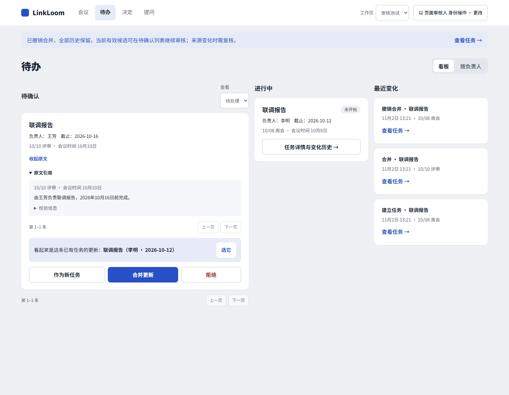
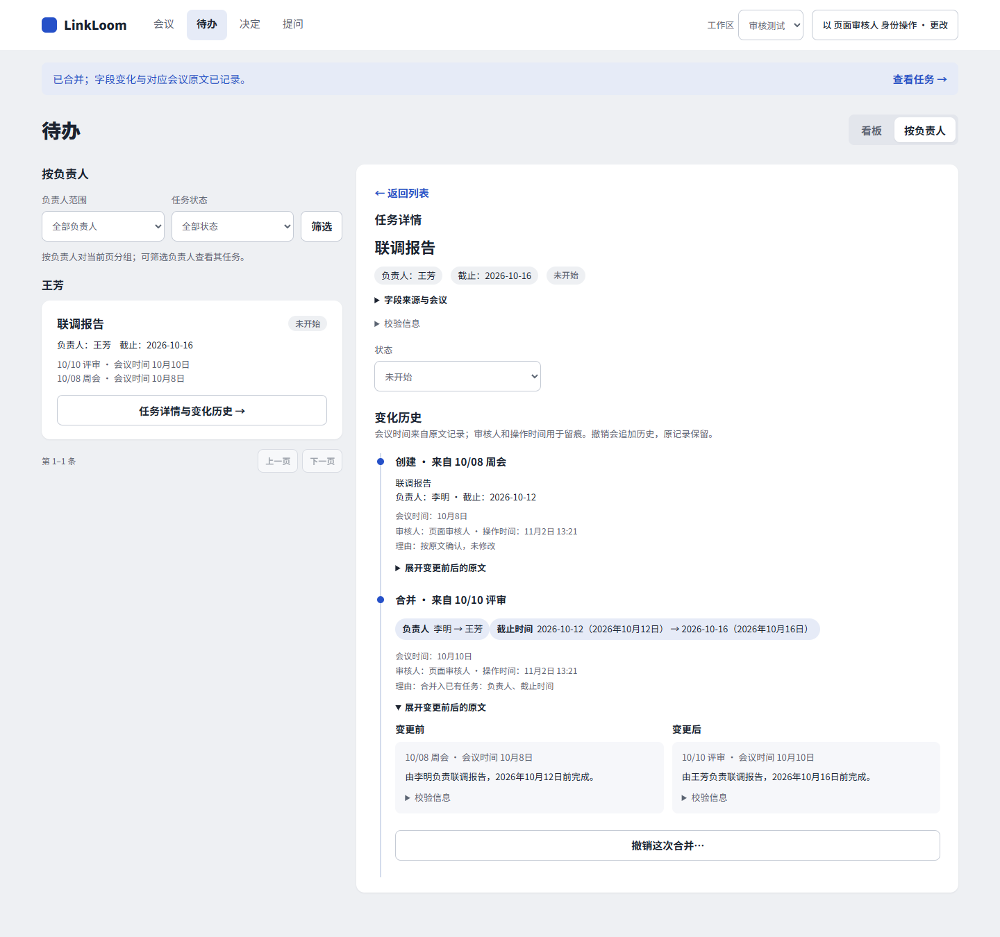
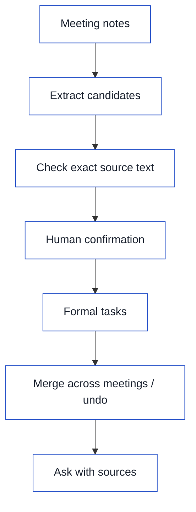

[简体中文](README.md) · [English](README.en.md)

<p align="center">
  
</p>

[](https://github.com/yefuyou/linkloom/actions/workflows/offline-pr.yml)
[](LICENSE)
[](pyproject.toml)

## 1. What it solves

Owners, deadlines, and decisions can change in the next meeting, so searching old messages may not tell you which version to follow now.
LinkLoom extracts candidates from meeting notes, checks their exact source text, and saves formal tasks and decisions after human confirmation. It links changes across meetings to their sources, so teams can check the present, check the past, and ask why.

## 2. Demo

**Demo GIF to come.** These two screenshots were captured again from the current master UI. They use the repository's synthetic workflow fixture. Its sentences were rewritten to fit the old extractor. They show the workflow, not extraction quality on real meetings.

Board: expand a candidate, check the original text, then choose to create, merge, or reject it.



By owner: open a task's change history. Compare changes to its owner and deadline with the original meeting text.



## 3. Core workflow



Merges and undo actions both need human confirmation. A model's suggestion that two records describe the same work does not become a formal change on its own.

## 4. Key design choices

### Models interpret; rules check the proof

Meetings use varied language, so models interpret meaning and propose candidates and investigation steps.
Rules check exact quotes, source versions, workspace scope, permissions, and budgets. A plausible model response is not proof.

### Human confirmation makes it effective; changes can be undone

Extracted items and relationship suggestions stay as candidates until a person confirms a formal task or reviewed decision.
Cross-meeting merges can be undone. Undo adds history and keeps the original records, so mistakes can be reviewed.

### Temporal decision storage

A new decision should not erase the old one: what applies now and what applied then are different questions.
The store keeps effective dates, replacement relationships, and source evidence. It supports current and as-of queries; source changes can require a new review.

### Bounded multi-hop investigation

Reasons and changes often span several records, so an investigation follows relationships to find more evidence.
Steps, tools, context, and budgets are bounded. Missing evidence stays visible instead of turning an endless search into an overconfident answer.

### Recoverable runtime

The runtime records each call's intent before execution, then saves results and checkpoints. Recovery can distinguish completed steps from uncertain outcomes.
The underlying runtime supports controlled recovery, but the current web investigation session still needs the service to stay running.

### Retrieval and local reranking

BM25 finds keywords, vector search adds semantic matches, and RRF combines them.
A local quantized cross-encoder reranks candidates to reduce gaps from using only one retrieval path.
The default `auto` mode uses local models only, and missing dependencies or rerank failures keep the original RRF order.

### Missing configuration

Without an API key, the service can still start, create workspaces, save sources, review existing candidates, and query reviewed decisions and history.
AI extraction and external investigation need configuration and explicit opt-in. If enabled with a missing key or dependency, the launcher asks for a fix rather than switching to another remote provider.

## 5. Evaluation and numbers

These results measure routing, query speed, retrieval, and extraction separately. They are not end-to-end product accuracy, and one dataset's score does not stand in for another's.

### Routing

Accuracy requires both the route and target to be correct. Wrong bindings are counted separately. Held-out sets H and F were each used only once.

| Dataset | Cases | Accuracy | Wrong bindings |
| --- | ---: | ---: | ---: |
| Development | 60 | 98.3% | 0 |
| Held-out H | 13 | 46.2%→76.9% | 1 |
| Held-out F | 16 | 56.2%→87.5% | 0 |

What this means: the development score is strong, but new wording still causes errors, including a wrong binding in H.

Entry points: [routing evaluation script](scripts/eval_routing.py) and [routing cases](tests/routing).

### Scale

Query latency on offline synthetic data. As-of queries read stored temporal decisions; they use a different path from full-text retrieval.

| Scale | BM25 p50 | As-of query p50 |
| --- | ---: | ---: |
| 1 thousand records | 6 ms | — |
| 10 thousand records | 80 ms | — |
| 100 thousand records | 958 ms | 0.73 ms |

What this means: in this test, keyword search slowed as data grew, while date queries over stored decisions stayed fast.

Source: [scale benchmark](benchmarks/scale/2026-10-29/results.md).

### Retrieval reranking (development sets)

All values below are development-set Recall@5, including synthetic scale data. The frozen 30 questions are also used for development, not held-out acceptance.
Both rerankers run after the same RRF results.

| Dataset | BM25 | RRF | +base INT8 rerank | +m3 rerank |
| --- | ---: | ---: | ---: | ---: |
| 1 thousand documents | 1 | 0.83 | 1 | 1 |
| 10 thousand documents | 1 | 0.94 | 1 | 1 |
| Frozen 30 questions | 0.9239 | 0.9361 | 0.9322 | 0.9433 |

What this means: reranking recovers some missed sources, but it does not improve every question.

Base INT8 rerank p95 is about 2 seconds on a non-exclusive machine. Recall@5 for `drm-002` remains **0.75** after either reranker.
Source: [2026-11-02 rerank development report](benchmarks/rerank/2026-11-02/results.md).

### Meeting action-item extraction

Combined recall on two held-out sets. The denominator is 15 reference tasks.

| System | Recall |
| --- | ---: |
| Baseline | 10/15 |
| v2 | 7/15 |
| legacy | 5/15 |

What this means: v2 still misses more tasks than the baseline on held-out data; its strong development results did not carry over.

Source: [combined held-out results](benchmarks/ami_tasks/results_es2004_final.md). This separate extraction evaluation does not measure field completeness after product ingestion.
Product ingestion field checks are being improved in [PR #47](https://github.com/yefuyou/linkloom/pull/47). It is not merged, and its unmerged results are not quoted here.

## 6. Quick start

Requires Git and **Python 3.11+**.

```bash
git clone https://github.com/yefuyou/linkloom.git
cd linkloom
```

macOS / Linux:

```bash
python3 -m venv .venv
source .venv/bin/activate
cp .env.example .env
```

PowerShell:

```powershell
python -m venv .venv
.\.venv\Scripts\Activate.ps1
Copy-Item .env.example .env
```

Install with the Gemini dependency:

```bash
python -m pip install -e ".[smoke]"
```

Fill in only `GEMINI_API_KEY` in the project root `.env`. Leave other provider keys empty. The launcher loads this file automatically. Existing environment variables take priority. Restart after changing it.
Start AI extraction and local human review:

```bash
python -m linkloom.ui --database work/product.sqlite --port 8765 --allow-external-provider --allow-local-task-review
```

Open the [local UI](http://127.0.0.1:8765/). Import notes on the meetings page, then check candidates on the [tasks page](http://127.0.0.1:8765/tasks).
With AI enabled, source text is sent to the configured Gemini service and may incur API costs. Local review saves a self-reported name; it does not authenticate identity.

### Optional retrieval dependencies

```bash
python -m pip install -e ".[rerank]"
```

This extra installs dependencies for vector search and local reranking. Models download to the user cache on first use.
`LINKLOOM_RERANK=auto` is the default. If reranking is unavailable, retrieval keeps the RRF order. Set it to `off` to disable reranking.
Without vector dependencies, uncomment `LINKLOOM_RETRIEVAL_MODE=bm25` in `.env` for keyword-only retrieval.
For investigations into reasons and source relationships, also start with `--allow-temporal-agent` and grant permission for each question.
`jev` is experimental and has not been verified against the real API. Only an explicit choice of that mode sends queries and candidate text externally.

### Offline use

For offline features alone, install the base package with `python -m pip install -e .`. No API key is needed.
Use a separate database for the preset, key-free demo:

```bash
python -m linkloom.ui --database work/task-demo.sqlite --port 8765 --offline-task-demo --allow-local-task-review
```

For normal offline use, remove `--offline-task-demo` and use `work/product.sqlite`.
Offline features include creating workspaces, saving sources, reviewing existing candidates, and querying reviewed decisions and history. AI extraction of new sources and external investigation need configuration and permission.
The preset demo makes no external model calls. It does not show extraction quality on real meetings. Stop the service using the same port before switching commands.

## 7. Limits and next steps

- **No GraphRAG.** Evidence comes from retrieval, temporal records, and bounded investigation. The product does not build a whole-corpus GraphRAG.
- **No automatic same-work merges.** A person confirms candidate relationships. Merging two existing formal tasks is also not supported.
- **Extraction still misses tasks.** It has not beaten the baseline on held-out data. Exact-text checks can validate a candidate, but cannot prove that every task was found.
- **Some operation endpoints are pending.** Follow-up HTTP endpoints for audit queries, field edits, source rebinding, and invalidation are tracked in [#37](https://github.com/yefuyou/linkloom/issues/37).
- **People identity is limited.** Owners keep their original wording. Directory links and login identity remain planned work; see [#38](https://github.com/yefuyou/linkloom/issues/38).
- **A known test is intermittent.** A local HTTP connection test sometimes fails on macOS. The cause is unconfirmed; see [#45](https://github.com/yefuyou/linkloom/issues/45).

License: [MIT](LICENSE).
