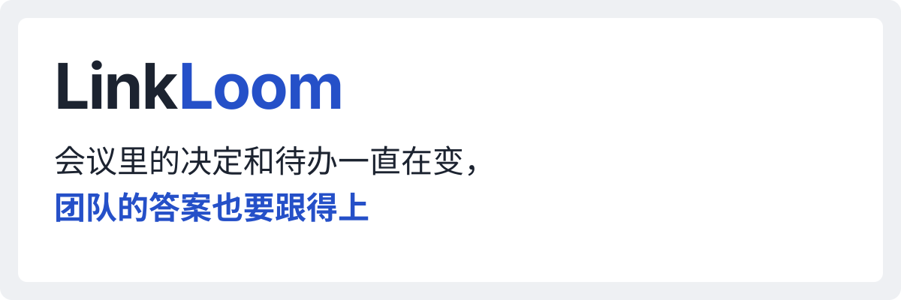
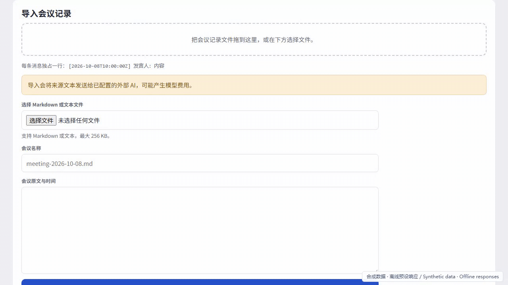
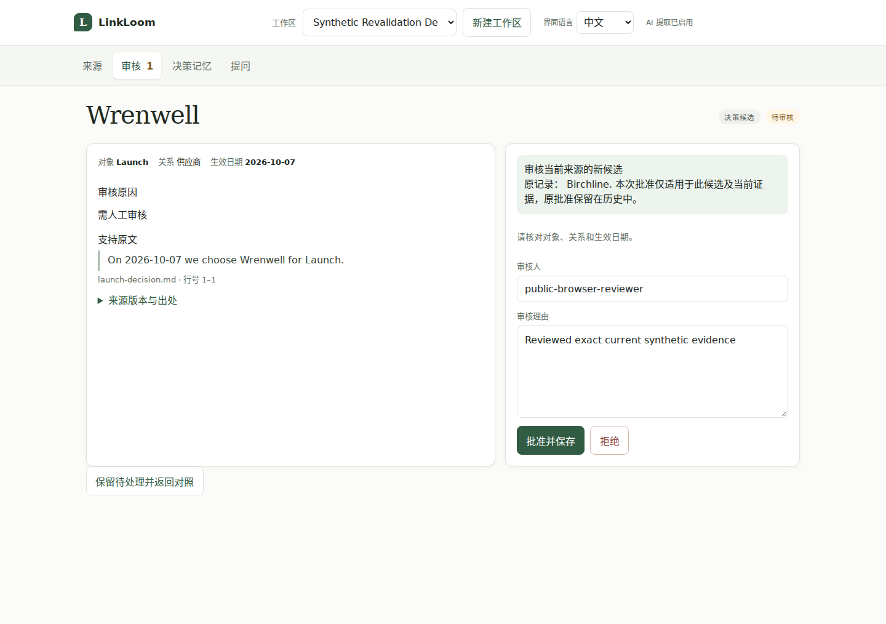
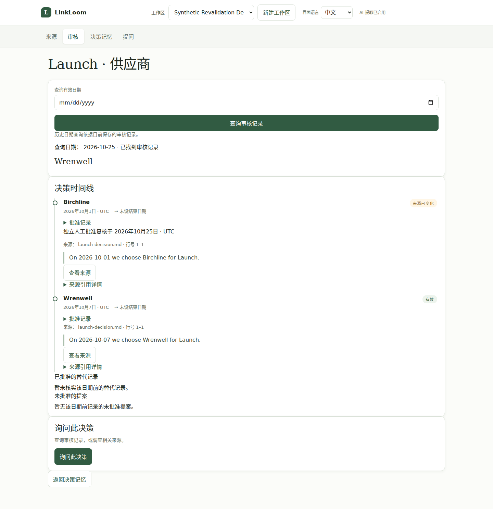
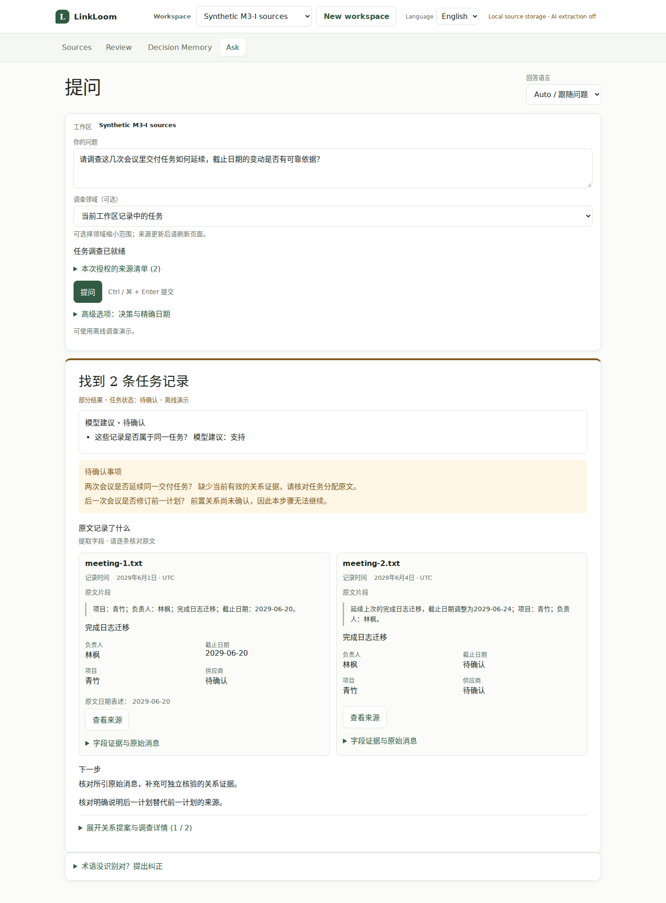

<p align="center">
  
</p>

<h1 align="center">LinkLoom</h1>

<p align="center">
  Stop digging through chat history to ask "what did we actually decide last week?"<br/>
  A shared, local-first timeline of team decisions, task handoffs, and source evidence across meetings.
</p>

<p align="center">
  <a href="https://github.com/yefuyou/linkloom/actions/workflows/offline-pr.yml"></a>
  <a href="LICENSE"></a>
  <a href="pyproject.toml"></a>
</p>

<p align="center">⭐ Star this repo if you find it useful</p>

<p align="center"><a href="README.md">简体中文</a> · <strong>English</strong></p>

---

On Monday's planning meeting, the team agrees to ship the payment redesign next Friday, owned by Li. On Wednesday's cross-team review, the date moves to early next month and integration shifts to Wang. On Friday's standup, someone floats removing the legacy entry point—just a suggestion, never approved.

A week later, a teammate returning from leave or an engineer picking up the handoff asks: *"Who owns this right now? When is it shipping? Why did it slip?"* Standard meeting summaries and RAG search pull all three snippets together, leaving everyone with a different version of the truth.

LinkLoom connects meeting notes, decisions, and action items into one traceable team timeline. AI extracts drafts and investigates cross-meeting clues; nothing becomes official until your team confirms it. Whether you are aligning across squads, handing off tasks, or reviewing why a deadline moved, every answer jumps straight back to the exact meeting lines. All data lives in a local SQLite file, and lookup/review work even without an API key.

<p align="center">
  
</p>

## Features

### Draft extraction with one-click source verification

Import meeting notes and LinkLoom pulls out proposed decisions, action items, owners, and deadlines on the right while keeping the full transcript on the left.

Click any card to scroll straight to the exact source lines. AI extractions stay as drafts—confirm what was actually decided, edit what needs tweaking, and ignore passing ideas so they never pollute official team records.

<p align="center">
  
</p>

### Track decisions and task handoffs across meetings

As projects evolve and owners rotate, LinkLoom never silently overwrites history. Instead, it links every change into a clear timeline so new joiners and leads can catch up in a minute:

- **One shared team truth**: Know what is effective today, what was effective on Oct 7, and which decision replaced an earlier one.
- **Full handoff context**: See how an action item moved across owners and deadlines, with every update tied to its source meeting—and undo accidental merges anytime.
- **Staleness flags**: If a meeting note is edited later, LinkLoom compares content hashes and marks affected records as "source changed" for re-review, so you don't keep working off outdated notes.

<p align="center">
  
</p>

<p align="center">
  
</p>

### Ask: instant answers for facts, bounded Agents for "why"

Questions like *"Who owns the payment redesign now?"* or *"What was the target date on Oct 7?"* hit the local temporal store directly—no LLM cost, no date confusion, and sub-millisecond median lookup (`0.73 ms` at 100k offline synthetic records, see the [scale benchmark](benchmarks/scale/2026-10-29/results.md)).

Questions like *"Why did the deadline slip, and was it tied to last week's API risk?"* go to a read-only Agent backed by incremental BM25, local embeddings, and optional reranking. Step and budget limits keep it bounded, and missing evidence is reported honestly instead of guessed.

## Compared to standard RAG

Evaluated on the same cross-meeting test set with the same model (DeepSeek, [PR #64](https://github.com/yefuyou/linkloom/pull/64)): standard hybrid RAG produced **13 temporal attribution errors** across 120 answers (blending later changes into earlier dates), while LinkLoom produced **0**. This is a post-hoc metric, defined after seeing the results and used only for explanation, not as a score. In the same comparison, standard RAG had a slightly higher D3 content score (77.8% vs 72.2%), and LinkLoom returned more empty answers (53 vs 24).

After refining query planning and result assembly, offline replay strict accuracy on the dev set rose from **60.0% to 81.7%** ([PR #66](https://github.com/yefuyou/linkloom/pull/66) / [#67](https://github.com/yefuyou/linkloom/pull/67), dev-set replay, not a held-out score). On the held-out D3 set, the graph retrieval path run on its own scored a mean of **63.89%**, range `[58.33%, 66.67%]` over three runs ([PR #55](https://github.com/yefuyou/linkloom/pull/55)); this is not an end-to-end score with fallback.

## Privacy & models

LinkLoom runs locally on a single SQLite file by default:

| Mode | Setup | Where data goes |
|---|---|---|
| Offline review & browsing | No API key required | Never leaves your machine |
| Lookup confirmed state / dates | Local SQLite query | Never leaves your machine |
| AI draft extraction & investigation | Set `GEMINI_API_KEY` (or optional DeepSeek) | Sends relevant meeting text to your configured provider |
| Lexical search / local rerank | Built-in incremental BM25 + optional local embeddings | Computed locally; optional models are downloaded to a local cache on first use |

Local review stores the reviewer's self-reported name; it does not authenticate people.

## Quickstart

Requires **Git** and **Python 3.11+**.

### 1. Try offline first (no API key needed)

```bash
git clone https://github.com/yefuyou/linkloom.git
cd linkloom
python -m pip install -e .
python -m linkloom.ui --database work/task-demo.sqlite --port 8765 --offline-task-demo --allow-local-task-review
```

Open **[http://127.0.0.1:8765/](http://127.0.0.1:8765/)** to explore cross-meeting task tracking and source evidence.

### 2. Connect Gemini for full extraction & investigation

```bash
python -m pip install -e ".[smoke]"
cp .env.example .env   # add GEMINI_API_KEY (Copy-Item on PowerShell)
python -m linkloom.ui --database work/product.sqlite --port 8765 --allow-external-provider --allow-temporal-agent --allow-local-task-review
```

> Optional: install local vector search and reranking with `python -m pip install -e ".[rerank]"`, or set `LINKLOOM_RETRIEVAL_MODE=bm25` in `.env` for lexical-only mode.

## Connect to Claude (Read-Only MCP Server)

LinkLoom ships a read-only MCP server so you can query confirmed team decisions and tasks straight from Claude Code or Claude Desktop (`ask`, `list_decisions`, `get_decision_history`, `list_tasks`):

```bash
python -m pip install -e ".[mcp]"
claude mcp add linkloom -- "<venv-python>" -m linkloom.mcp_server --database /path/to/product.sqlite
```

Replace `<venv-python>` with the absolute path of the virtual-environment Python that has `.[mcp]` installed. Every tool requires the currently selected `workspace`; questions are not sent to external models by default.

## Roadmap (v2)

The local text-meeting loop is solid. The following work is in development and none of it is merged to `master` yet:

- **Parallel investigation & unified routing**: Merging LangGraph Supervisor-Worker orchestration and converged semantic routing.
- **Cleaner team workspace & glossary memory**: Unified review/timeline workspace, team jargon glossary, and confirming decisions before an effective date is known.
- **Audio & team collaboration**: Uploaded meeting audio transcription aligned to speaker timestamps, member-scoped permissions, and opt-in task dispatch.

---

[Product Architecture](docs/architecture/PRODUCT_ARCHITECTURE.md) · [Runtime Design](docs/architecture/RUNTIME_ARCHITECTURE.md) · [Developer Map](docs/README.md) · [Contributing](CONTRIBUTING.md) · [MIT License](LICENSE)
