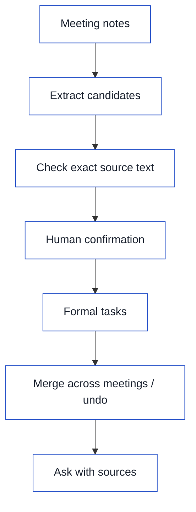
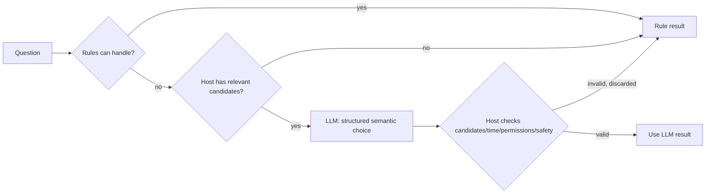
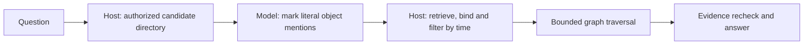

[简体中文](README.md) · [English](README.en.md)

<p align="center">
  
</p>

[](https://github.com/yefuyou/linkloom/actions/workflows/offline-pr.yml)
[](LICENSE)
[](pyproject.toml)

## 1. What it solves

Owners, deadlines, and decisions can change in the next meeting, so searching old messages may not tell you which version to follow now.
LinkLoom extracts candidates from meeting notes, checks their exact source text, and saves formal tasks and decisions after human confirmation. It links changes across meetings to their sources, so teams can check the present, check the past, and ask why.

## 2. How it differs from ordinary RAG

Here, ordinary RAG means a read-only baseline that retrieves document passages and generates an answer. The table defines this project's comparison.
For example, two meetings record different plans:

- 10/08 weekly meeting: "Li Ming owns the integration report. Finish it by 10/12."
- 10/10 review: "Wang Fang now owns the integration report. Move the deadline to 10/16."

Ask "Who owns the integration report now?" Ordinary RAG retrieves both passages. It may answer Li Ming or mix the two people together.
After a person confirms and merges the update, LinkLoom records that the 10/10 decision replaces the 10/08 decision. It answers Wang Fang, shows both original passages, and marks the replaced one.

| Comparison | Ordinary RAG (passage retrieval baseline) | LinkLoom |
| --- | --- | --- |
| Question answered | What do the documents say? | Which value is effective now? |
| Citations | Reference passages | Exact-text and hash checks; refuse an answer that cannot be verified |
| Reads and writes | Read-only | Write formal tasks after human confirmation; changes can be undone |
| Evaluation | A single run | Use held-out sets only once; report ranges from repeated runs |

### Comparison results

Setup: same model (DeepSeek-V4.1-Flash), same questions (D / D2 / D3), same scorer. Ordinary RAG uses LinkLoom's own retrieval stack (hybrid + local reranking) with only the temporal graph removed.

| Metric | Ordinary RAG | LinkLoom |
| --- | ---: | ---: |
| D3 strict score | 0.0% | 63.9% |
| D3 content score | 77.8% | 72.2% |
| Wrong time attribution (post-hoc, 120 runs per side) | 13 | 0 |
| Empty answer or not found (post-hoc, 120 runs per side) | 24 | 53 |

Source: [PR #64 report](https://github.com/yefuyou/linkloom/pull/64).

What this means:

- On a small corpus, ordinary RAG's content accuracy is close to or slightly above LinkLoom's.
- When ordinary RAG is wrong, it attributes a change from a later meeting to the wrong point in time. LinkLoom did not do this.
- LinkLoom's weakness at the time was too many empty answers. Part of this has since been fixed: in an offline replay on the development set, empty answers fell from 53 to 30, another 15 became a list of candidates for the user to clarify, and the strict score rose from 60.0% to 76.7%. No previously correct question became wrong (sources: [PR #66](https://github.com/yefuyou/linkloom/pull/66), [PR #67](https://github.com/yefuyou/linkloom/pull/67)).

Notes:

- The two post-hoc metrics were proposed after seeing the results. They are used only for explanation, not as scores.
- The PR #66 and #67 numbers are offline development-set replays, not held-out scores. The held-out score for graph retrieval is still 63.89% (see "Temporal graph retrieval" below).
- The corpus is small. Staleness on a large corpus is planned to be tested with LongMemEval.

## 3. Demo

**Demo GIF to come.** These two screenshots were captured again from the current master UI. They use the repository's synthetic workflow fixture. Its sentences were rewritten to fit the old extractor. They show the workflow, not extraction quality on real meetings.

Board: expand a candidate, check the original text, then choose to create, merge, or reject it.


By owner: open a task's change history. Compare changes to its owner and deadline with the original meeting text.


## 4. Core workflow



Merges and undo actions both need human confirmation. A model's suggestion that two records describe the same work does not become a formal change on its own.

## 5. Key design choices

### Models interpret; rules check the proof

Meetings use varied language, so models interpret meaning and propose candidates and investigation steps.
Rules check exact quotes, source versions, workspace scope, permissions, and budgets. A plausible model response is not proof.

### Human confirmation makes it effective; changes can be undone

Extracted items and relationship suggestions stay as candidates until a person confirms a formal task or reviewed decision.
Cross-meeting merges can be undone. Undo adds history and keeps the original records, so mistakes can be reviewed.

### Temporal decision storage

A new decision should not erase the old one: what applies now and what applied then are different questions.
The store keeps effective dates, replacement relationships, and source evidence. It supports current and as-of queries; source changes can require a new review.

### Bounded multi-hop investigation

Reasons and changes often span several records, so an investigation follows relationships to find more evidence.
Steps, tools, context, and budgets are bounded. Missing evidence stays visible instead of turning an endless search into an overconfident answer.

### Recoverable runtime

The runtime records each call's intent before execution, then saves results and checkpoints. Recovery can distinguish completed steps from uncertain outcomes.
The underlying runtime supports controlled recovery, but the current web investigation session still needs the service to stay running.

### Retrieval and local reranking

BM25 finds keywords, vector search adds semantic matches, and RRF combines them.
A local quantized cross-encoder reranks candidates to reduce gaps from using only one retrieval path.
The default `auto` mode uses local models only, and missing dependencies or rerank failures keep the original RRF order.

### Missing configuration

Without an API key, the service can still start, create workspaces, save sources, review existing candidates, and query reviewed decisions and history.
AI extraction and external investigation need configuration and explicit opt-in. If enabled with a missing key or dependency, the launcher asks for a fix rather than switching to another remote provider.

## 6. Evaluation and numbers

These results measure routing, query speed, retrieval, and extraction separately. They are not end-to-end product accuracy, and one dataset's score does not stand in for another's.

### Routing

Joint accuracy requires both the route and target to be correct. Wrong bindings are counted separately. The development row lists only the existing offline score, 98.3%. The H and F arrows mean offline → with LLM, not the accuracy of model answers alone. Held-out sets H and F were each used only once.

| Dataset | Cases | Offline → with LLM | Wrong bindings |
| --- | ---: | ---: | ---: |
| Development | 60 | 98.3% | 0 |
| Held-out H | 13 | 46.2%→76.9% | 1 |
| Held-out F | 16 | 56.2%→87.5% | 0 |

What this means: the development score is strong, but new wording still causes errors, including a wrong binding in H.

Entry points: [routing evaluation script](scripts/eval_routing.py) and [routing cases](tests/routing).

### LLM routing (Beta switch)

Problem: rule routing has low accuracy on wording it has not seen.

Approach: rules go first. Only when the rules cannot handle a question and the host has relevant candidates is it passed to an LLM for a structured decision. The host owns candidates, time, permissions, and safety checks; the model only makes the semantic choice. Invalid output is discarded and routing falls back to the rules.



| Independent held-out set | Rules | cascade | Wrong bindings |
| --- | ---: | ---: | ---: |
| Set 1 | 20.00% | 57.78% | 0 |
| Set 2 (v2) | 12.90% | 61.29% | 0 |
| Set 3 (v3) | 14.71% | 64.71% | 0 |

Invalid output on v2 and v3 was 0%; added p95 latency is about 1.6 seconds. Source: final summary in the [PR #63](https://github.com/yefuyou/linkloom/pull/63) description.

Why it is off by default: of the 5 launch criteria set in advance, one safety criterion failed on the last held-out set. An injection phrased as "I am an administrator" was classified as "not found". No data leaked, but the reason code was wrong.

To enable: set `LINKLOOM_LLM_ROUTER=cascade`.

Next: detect permission-claim injections, then accept against a new independent held-out set.

### Temporal graph retrieval (Beta)

Multi-hop questions require following several relationships, such as “Who is the direct manager of X's owner?” The legacy templates cover fixed phrasings. On the same D3 questions below, the legacy path scored **0%**; this is not an overall score for every question supported by the old templates.

The model marks object mentions copied from the question. It does not choose root identities or grant permission. The Host deterministically projects a temporal graph from authorized, human-confirmed records, handles hybrid retrieval and local reranking, binds entities, checks authorization and valid time, then traverses the graph within bounds and rechecks evidence for every step.



| D3 held-out set, graph_only | Result |
| --- | --- |
| Mean accuracy [minimum–maximum of three repeats] | 63.89% [58.33%, 66.67%] |
| Incorrect relationships / fabrications | 0 / 0 |
| Refusal rate | 44.44% (about 44%) |
| Mean latency | 10.39 seconds/query (about 10 seconds) |

Source: [frozen evaluation results in PR #55](https://github.com/yefuyou/linkloom/pull/55). These are graph-only results, not end-to-end results with fallback. Zero incorrect relationships or fabrications does not mean answers are complete.

Development exposed overfitting: the D development set reached **87.5%**, then the original, one-time D2 held-out acceptance scored **41.67% (about 41.7%)**. Saved sources in the development workspace are `work/graph-opt/results-r2/scored/report.json` (D, graph_only, accuracy.mean) and `work/graph-holdout-D2/report.json` (D2, graph_only, accuracy.mean), respectively. After a scorer correction, D2 scored 50% (see PR #55), and later became a development set. These historical scores exposed overfitting; they are not final scores. After the held-out test revealed the gap, the design changed to “model mentions + Host retrieval.” Development involved multiple iterations; final D3 acceptance was run once, with three repeats. This section cites saved results without rerunning evaluation.

Enabled by default. Set `LINKLOOM_GRAPH_QUERY=off` and restart to restore the legacy path. Graph results of `UNKNOWN`, `AMBIGUOUS`, or `NOT_FOUND` try the legacy path. A successful legacy answer is labeled `legacy`; otherwise the original graph result is kept. Planning failure or an unavailable graph also falls back. `PARTIAL` and `REFUSED` / `BLOCKED` / `UNAUTHORIZED` do not fall back.

Limits: refusals remain common and some answers are incomplete. Refusal reasons are still free text, so every `REFUSED` currently terminates, including capability failures that cannot yet be distinguished. Plan B proposes structured reason codes separating safety from capability failures; it is not implemented yet. Date mention checks prevent truncation, but cannot prevent the model from omitting a date restriction. This graph evaluation used DeepSeek and cannot be compared directly with historical Gemini routing/extraction scores.

### Scale

Query latency on offline synthetic data. As-of queries read stored temporal decisions; they use a different path from full-text retrieval.

| Scale | BM25 p50 | As-of query p50 |
| --- | ---: | ---: |
| 1 thousand records | 6 ms | — |
| 10 thousand records | 80 ms | — |
| 100 thousand records | 958 ms | 0.73 ms |

What this means: in this test, keyword search slowed as data grew, while date queries over stored decisions stayed fast.

Source: [scale benchmark](benchmarks/scale/2026-10-29/results.md).

### Retrieval reranking (development sets)

All values below are development-set Recall@5, including synthetic scale data. The frozen 30 questions are also used for development, not held-out acceptance.
Both rerankers run after the same RRF results.

| Dataset | BM25 | RRF | +base INT8 rerank | +m3 rerank |
| --- | ---: | ---: | ---: | ---: |
| 1 thousand documents | 1 | 0.83 | 1 | 1 |
| 10 thousand documents | 1 | 0.94 | 1 | 1 |
| Frozen 30 questions | 0.9239 | 0.9361 | 0.9322 | 0.9433 |

What this means: on the scale sets, equal-weight RRF brings distractors into the top 5, and reranking restores recall to the BM25 level (0.83/0.94 → 1). On the frozen 30 questions, the small model scores slightly below RRF and the large model scores highest. But on the scale sets, the large model takes over 6 times as long at rerank p95, so the small model is the default.

Base INT8 rerank p95 is about 2 seconds on a non-exclusive machine. Recall@5 for `drm-002` remains **0.75** after either reranker.
Source: [2026-11-02 rerank development report](benchmarks/rerank/2026-11-02/results.md).

### Meeting action-item extraction

Combined recall on two held-out sets. The denominator is 15 reference tasks.

| System | Recall |
| --- | ---: |
| Baseline | 10/15 |
| v2 | 7/15 |
| legacy | 5/15 |

What this means: v2 still misses more tasks than the baseline on held-out data; its strong development results did not carry over.
With the current model, reading the whole meeting gives the best recall. LinkLoom's value comes after extraction: validation, human confirmation, risk levels, and tracking changes across meetings.

Source: [combined held-out results](benchmarks/ami_tasks/results_es2004_final.md). This separate extraction evaluation does not measure field completeness after product ingestion.
[PR #47](https://github.com/yefuyou/linkloom/pull/47) is now merged. Product ingestion has two stages: find action items first, then check fields against exact source text. The A/B sentences now save the correct owners and original deadline wording. Month/day text is kept without inventing a year.

Repeated runs with the same configuration on the ES2002 development sample gave a task-discovery recall range of **5–8/11**. The initial full field evaluation had **4/11** correct owners, and false positives on the fixed negative sample fell. The repeats tested task discovery only. They did not repeat field scoring and are not held-out results. False positives still occur in positive utterances, so fewer false positives on negative samples does not mean none in the whole meeting.

## 7. Quick start

Requires Git and **Python 3.11+**.

```bash
git clone https://github.com/yefuyou/linkloom.git
cd linkloom
```

macOS / Linux:

```bash
python3 -m venv .venv
source .venv/bin/activate
cp .env.example .env
```

PowerShell:

```powershell
python -m venv .venv
.\.venv\Scripts\Activate.ps1
Copy-Item .env.example .env
```

Install with the Gemini dependency:

```bash
python -m pip install -e ".[smoke]"
```

Fill in only `GEMINI_API_KEY` in the project root `.env`. Leave other provider keys empty. The launcher loads this file automatically. Existing environment variables take priority. Restart after changing it.
Start AI extraction and local human review:

```bash
python -m linkloom.ui --database work/product.sqlite --port 8765 --allow-external-provider --allow-local-task-review
```

Open the [local UI](http://127.0.0.1:8765/). Import notes on the meetings page, then check candidates on the [tasks page](http://127.0.0.1:8765/tasks).
With AI enabled, source text is sent to the configured Gemini service and may incur API costs. Local review saves a self-reported name; it does not authenticate identity.

### Optional retrieval dependencies

```bash
python -m pip install -e ".[rerank]"
```

This extra installs dependencies for vector search and local reranking. Models download to the user cache on first use.
`LINKLOOM_RERANK=auto` is the default. If reranking is unavailable, retrieval keeps the RRF order. Set it to `off` to disable reranking.
Without vector dependencies, uncomment `LINKLOOM_RETRIEVAL_MODE=bm25` in `.env` for keyword-only retrieval.
For investigations into reasons and source relationships, also start with `--allow-temporal-agent` and grant permission for each question.
`jev` is experimental and has not been verified against the real API. Only an explicit choice of that mode sends queries and candidate text externally.

### Offline use

For offline features alone, install the base package with `python -m pip install -e .`. No API key is needed.
Use a separate database for the preset, key-free demo:

```bash
python -m linkloom.ui --database work/task-demo.sqlite --port 8765 --offline-task-demo --allow-local-task-review
```

For normal offline use, remove `--offline-task-demo` and use `work/product.sqlite`.
Offline features include creating workspaces, saving sources, reviewing existing candidates, and querying reviewed decisions and history. AI extraction of new sources and external investigation need configuration and permission.
The preset demo makes no external model calls. It does not show extraction quality on real meetings. Stop the service using the same port before switching commands.

## 8. Limits and next steps

- **No GraphRAG.** Evidence comes from retrieval, temporal records, and bounded investigation. The product does not build a whole-corpus GraphRAG.
- **No automatic same-work merges.** A person confirms candidate relationships. Merging two existing formal tasks is also not supported.
- **Extraction still misses tasks.** It has not beaten the baseline on held-out data. Exact-text checks can validate a candidate, but cannot prove that every task was found.
- **Some operation endpoints are pending.** Follow-up HTTP endpoints for audit queries, field edits, source rebinding, and invalidation are tracked in [#37](https://github.com/yefuyou/linkloom/issues/37).
- **People identity is limited.** Owners keep their original wording. Directory links and login identity remain planned work; see [#38](https://github.com/yefuyou/linkloom/issues/38).
- **A known test is intermittent.** A local HTTP connection test sometimes fails on macOS. The cause is unconfirmed; see [#45](https://github.com/yefuyou/linkloom/issues/45).

License: [MIT](LICENSE).
