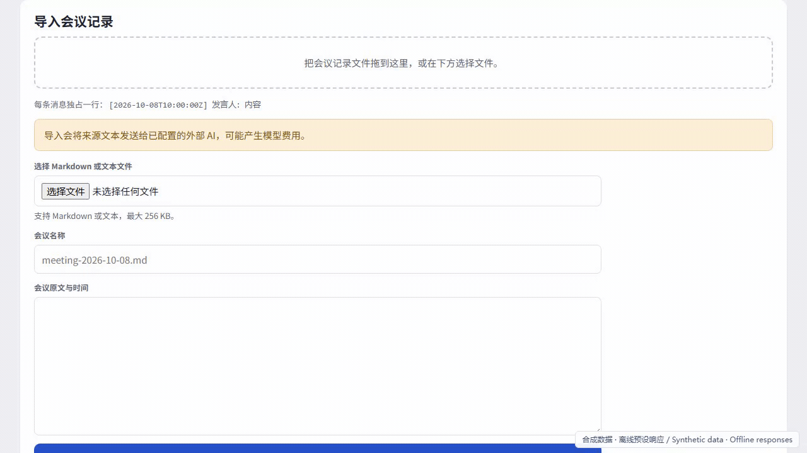
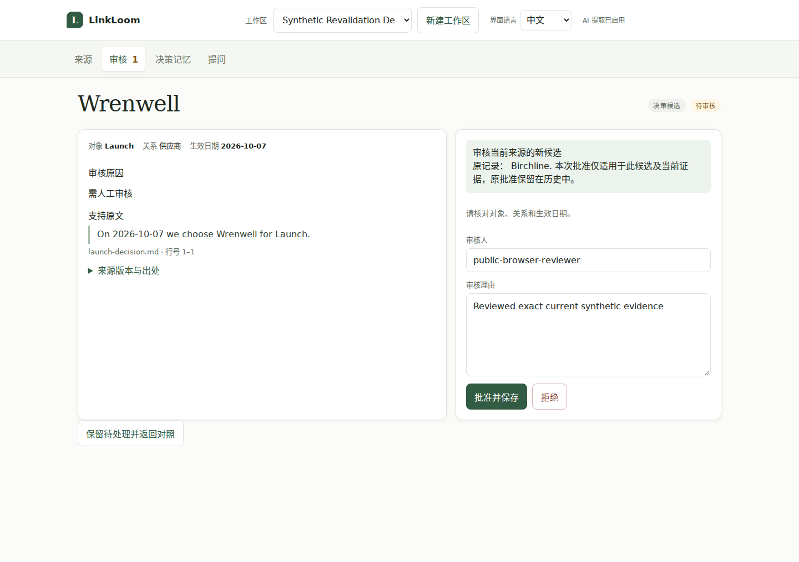
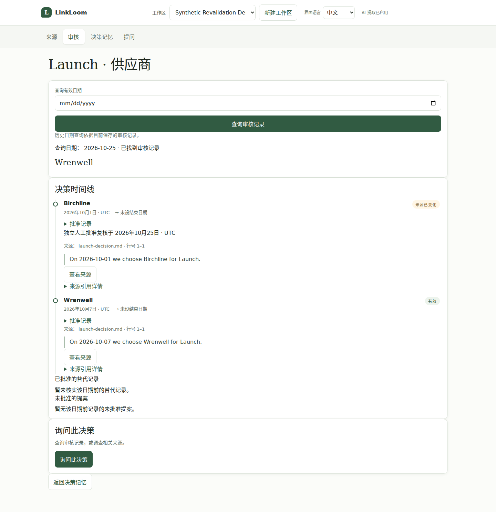
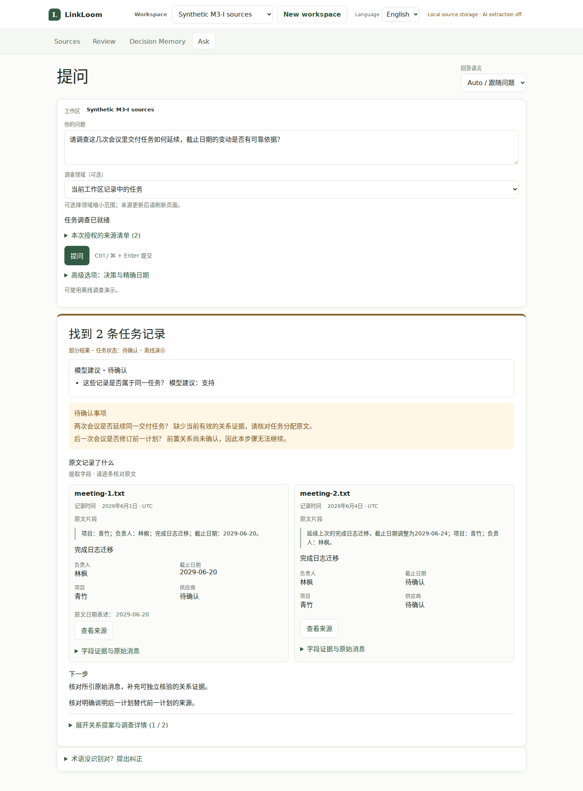

<p align="center">
  
</p>

<h1 align="center">LinkLoom</h1>

<p align="center">
  别再在聊天记录里翻“上次到底怎么定的”。<br/>
  让团队每一场会的拍板、改期和任务交接都有一条共同的时间线——谁接的、什么时候改的、依据哪句话，全组对齐不再扯皮。
</p>

<p align="center">
  <a href="https://github.com/yefuyou/linkloom/actions/workflows/offline-pr.yml"></a>
  <a href="LICENSE"></a>
  <a href="pyproject.toml"></a>
</p>

<p align="center">⭐ 觉得有用请点个 Star，方便随时找回</p>

<p align="center"><strong>简体中文</strong> · <a href="README.en.md">English</a></p>

---

周一需求会定下支付改版下周五上线，小李负责；周三跨组评审评估风险后改口，上线延到下个月初，联调转给小王；周五站会又有人顺嘴提了一句要不要把老入口顺便下掉。

等一周后，请假回来的同事、新接手的开发、或者准备复盘的负责人去翻会议记录：“这事现在到底归谁管？定在什么时候上？为什么改期的？”——普通的会议纪要和搜索工具只会把三场会的话一起捞出来，团队里每个人看到的口径都不一样。

LinkLoom 帮团队把每次会议的记录、决议和待办串成同一条可追溯的时间线。AI 负责读懂会议、抽草稿、跨会议找线索；团队确认后才成为正式共识。不管是全组日常对齐、任务交接，还是复盘某次为什么改期，每条结论都能直接跳回当时的会议原话。数据默认存在本地 SQLite 文件里，不配模型也能查历史、审待办。

<p align="center">
  
</p>

## 主要功能

### 抽草稿，对照原话一键确认

导入会议纪要后，LinkLoom 自动把里面拍板的决定、派发的待办、负责人和截止日期抽出来摆在右侧，左侧就是会议原文。

点一下任意一条卡片，左侧直接滚到对应的那几行原话。AI 抽出来的内容只是草稿——觉得对就点确认，不对直接改，随口提的建议可以忽略，不会悄悄混进正式记录里。

<p align="center">
  
</p>

### 跨会议追踪议题与任务交接

项目推进中人来人往、排期常变，LinkLoom 不拿新决定直接抹掉旧记录，而是把全组每次调整按时间接起来，新人接手或复盘时一分钟看清全貌：

- **统一团队口径**：今天有效的是哪版、上周三那天有效的是哪版、新决定替代了哪条旧决定，全组查到的是同一份答案。
- **交接有来龙去脉**：一个任务从谁手里转给了谁、截止日期推迟过几次，每次变动都挂着那场会的原文出处；合错了还能随时撤销。
- **纪要改了全组知情**：哪份会议记录事后被编辑过，系统比对指纹后会自动把受影响的旧结论标出来提醒复核，避免有人还在按过期纪要干活。

<p align="center">
  
</p>

<p align="center">
  
</p>

### 提问：能直接查的秒回，要追原因的派 Agent 去翻

问“支付改版现在谁负责”“10 月 7 号定的是哪天”，LinkLoom 直接查本地时序记录，不花模型费用也不怕时间串台——10 万条数据下按日期查询中位耗时不到 1 毫秒。

问“为什么突然延期了”“和上次会聊的接口风险有没有关系”，再交给只读 Agent 去多步翻原文：用增量 BM25 关键词加本地向量混合检索，步数和预算都有上限，找不到的缺口也会直说，不拿常识乱编。

## 对比普通 RAG 的实测表现

在跨会议测试集上用同一模型（DeepSeek）做过对照：普通混合检索 RAG 在 120 次回答里出现了 **13 次时间归属错误**（把后来会议的变更安到早期时间点上），LinkLoom 为 **0 次**；优化查询规划与结果组装后，开发集离线重放严格正确率从 **60.0% 提升到了 81.7%**（PR #66 / #67 开发集结果，非保留集成绩；独立保留集 D3 均值为 **63.89%**，三次区间 `[58.33%, 66.67%]`）。

## 隐私与模型配置

LinkLoom 默认本地单机运行，所有会议原文、审核记录和历史版本都存在本地 SQLite 文件里。

| 场景 | 怎么跑 | 数据去向 |
|---|---|---|
| 离线查看与审核 | 不填任何 API Key | 全程不出本机 |
| 按日期/状态查询已确认记录 | 本地 SQLite 查询 | 全程不出本机 |
| AI 抽取草稿与跨会议调查 | 需配置 `GEMINI_API_KEY`（及可选 DeepSeek） | 仅发送相关会议文本给配置的模型服务 |
| 关键词检索 / 本地重排 | 内置增量 BM25，可选本地向量与重排模型 | 全程本机计算，不联网 |

## 快速开始

需要 **Git** 和 **Python 3.11+**。

### 1. 先离线体验（不用 API Key）

```bash
git clone https://github.com/yefuyou/linkloom.git
cd linkloom
python -m pip install -e .
python -m linkloom.ui --database work/task-demo.sqlite --port 8765 --offline-task-demo --allow-local-task-review
```

浏览器打开 **[http://127.0.0.1:8765/](http://127.0.0.1:8765/)**，就能体验跨会议任务追问与原文对照。

### 2. 接上 Gemini 跑完整流程

```bash
python -m pip install -e ".[smoke]"
cp .env.example .env   # 填入 GEMINI_API_KEY（Windows PowerShell 用 Copy-Item）
python -m linkloom.ui --database work/product.sqlite --port 8765 --allow-external-provider --allow-temporal-agent --allow-local-task-review
```

想开启本地向量检索和重排，再装一下可选依赖：`python -m pip install -e ".[rerank]"`；如果只用关键词检索，在 `.env` 里加一行 `LINKLOOM_RETRIEVAL_MODE=bm25` 就行。

## 接进 Claude（只读 MCP Server）

如果你平时用 Claude Code 或 Claude Desktop，可以直接把 LinkLoom 挂成只读 MCP 工具，在聊天里直接查你本地的会议决议和待办（提供 `ask`、`list_decisions`、`get_decision_history`、`list_tasks` 四个工具）：

```bash
python -m pip install -e ".[mcp]"
claude mcp add linkloom -- python -m linkloom.mcp_server --database /path/to/product.sqlite
```

## 路线图

目前单机文本会议闭环已经稳定，接下来正在推进的方向包括（尚未全部合入主干）：

- **多分支并行调查与路由收敛**：合入 LangGraph 并行调查编排与统一语义路由；
- **更顺滑的工作台与团队记忆**：把会议原文、草稿审核和演变时间线整合进同一套流畅交互，沉淀团队黑话术语库，并支持先确认内容、后补生效日期；
- **会议录音与团队协同**：支持上传录音转写并对齐发言人时间戳，以及成员权限隔离和任务确认后的可控外部派发。

---

[产品架构](docs/architecture/PRODUCT_ARCHITECTURE.md) · [运行时设计](docs/architecture/RUNTIME_ARCHITECTURE.md) · [源码导航](docs/README.md) · [贡献指南](CONTRIBUTING.md) · [MIT License](LICENSE)
