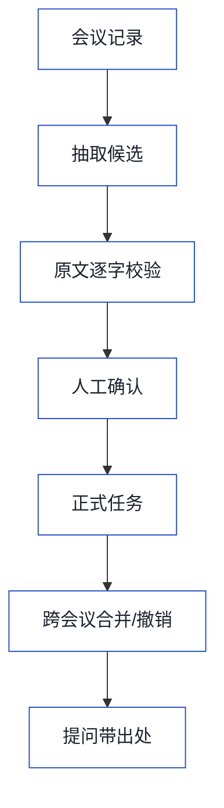

[简体中文](README.md) · [English](README.en.md)

<p align="center">
  
</p>

[](https://github.com/yefuyou/linkloom/actions/workflows/offline-pr.yml)
[](LICENSE)
[](pyproject.toml)

## 1. 它解决什么

会议开完了，负责人、截止时间和决定还会在下一场会议里改变，翻聊天记录很难知道现在该按哪一版做。
LinkLoom 从会议记录中抽取候选，经原文逐字校验和人工确认后保存正式任务与决定，再把跨会议的变化和出处连起来，方便团队查现在、查过去、问原因。

## 2. 演示

**演示 GIF 待补。** 以下两张图重新截取自当前 master 界面，使用仓库已有的合成页面流程夹具；句子经改写以适配旧抽取器，只展示操作流程，不代表真实会议抽取效果。

看板：展开一张候选卡片，对照原文，再选择创建、合并或拒绝。


按负责人：查看同一任务的变化历史，对照负责人和截止时间的变更，以及各次会议的原文。


## 3. 核心流程



合并与撤销都需要人工确认；模型提出的“可能是同一件事”不会自动变成正式变更。

## 4. 关键设计

### 理解交给模型，证明交给规则

会议里的说法不固定，模型负责理解语义、提出候选和调查步骤。
规则负责核对原文、来源版本、工作区、权限与预算，避免把“模型说得像”当成“已经有证据”。

### 人工确认才生效，而且可撤销

抽取结果和关系建议先留在候选区，人工确认后才进入正式任务或已审核决定。
跨会议合并可以撤销，撤销会追加历史并保留原记录，方便复查误操作。

### 时序决策存储

新决定不应抹掉旧决定，因为“现在用什么”和“当时用什么”是两个问题。
系统保留生效时间、替代关系和来源证据，支持查询当前或指定日期有效的决定；来源变更后，相关记录可能需要复核。

### 有界多跳

原因和变更往往分散在多份记录里，调查需要沿关联逐步补找证据。
步数、工具、上下文和预算都有边界，证据不足时列出缺口，避免无限搜索后给出过度确定的答案。

### 可恢复运行时

运行时先把调用意图记入账本再执行，并保存结果与检查点，让恢复过程知道哪些步骤已经发生、哪些结果仍不确定。
底层支持受控恢复，当前网页调查会话仍需保持服务运行。

### 检索与本地重排

BM25 找关键词，向量检索补语义，再用 RRF 融合，并由本地量化 cross-encoder 重排候选，减少只看单一路径造成的遗漏。
重排缺依赖或执行失败时自动保留 RRF 原顺序；`auto` 默认只用本地模型，不会自动切到远端服务。

### 配置缺失时的降级

没有 API Key 也能启动服务、创建工作区、保存来源、审核已有候选，以及查询已审核决定和历史。
AI 抽取与外部调查需要配置并显式启用；显式启用后若缺少密钥或依赖，启动器会提示修正，不会悄悄改用另一家远端服务。

## 5. 评测与数字

这些结果分别衡量路由、查询速度、检索和抽取，不是端到端产品正确率；不同数据集的成绩不能互相替代。

### 路由

准确率按“路由与目标同时正确”计算，错绑单独列出。保留集 H、F 各只使用一次。

| 数据集 | 条数 | 准确率 | 错绑 |
| --- | ---: | ---: | ---: |
| 开发集 | 60 | 98.3% | 0 |
| 保留集 H | 13 | 46.2%→76.9% | 1 |
| 保留集 F | 16 | 56.2%→87.5% | 0 |

这说明了什么：开发集表现很好，但换一批问法仍会错，H 里还出现了错绑。

评测入口：[路由评测脚本](scripts/eval_routing.py)与[路由用例](tests/routing)。

### 规模

离线合成数据的查询耗时；按日期查询使用已落库的时序决定，和全文检索是不同路径。

| 规模 | BM25 p50 | 按日期查询 p50 |
| --- | ---: | ---: |
| 1千条 | 6 ms | — |
| 1万条 | 80 ms | — |
| 10万条 | 958 ms | 0.73 ms |

这说明了什么：这次测试里，关键词检索随数据增多而变慢，按日期查已存决定仍很快。

来源：[规模评测](benchmarks/scale/2026-10-29/results.md)。

### 检索重排（开发集）

下表均为开发集 Recall@5，包含合成规模数据；冻结 30 题也用于开发，不是保留集验收。
`+base INT8 重排`和`+m3 重排`都接在同一 RRF 结果之后。

| 数据集 | BM25 | RRF | +base INT8 重排 | +m3 重排 |
| --- | ---: | ---: | ---: | ---: |
| 1千篇 | 1 | 0.83 | 1 | 1 |
| 1万篇 | 1 | 0.94 | 1 | 1 |
| 冻结 30 题 | 0.9239 | 0.9361 | 0.9322 | 0.9433 |

这说明了什么：重排能补回一部分漏掉的来源，但不保证每道题都更好。

base INT8 重排 p95 约 2 秒（非独占机器）；`drm-002` 的 Recall@5 在两种重排后仍为 **0.75**。
来源：[2026-11-02 重排开发集报告](benchmarks/rerank/2026-11-02/results.md)。

### 会议待办抽取

两组保留集的召回合计如下，分母是 15 条标准答案。

| 系统 | 召回 |
| --- | ---: |
| 基线 | 10/15 |
| v2 | 7/15 |
| legacy | 5/15 |

这说明了什么：v2 在保留集上仍比基线漏得更多，开发集的好成绩没有延续过来。

来源：[两组保留集汇总](benchmarks/ami_tasks/results_es2004_final.md)。这项独立抽取评测不等于产品入库后的字段完整率。
产品入库的字段校验正在改进（[PR #47](https://github.com/yefuyou/linkloom/pull/47)，尚未合并），这里不引用未合并的结果。

## 6. 快速开始

需要 Git 和 **Python 3.11+**。

```bash
git clone https://github.com/yefuyou/linkloom.git
cd linkloom
```

macOS / Linux：

```bash
python3 -m venv .venv
source .venv/bin/activate
cp .env.example .env
```

PowerShell：

```powershell
python -m venv .venv
.\.venv\Scripts\Activate.ps1
Copy-Item .env.example .env
```

安装带 Gemini 依赖的版本：

```bash
python -m pip install -e ".[smoke]"
```

在项目根目录的 `.env` 中只需填写 `GEMINI_API_KEY`，其他服务的密钥留空即可；启动器自动加载此文件，已有环境变量优先，修改后需重启。
然后启动 AI 抽取与本地人工审核：

```bash
python -m linkloom.ui --database work/product.sqlite --port 8765 --allow-external-provider --allow-local-task-review
```

打开[本地界面](http://127.0.0.1:8765/)，在会议页导入记录，再到[待办页](http://127.0.0.1:8765/tasks)核对候选。
启用 AI 后，来源文本会发送给配置的 Gemini 服务，可能产生 API 费用；本地审核保存自报姓名，不认证人员身份。

### 可选检索依赖

```bash
python -m pip install -e ".[rerank]"
```

此扩展安装向量检索与本地重排所需的依赖，模型首次使用时按需下载到用户缓存。
`LINKLOOM_RERANK=auto` 是默认值，重排不可用时自动保留 RRF 顺序；设为 `off` 可禁用。
如果不安装向量依赖，可在 `.env` 中取消 `LINKLOOM_RETRIEVAL_MODE=bm25` 的注释，使用纯关键词检索。
要启用原因和来源关系调查，启动时另加 `--allow-temporal-agent`，并在提问时逐次授权。
`jev` 是实验性选项，未经真实 API 验证，只有显式选择该模式才会外发查询与候选原文。

### 离线使用

仅使用离线功能可安装基础包：`python -m pip install -e .`，不需要 API Key。
无需密钥的预设演示使用独立数据库：

```bash
python -m linkloom.ui --database work/task-demo.sqlite --port 8765 --offline-task-demo --allow-local-task-review
```

普通离线启动时去掉 `--offline-task-demo`，并使用 `work/product.sqlite`。
离线可创建工作区、保存来源、审核已有候选、查询已审核决定及其历史；新来源的 AI 抽取和外部调查需要配置与授权。
预设演示不调用外部模型，和真实会议抽取效果无关；切换启动命令前先停止占用同一端口的服务。

## 7. 边界与后续

- **不用 GraphRAG。** 当前围绕检索、时序记录与有界调查组织证据，不构建全库 GraphRAG。
- **不自动合并同一件事。** 候选关系由人工确认；目前也不支持两条正式任务互相合并。
- **抽取仍会漏。** 保留集上尚未超过基线，逐字校验也只能验证已有候选，不能证明所有待办都已找到。
- **部分操作接口待补。** 审计查询、字段修改、来源重新绑定与失效的后续 HTTP 接口见 [#37](https://github.com/yefuyou/linkloom/issues/37)。
- **人员身份仍有限。** 负责人保留原文，人员目录关联与登录身份尚属设计预留，见 [#38](https://github.com/yefuyou/linkloom/issues/38)。
- **存在已知测试波动。** macOS 上一项本地 HTTP 连接测试间歇失败，原因尚未确认，见 [#45](https://github.com/yefuyou/linkloom/issues/45)。

许可证：[MIT](LICENSE)。
