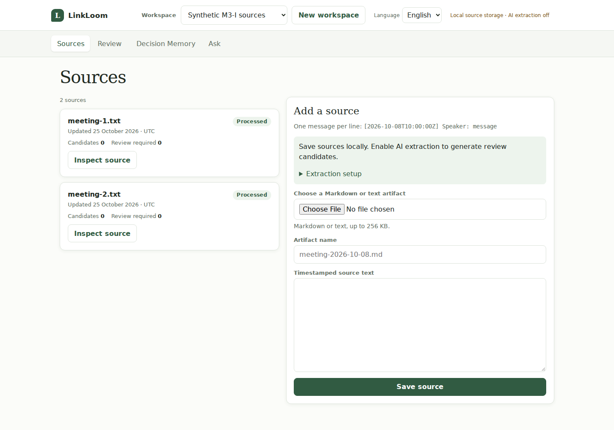
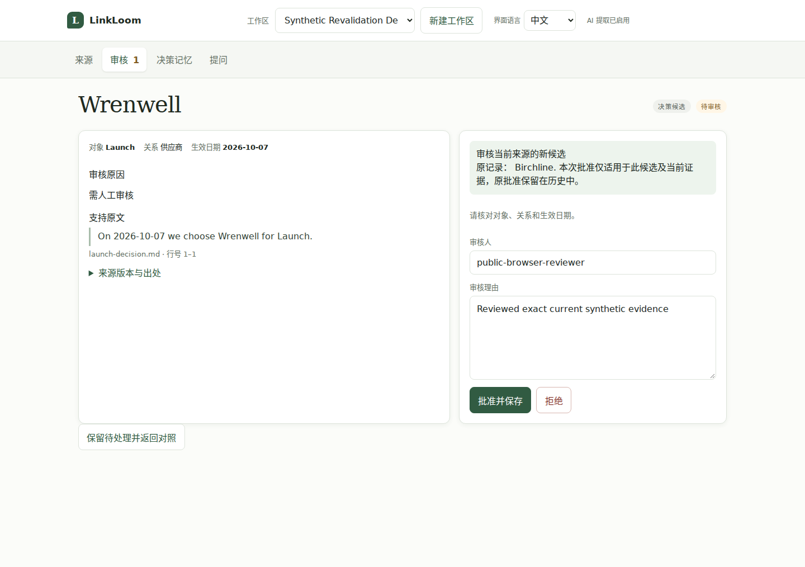
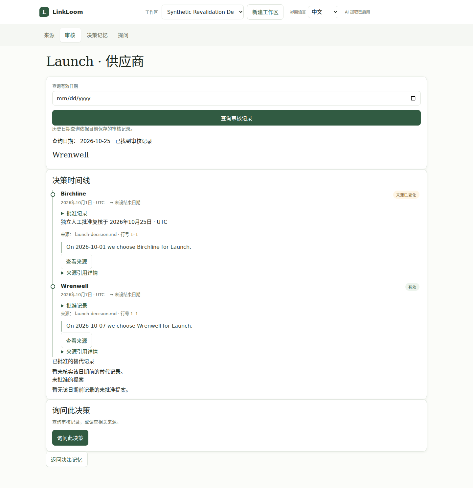
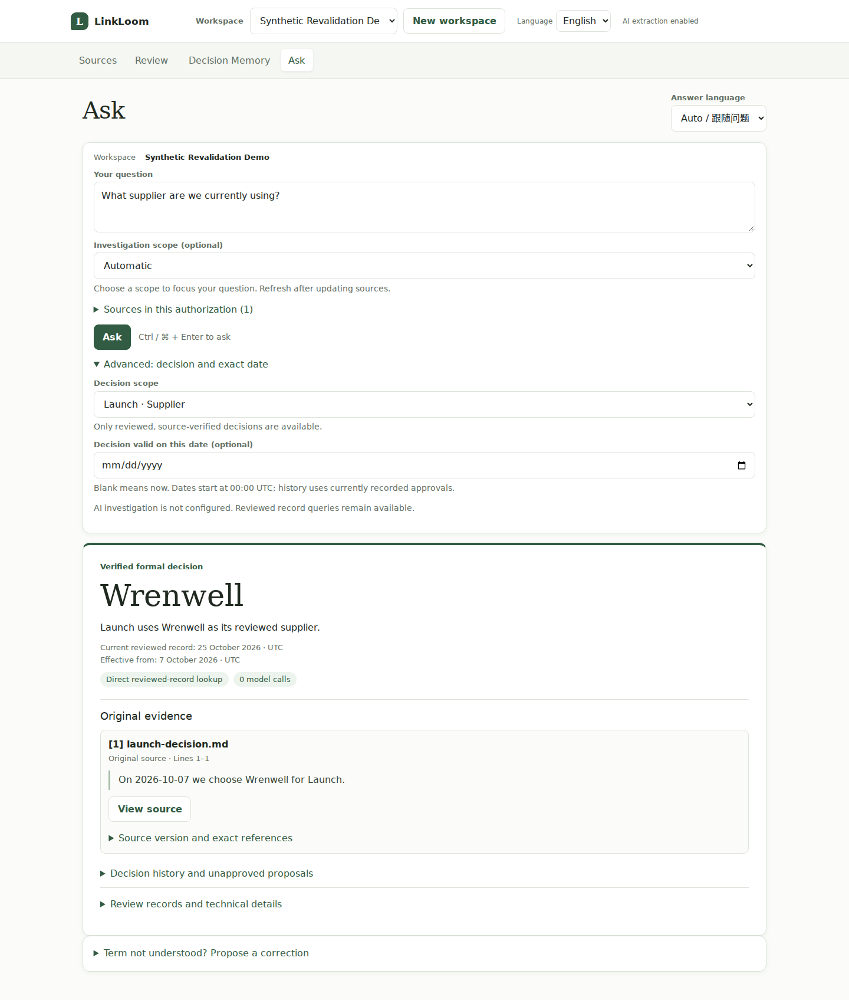
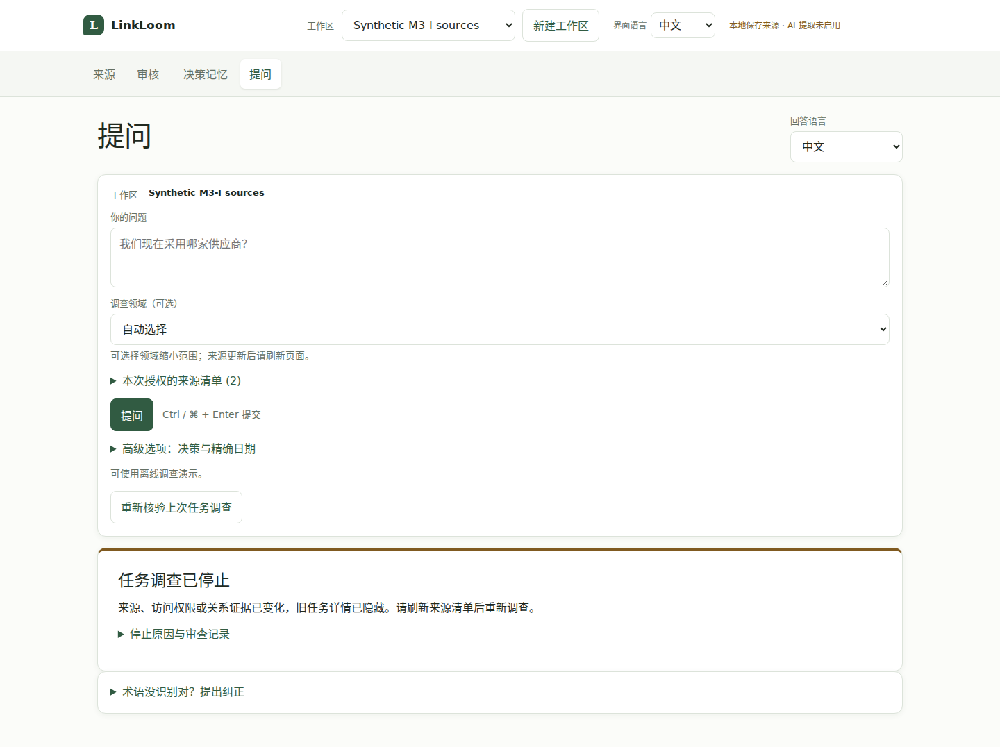
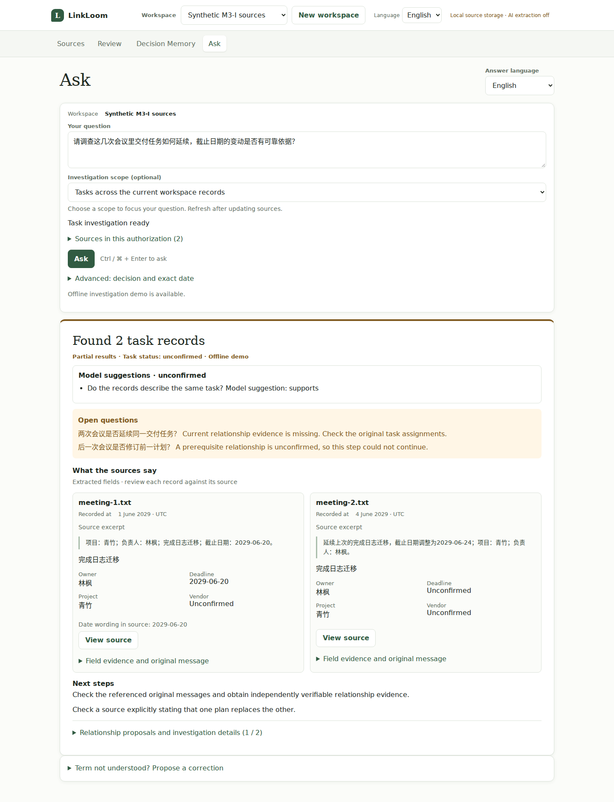
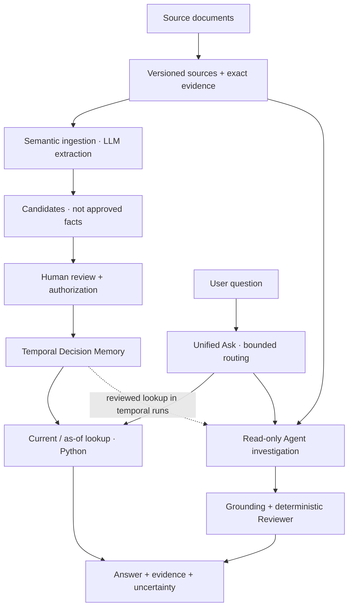

# LinkLoom

[English](README.md) · [简体中文](README.zh-CN.md)

**Recover the decision that is valid now, what changed, and the source that proves it.**

LinkLoom is a local-first team knowledge assistant for evolving meeting notes and
Markdown sources. It combines human-reviewed decision history with a bounded,
read-only investigation Agent, to connect answers with their source evidence, effective dates and review history.

## From a meeting trail to an answer

Monday's meeting chooses **Birchline**. A later meeting replaces it with
**Wrenwell**, effective October 8. A third note only *proposes* Kestrel Ledger.
Which supplier is approved today? Which was valid on October 7? What action and
owner were recorded, and which original passage supports the change?

LinkLoom keeps proposals separate from approved decisions, preserves effective
dates and supersession, and exposes source evidence. If an imported source is
updated and its evidence no longer matches, affected decisions need review.
Questions about reasons or conflicting sources can take the investigation path.

## See the product

Follow the [60–90 second walkthrough](docs/V1_DEMO.md). The screenshots below
show synthetic meeting data with offline responses.
<table>
  <tr><th>1 · Import sources</th><th>2 · Review candidates</th></tr>
  <tr>
    <td><a href="docs/requirements/product-copy-ux-cleanup/evidence/integrated/after-sources-en.png"></a></td>
    <td><a href="docs/requirements/product-copy-ux-cleanup/evidence/integrated/after-review-zh.png"></a></td>
  </tr>
  <tr><th>3 · Follow decision history</th><th>4 · Ask with evidence</th></tr>
  <tr>
    <td><a href="docs/requirements/product-copy-ux-cleanup/evidence/integrated/after-decisions-zh.png"></a></td>
    <td><a href="docs/requirements/product-copy-ux-cleanup/evidence/integrated/after-ask-en.png"></a></td>
  </tr>
  <tr><th>5 · Notice stale evidence</th><th>Investigate task records</th></tr>
  <tr>
    <td><a href="docs/requirements/product-copy-ux-cleanup/evidence/integrated/after-blocked-zh.png"></a></td>
    <td><a href="docs/requirements/product-copy-ux-cleanup/evidence/integrated/after-task-en.png"></a></td>
  </tr>
</table>

Also inspect the [replacement approval](docs/requirements/product-copy-ux-cleanup/evidence/integrated/after-review-zh.png)
and [decision history](docs/requirements/product-copy-ux-cleanup/evidence/integrated/after-decisions-zh.png).

## What you can do today

| Capability | What it does |
|---|---|
| Import and extract | Store timestamped text as immutable source versions with exact evidence spans. Semantic extraction requires explicit Gemini opt-in. |
| Review decisions | Inspect, approve or reject candidates; approval and materialization record authorization. Proposals remain supporting-only. |
| Recover decision history | Query current or as-of state, effective dates, predecessors, evidence and receipts in workspace-scoped SQLite. Records can include actions and owners when supported. |
| Ask in one place | Reviewed-state questions use deterministic lookup. Reasons and conflicts use an explicitly enabled temporal investigation Agent. |
| Investigate source relations | Supported project → owner → direct-leader and alias → project → owner → direct-leader question forms use bounded search/read plans. Unsupported forms request clarification. |
| Inspect cross-meeting tasks | Compare task records across meetings, inspect owner/date evidence and review unconfirmed AI relationship suggestions. Use the offline demo or explicitly configure task investigation with per-question source permission. |
| Keep verified partial results | See verified relationships alongside the specific evidence still needed to answer the rest of your question. |
| Track source changes | Explicit product source updates/deletions reconcile evidence and surface affected current materialized decisions in Review Attention. No automatic filesystem watcher. |

## How it works



The [product architecture](docs/architecture/PRODUCT_ARCHITECTURE.md) separates
reviewed truth, source investigation and stale-evidence handling. The
[runtime architecture](docs/architecture/RUNTIME_ARCHITECTURE.md) shows which
components call an LLM and which enforce deterministic Python contracts.

## Quickstart

Requires **Python 3.11+**. From a terminal:

```bash
git clone https://github.com/yefuyou/linkloom.git
cd linkloom
python -m venv .venv
```

Activate with `source .venv/bin/activate` on macOS/Linux, or
`.\.venv\Scripts\Activate.ps1` in PowerShell. Then:

```bash
python -m pip install -e .
python -m linkloom.ui --port 8765 --database work/product.sqlite
```

Open [the local UI](http://127.0.0.1:8765/). Create a workspace and inspect
Sources, Review, Decision Memory and Ask. **No key is needed to start.** A fresh
database has no approved decisions, and extraction and Agent investigation are
disabled. The database path above keeps demo data in this checkout; omitting
`--database` defaults to `~/.linkloom/product.sqlite`.

For a key-free **cross-meeting task demonstration**, use the explicit synthetic
mode with a dedicated local database:

```bash
python -m linkloom.ui --port 8765 --database work/task-demo.sqlite --offline-task-demo
```

In Ask, choose **Tasks across the current workspace records** and ask whether
the meetings describe the same task. Results show each source record, extracted
owner/date fields, relationship suggestions and unresolved checks. The **Offline
demo** label identifies preset responses; this mode makes no external AI calls.
Task relationships require separate approval. The current task view supports
investigation and evidence review.

For configurable task investigation, see the
[setup and authorization contract](docs/requirements/m3-q-real-task-investigation/SPEC.md).
For the complete source → review → answer workflow, install the provider extra
and set `GEMINI_API_KEY` in your environment:

```bash
python -m pip install -e ".[smoke]"
python -m linkloom.ui --port 8765 --database work/product.sqlite --allow-external-provider
```

Import [the synthetic meeting](tests/fixtures/v1_release_acceptance_meeting.txt),
review Birchline and Wrenwell, then ask **“What supplier are we currently
using?”** or select **2026-10-07** for the historical value. See the
[walkthrough](docs/V1_DEMO.md) for evidence and date checks before approval.

To also enable reason/conflict and source-relation investigations, launch with
both permissions (stop the previous server first). For the minimal installation,
select BM25 first: `export LINKLOOM_RETRIEVAL_MODE=bm25` on macOS/Linux, or
`$env:LINKLOOM_RETRIEVAL_MODE = 'bm25'` in PowerShell. The default hybrid mode
instead needs `python -m pip install -e ".[retrieval]"` and may download its local
embedding model on first use.

```bash
python -m linkloom.ui --port 8765 --database work/product.sqlite --allow-external-provider --allow-temporal-agent
```

These opt-ins send source text to the configured Gemini model and can incur
provider costs; investigation also requires per-request permission in Ask.
The product launcher pins its configured model and has no provider settings UI.
For a key-free **older replay**, open [legacy Ask](http://127.0.0.1:8765/legacy-ask);
it does not run the current source ingestion/review workflow.

## Engineering worth looking at

- **Time and authority are data.** Decision validity, supersession, evidence and
  authorization receipts are persisted together; extraction confidence alone
  cannot establish an approved fact.
- **One model loop, explicit tool boundaries.** The model proposes calls or a
  structured Final. Python validates arguments, workspace scope, permissions
  and budgets before execution; durable proposals and tool results support
  controlled resume.
- **Retrieval and context have separate jobs.** BM25, optional local dense
  retrieval and hybrid fusion find evidence. Budgeted context assembly filters
  scope, duplicates and stale provenance; memory hints never become citations.
- **Answers pass evidence checks.** Grounding validates observed source
  identities, hashes and quotes; a deterministic Reviewer gates Agent results.
  Integrated Recovery can close exhausted relation plans with a validated
  partial result; missing evidence and uncertain execution stay distinct.
- **Source changes have consequences.** Reconciliation compares the current
  evidence inventory with materialized provenance; it can mark records STALE
  or NEEDS_REVALIDATION without silently promoting a replacement candidate.

## Data and review

Sources, decision history and review records are stored locally in a workspace.
Source changes flag affected decisions for review. Revalidation compares the
original approval with current evidence and records a separate approval for a
new candidate.

AI extraction and investigation send source text to the configured external
provider only when enabled and may incur model costs. Ask requires permission
for each external investigation. Direct reviewed-record lookup runs locally.

Task suggestions remain unconfirmed until separately approved. Partial results
show the facts found and the remaining questions. Source conflicts, unavailable
access and uncertain AI service responses have distinct states. Original
Markdown/Obsidian files stay unchanged.

The current application runs locally. Investigation sessions use process-local
state; keep the server running while investigating. See the
[evidence and evaluation reference](docs/requirements/product_evidence_portfolio_v1/EVALUATION_MATRIX.md)
for recorded validation protocols and results.

## For developers

Start with the [source reading map](docs/README.md), then the
[product architecture](docs/architecture/PRODUCT_ARCHITECTURE.md) and
[runtime architecture](docs/architecture/RUNTIME_ARCHITECTURE.md).
The [roadmap](docs/PRODUCT_ROADMAP.md) owns product direction;
[Agent rules](AGENTS.md) own contribution boundaries. Historical architecture,
evaluations and the [LangGraph reference mapping](docs/architecture/LANGGRAPH_MAPPING.md)
remain available through the developer map.

## License

[MIT](LICENSE).
