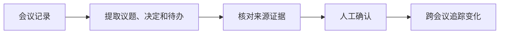
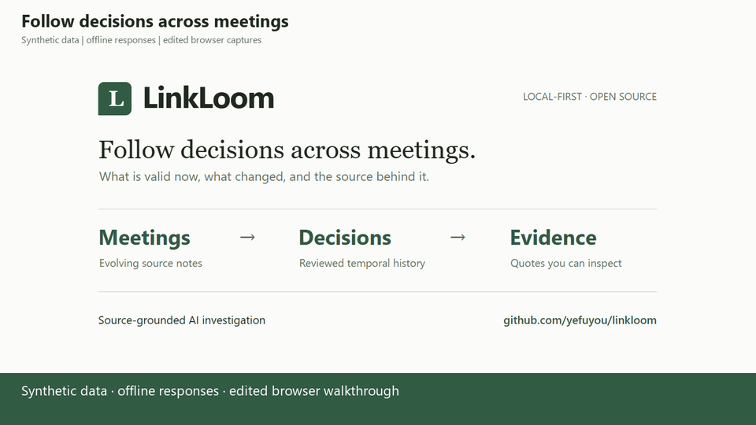
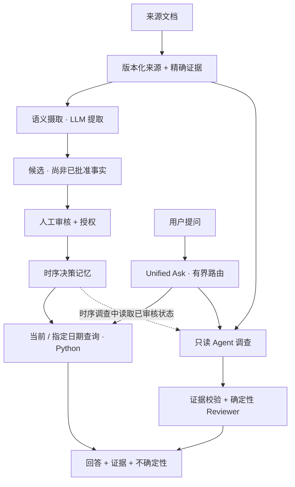

# LinkLoom

从会议记录里提取议题、决定和待办，并跨会议追踪同一件事的变化。每条结论都附原文证据；待办和变更经人工确认后才生效。

需要 Python 3.11+ 和 Git：
```bash
git clone https://github.com/yefuyou/linkloom.git
python -m pip install -e ./linkloom
python -m linkloom.ui --offline-task-demo --database linkloom/work/task-demo.sqlite --port 8765
```

打开 [本地演示](http://127.0.0.1:8765/)。在 Ask 选择 **Tasks across the current workspace records**，询问几次会议说的是否同一个任务、截止日期如何变化。

演示使用合成会议记录和预设响应，无需 API Key。



## 从会议记录到有据可查的回答

周一会议选择了 **Birchline**，后来的会议决定从 10 月 8 日起改用 **Wrenwell**，
第三份记录只是*提议*采用 Kestrel Ledger。今天批准使用哪家供应商？10 月 7 日
用的又是哪家？记录了什么行动、由谁负责，哪段原文支持这次变更？

LinkLoom 将提案与已批准决定分开，保留生效时间、替代关系与来源证据。导入的来源
更新后，如果证据不再匹配，相关决定会进入待复核状态。涉及原因或来源冲突的问题
可以进入调查路径。

## 看看实际产品

[80 秒演示视频](docs/launch/assets/linkloom-walkthrough.mp4) · [逐步体验](docs/V1_DEMO.md)



三张产品截图：[审核候选](docs/requirements/product-copy-ux-cleanup/evidence/integrated/after-review-zh.png) ·
[决策历史](docs/requirements/product-copy-ux-cleanup/evidence/integrated/after-decisions-zh.png) ·
[任务记录与证据](docs/requirements/product-copy-ux-cleanup/evidence/integrated/after-task-zh.png)。
视频前半复用 V1 画面；截图为 #25 更新后的界面。演示均使用合成资料与离线响应。

## 三个核心能力

- **追溯决定**：找回当前或指定日期有效的决定、生效时间和替代历史。
- **审核与复核**：候选先经人工审核；原文证据变化后复核相关决定。
- **带着证据调查**：对照来源记录、字段与原文，明确展示待确认关系和资料缺口。

跨会议任务演示保留每条记录的负责人和日期证据；模型关系建议仍待确认，不代表已经批准延期或变更负责人。

## Quickstart

需要 **Python 3.11+**，在终端执行：

```bash
git clone https://github.com/yefuyou/linkloom.git
cd linkloom
```

macOS/Linux 创建并激活环境：

```bash
python3 -m venv .venv
source .venv/bin/activate
```

PowerShell 创建并激活环境：

```powershell
python -m venv .venv
.\.venv\Scripts\Activate.ps1
```

激活后执行：

```bash
python -m pip install -e .
python -m linkloom.ui --port 8765 --database work/product.sqlite
```

打开[本地界面](http://127.0.0.1:8765/)，创建工作区，查看 Sources、Review、
Decision Memory 和 Ask。**启动不需要密钥。** 新数据库还没有已批准决定，提取与
Agent 调查默认关闭。上面的数据库路径将演示数据留在当前检出目录；省略
`--database` 时默认使用 `~/.linkloom/product.sqlite`。

无需密钥的跨会议任务演示（使用独立数据库）：

```bash
python -m linkloom.ui --port 8765 --database work/task-demo.sqlite --offline-task-demo
```

先停止占用同一端口的服务。在 Ask 选择 **Tasks across the current workspace records**，输入：
“Do these meetings describe the same task, and what changed about its deadline?”。
查看两条记录并展开 **Field evidence and original message**。离线预设响应不调用外部模型；
第二条 deadline 字段保持未确认，模型建议不授予正式业务批准。

可选的本地任务核验需显式启用 `--allow-local-task-review`，仅限 localhost。
它保存用户自声明的核验回执，不认证人员身份，也不代表正式业务批准；关系和日期结论仍须独立来源证据复核。

真实 AI 任务调查的配置与逐次授权见
[配置说明](docs/requirements/m3-q-real-task-investigation/SPEC.md)。

要体验完整的来源 → 审核 → 回答流程，安装 Provider 扩展，并在环境中配置
`GEMINI_API_KEY`：

```bash
python -m pip install -e ".[smoke]"
python -m linkloom.ui --port 8765 --database work/product.sqlite --allow-external-provider
```

导入[合成会议样例](tests/fixtures/v1_release_acceptance_meeting.txt)，审核 Birchline
和 Wrenwell，然后询问 **“What supplier are we currently using?”**，或选择
**2026-10-07** 查看历史状态。批准前的证据与日期检查见[演示指南](docs/V1_DEMO.md)。

要同时启用原因、冲突与来源关系调查，使用两个权限开关启动（先停止前一个服务）。
最小安装请先选择 BM25：macOS/Linux 执行 `export LINKLOOM_RETRIEVAL_MODE=bm25`，
PowerShell 执行 `$env:LINKLOOM_RETRIEVAL_MODE = 'bm25'`。默认混合模式则需要
`python -m pip install -e ".[retrieval]"`，首次使用可能下载本地嵌入模型。

```bash
python -m linkloom.ui --port 8765 --database work/product.sqlite --allow-external-provider --allow-temporal-agent
```

启用后来源文本会发送给配置的 Gemini 模型，可能产生 Provider 费用；调查还需在
Ask 中逐次授权。产品启动器固定所配置的模型，界面内没有 Provider 设置。
无需密钥的**旧版回放**位于 [legacy Ask](http://127.0.0.1:8765/legacy-ask)，
它不执行当前的来源摄取和审核流程。

## 如何协作



[产品架构图](docs/architecture/PRODUCT_ARCHITECTURE.md)展开已审核事实、来源调查与
证据过期处理。[Runtime 技术架构图](docs/architecture/RUNTIME_ARCHITECTURE.md)
区分真正调用 LLM 的部分和执行确定性 Python 合约的组件。

## 值得看的工程设计

- **时间与授权都进入数据模型。** 决策有效期、替代关系、证据和授权收据共同持久化；
  提取置信度本身不能使候选成为已批准事实。
- **单一模型循环，明确工具边界。** 模型提出工具调用或结构化 Final；Python 在执行前
  校验参数、工作区、权限与预算，持久化提案和工具结果以支持受控恢复。
- **检索与上下文各司其职。** BM25、可选本地稠密检索与混合融合寻找证据；有预算的
  上下文组装处理范围、去重和过期来源，记忆提示不会变成引用。
- **回答经过证据检查。** Grounding 校验实际观察过的来源身份、哈希与原文；确定性
  Reviewer 把关 Agent 结果。已集成的 Recovery 可让证据耗尽的关系计划以核验后的
  部分结果结束，并区分证据不足与执行结果不确定。
- **来源变化会影响决策状态。** 对账将当前证据清单与落库时的出处比较，可标记
  STALE 或 NEEDS_REVALIDATION，不会悄悄把新候选提升为替代事实。

## 数据与审核

来源、决策历史和审核记录按工作区保存在本地。来源变化后，受影响的决策会进入
待复核状态。复核时可对照原批准与当前证据，为新候选单独记录批准。

AI 提取与调查需明确启用，会将来源文本发送给已配置的外部服务，并可能产生模型费用。
外部调查还需在「提问」中逐次授权。直接查询已审核决策在本地完成。

任务关系建议保持待确认；部分结果会列出已找到的信息和剩余问题。
来源冲突、访问不可用和 AI 服务响应不确定分别显示。原始 Markdown/Obsidian 文件保持不变。

当前产品在本地运行。调查会话使用进程内状态，调查期间请保持服务运行。
验证方法与已记录结果见[评测参考](docs/requirements/product_evidence_portfolio_v1/EVALUATION_MATRIX.md)。

## 开发者入口

[贡献指南](CONTRIBUTING.md) · [报告问题或反馈](https://github.com/yefuyou/linkloom/issues/new)

先看[源码阅读导航](docs/README.md)，再看
[产品架构图](docs/architecture/PRODUCT_ARCHITECTURE.md)和
[Runtime 技术架构图](docs/architecture/RUNTIME_ARCHITECTURE.md)。
[Roadmap](docs/PRODUCT_ROADMAP.md)维护产品方向，
[Agent 规则](AGENTS.md)约束贡献边界。历史架构、评估与
[LangGraph 参考映射](docs/architecture/LANGGRAPH_MAPPING.md)保留在开发者导航中。

## 许可证

[MIT](LICENSE)。
