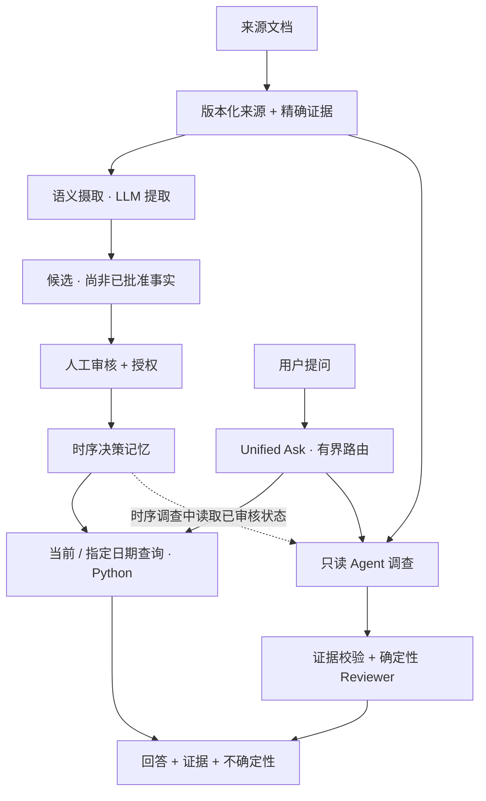

# LinkLoom

[English](README.md) · [简体中文](README.zh-CN.md)

**找回当前有效的决定、它经历的变更，以及支持它的原始证据。**

LinkLoom 是一个本地优先的团队知识助手，面向持续变化的会议记录与 Markdown
来源。它把人工审核的决策历史与只读的 AI 调查结合起来，让相关段落
成为回答的起点，并继续核对决定何时有效、经过谁审核、证据是否仍然成立。

## 从会议记录到有据可查的回答

周一会议选择了 **Birchline**，后来的会议决定从 10 月 8 日起改用 **Wrenwell**，
第三份记录只是*提议*采用 Kestrel Ledger。今天批准使用哪家供应商？10 月 7 日
用的又是哪家？记录了什么行动、由谁负责，哪段原文支持这次变更？

LinkLoom 将提案与已批准决定分开，保留生效时间、替代关系与来源证据。导入的来源
更新后，如果证据不再匹配，相关决定会进入待复核状态。涉及原因或来源冲突的问题
可以进入调查路径。

## 看看实际产品

按[60～90 秒演示指南](docs/V1_DEMO.md)体验完整流程。以下截图使用合成会议资料与离线响应。
<table>
  <tr><th>1 · 导入来源</th><th>2 · 审核候选</th></tr>
  <tr>
    <td><a href="docs/requirements/product-copy-ux-cleanup/evidence/integrated/after-sources-en.png"></a></td>
    <td><a href="docs/requirements/product-copy-ux-cleanup/evidence/integrated/after-review-zh.png"></a></td>
  </tr>
  <tr><th>3 · 查看决策历史</th><th>4 · 带着证据提问</th></tr>
  <tr>
    <td><a href="docs/requirements/product-copy-ux-cleanup/evidence/integrated/after-decisions-zh.png"></a></td>
    <td><a href="docs/requirements/product-copy-ux-cleanup/evidence/integrated/after-ask-en.png"></a></td>
  </tr>
  <tr><th>5 · 发现证据过期</th><th>调查任务记录</th></tr>
  <tr>
    <td><a href="docs/requirements/product-copy-ux-cleanup/evidence/integrated/after-blocked-zh.png"></a></td>
    <td><a href="docs/requirements/product-copy-ux-cleanup/evidence/integrated/after-task-en.png"></a></td>
  </tr>
</table>

还可以查看[替代决定的批准界面](docs/requirements/product-copy-ux-cleanup/evidence/integrated/after-review-zh.png)和
[决策历史](docs/requirements/product-copy-ux-cleanup/evidence/integrated/after-decisions-zh.png)。

## 现在能做什么

| 能力 | 使用方式 |
|---|---|
| 导入与提取 | 将带时间戳的文本存为不可变来源版本，保留精确证据片段；语义提取需明确启用 Gemini。 |
| 审核决定 | 查看、批准或拒绝候选；批准与落库保存授权记录。提案只作支持材料。 |
| 回溯决策历史 | 在按工作区隔离的 SQLite 中查询当前或指定日期状态、生效时间、前序决定、证据与授权收据；有证据时记录行动和负责人。 |
| 统一提问 | 已审核状态走确定性查询；原因与冲突问题走明确启用的时序调查 Agent。 |
| 调查来源关系 | 支持“项目 → 负责人 → 直属领导”和“别名 → 项目 → 负责人 → 直属领导”的有界 search/read 计划；不支持的问法要求澄清。 |
| 跨会议任务调查 | 对照不同会议的任务记录，查看负责人、日期证据、待确认的 AI 关系建议与后续核查事项。可使用离线演示，或显式配置调查并逐次授权来源。 |
| 保留部分调查结果 | 展示已核验的关系，以及回答其余问题还需补充的具体证据。 |
| 跟踪来源变化 | 更新或移除来源后，重新核查证据，将受影响的决策放入审核列表；可对照新来源单独复核。 |

## 如何协作



[产品架构图](docs/architecture/PRODUCT_ARCHITECTURE.md)展开已审核事实、来源调查与
证据过期处理。[Runtime 技术架构图](docs/architecture/RUNTIME_ARCHITECTURE.md)
区分真正调用 LLM 的部分和执行确定性 Python 合约的组件。

## Quickstart

需要 **Python 3.11+**，在终端执行：

```bash
git clone https://github.com/yefuyou/linkloom.git
cd linkloom
python -m venv .venv
```

macOS/Linux 使用 `source .venv/bin/activate` 激活环境；PowerShell 使用
`.\.venv\Scripts\Activate.ps1`。然后执行：

```bash
python -m pip install -e .
python -m linkloom.ui --port 8765 --database work/product.sqlite
```

打开[本地界面](http://127.0.0.1:8765/)，创建工作区，查看 Sources、Review、
Decision Memory 和 Ask。**启动不需要密钥。** 新数据库还没有已批准决定，提取与
Agent 调查默认关闭。上面的数据库路径将演示数据留在当前检出目录；省略
`--database` 时默认使用 `~/.linkloom/product.sqlite`。

无需密钥的跨会议任务演示：

```bash
python -m linkloom.ui --port 8765 --database work/task-demo.sqlite --offline-task-demo
```

在「提问」中选择「当前空间记录中的任务」，询问不同会议是否描述同一任务。
结果展示逐条来源、提取的负责人和日期、关系建议与待确认事项。「离线演示」标记
表示使用预设响应，不调用外部 AI。任务关系需单独批准，当前任务视图用于调查与证据核查。

真实 AI 任务调查的配置与逐次授权见
[配置说明](docs/requirements/m3-q-real-task-investigation/SPEC.md)。

要体验完整的来源 → 审核 → 回答流程，安装 Provider 扩展，并在环境中配置
`GEMINI_API_KEY`：

```bash
python -m pip install -e ".[smoke]"
python -m linkloom.ui --port 8765 --database work/product.sqlite --allow-external-provider
```

导入[合成会议样例](tests/fixtures/v1_release_acceptance_meeting.txt)，审核 Birchline
和 Wrenwell，然后询问 **“What supplier are we currently using?”**，或选择
**2026-10-07** 查看历史状态。批准前的证据与日期检查见[演示指南](docs/V1_DEMO.md)。

要同时启用原因、冲突与来源关系调查，使用两个权限开关启动（先停止前一个服务）。
最小安装请先选择 BM25：macOS/Linux 执行 `export LINKLOOM_RETRIEVAL_MODE=bm25`，
PowerShell 执行 `$env:LINKLOOM_RETRIEVAL_MODE = 'bm25'`。默认混合模式则需要
`python -m pip install -e ".[retrieval]"`，首次使用可能下载本地嵌入模型。

```bash
python -m linkloom.ui --port 8765 --database work/product.sqlite --allow-external-provider --allow-temporal-agent
```

启用后来源文本会发送给配置的 Gemini 模型，可能产生 Provider 费用；调查还需在
Ask 中逐次授权。产品启动器固定所配置的模型，界面内没有 Provider 设置。
无需密钥的**旧版回放**位于 [legacy Ask](http://127.0.0.1:8765/legacy-ask)，
它不执行当前的来源摄取和审核流程。

## 值得看的工程设计

- **时间与授权都进入数据模型。** 决策有效期、替代关系、证据和授权收据共同持久化；
  提取置信度本身不能使候选成为已批准事实。
- **单一模型循环，明确工具边界。** 模型提出工具调用或结构化 Final；Python 在执行前
  校验参数、工作区、权限与预算，持久化提案和工具结果以支持受控恢复。
- **检索与上下文各司其职。** BM25、可选本地稠密检索与混合融合寻找证据；有预算的
  上下文组装处理范围、去重和过期来源，记忆提示不会变成引用。
- **回答经过证据检查。** Grounding 校验实际观察过的来源身份、哈希与原文；确定性
  Reviewer 把关 Agent 结果。已集成的 Recovery 可让证据耗尽的关系计划以核验后的
  部分结果结束，并区分证据不足与执行结果不确定。
- **来源变化会影响决策状态。** 对账将当前证据清单与落库时的出处比较，可标记
  STALE 或 NEEDS_REVALIDATION，不会悄悄把新候选提升为替代事实。

## 数据与审核

来源、决策历史和审核记录按工作区保存在本地。来源变化后，受影响的决策会进入
待复核状态。复核时可对照原批准与当前证据，为新候选单独记录批准。

AI 提取与调查需明确启用，会将来源文本发送给已配置的外部服务，并可能产生模型费用。
外部调查还需在「提问」中逐次授权。直接查询已审核决策在本地完成。

任务关系建议保持待确认；部分结果会列出已找到的信息和剩余问题。
来源冲突、访问不可用和 AI 服务响应不确定分别显示。原始 Markdown/Obsidian 文件保持不变。

当前产品在本地运行。调查会话使用进程内状态，调查期间请保持服务运行。
验证方法与已记录结果见[评测参考](docs/requirements/product_evidence_portfolio_v1/EVALUATION_MATRIX.md)。

## 开发者入口

先看[源码阅读导航](docs/README.md)，再看
[产品架构图](docs/architecture/PRODUCT_ARCHITECTURE.md)和
[Runtime 技术架构图](docs/architecture/RUNTIME_ARCHITECTURE.md)。
[Roadmap](docs/PRODUCT_ROADMAP.md)维护产品方向，
[Agent 规则](AGENTS.md)约束贡献边界。历史架构、评估与
[LangGraph 参考映射](docs/architecture/LANGGRAPH_MAPPING.md)保留在开发者导航中。

## 许可证

[MIT](LICENSE)。
