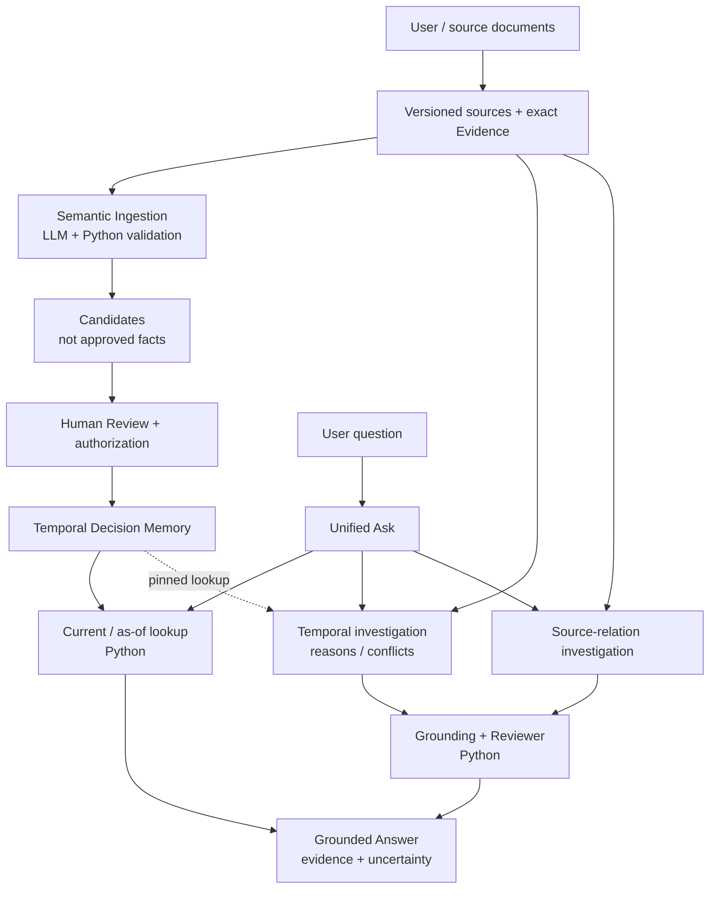
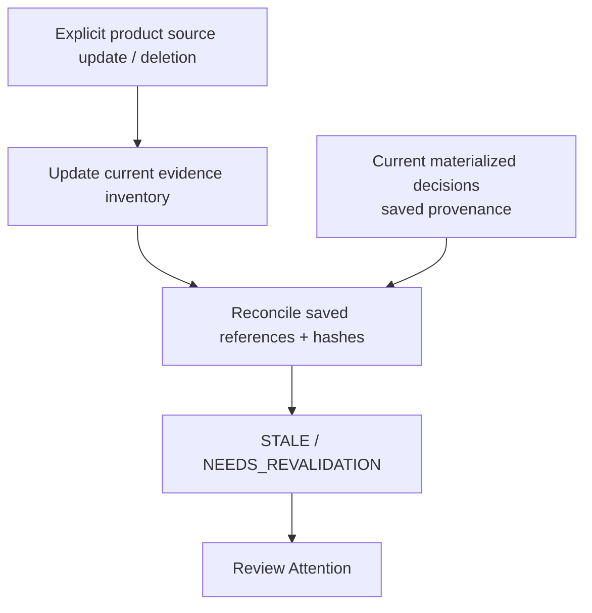

# Product architecture

[README](../../README.md) · [中文首页](../../README.zh-CN.md) ·
[Runtime architecture](RUNTIME_ARCHITECTURE.md) · [Developer map](../README.md)

LinkLoom recovers a team's decisions across changing sources: what is valid,
what it replaced, and which evidence supports it. This map describes the
merged implementation at `c5099ce242abcaad4a785710d435e0c582394b43`, checked
against remote master on October 20, 2026. Separate Recovery integration work
is not included.

## From sources to reviewed decisions

Read the solid arrows as product data/control flow; the dotted arrow is a
reviewed-state tool available to temporal investigations. Sources can also
be investigated before they yield an approved decision. Source-relation runs
do not use Decision Memory as evidence and do not write decisions.

## Three ways through Unified Ask

| Route | What happens | Authority boundary |
|---|---|---|
| Reviewed state | Python resolves a workspace, decision subject/relation and date, then checks effective state, source evidence and authorization receipts. | No LLM call. Missing or ambiguous scope asks for clarification; no unique verified effective decision means no authoritative conclusion. |
| Temporal investigation | With provider permission, the Agent searches/reads frozen source copies, can read the pinned reviewed decision, and proposes typed claims explaining reasons or conflicts. | Validator checks claims against the requested workspace, decision and date; Reviewer acceptance is required before projection. A replacement receipt alone does not establish its reason. |
| Source relations | Supported project → owner → direct-leader and alias → project → owner → direct-leader forms create a bounded deterministic TaskPlan. The model chooses allowed search/read tools. | No approved-decision prerequisite. Decision Memory and generic Agent Memory are disabled for these runs. Facts must come from observed source evidence; unsupported plans request clarification. |

The router and relation templates are Python rules, not a general-purpose
LLM intent classifier. Temporal and source-relation investigations share
the [runtime](RUNTIME_ARCHITECTURE.md), but have different scope and Final
contracts. Default bounds are eight model turns for temporal investigation and
up to twelve for source-relation investigation.

## A candidate is not an approved fact

Semantic Ingestion parses timestamped source segments, extracts structured
proposals through a provider, and validates source/evidence identity in Python.
The product Review flow records the human's resolution and explicit approval
before materializing a decision with an authorization receipt. Proposals stay
supporting-only; unresolved or invalid candidates cannot silently become truth.

The materialization library also has versioned deterministic policy
authorization contracts. That is a separate authorization path, not permission
for any model output to bypass the product's human Review flow.

Runtime output has another boundary: a grounded, Reviewer-passed result can
be captured as an `AgentMemoryCandidate` for later review. Reviewer PASS only
attests to the run's evidence checks. Capture is not approval, and approval
must still pass the materializer's authorization and freshness checks. Generic
Agent Memory stores preferences/terminology separately from business decisions.

## When source changes make a decision stale

The product stores immutable imported versions. An explicit Sources update
registers the new version, removes superseded evidence from the **current**
inventory, marks affected review candidates stale, reconciles Decision Memory,
and starts ingestion for the new version. Product source deletion similarly
unregisters current evidence and reconciles; it does not delete an original
file from the user's filesystem.

Reconciliation compares each record's saved evidence references/hashes with
the current workspace inventory:

| Evidence state | Source-state outcome |
|---|---|
| All saved references and known hashes still match | ACTIVE, subject to other lifecycle/receipt checks. |
| No source references, or none remain usable because references disappeared or hashes changed | STALE. |
| Some evidence remains valid while other references changed/disappeared, or a saved hash cannot be verified | NEEDS_REVALIDATION. |

For current materialized decisions, these states surface in Review Attention.
Stale candidates are removed from the pending Review list and do not appear in
that attention view. Old versions and decision history remain
available for inspection; a stale record does not authorize its new candidate.
The demo's edited Wrenwell passage exercises STALE. This is evidence-identity
reconciliation, not semantic detection that a real-world decision has changed.
There is no filesystem watcher, deployed reconciliation scheduler, or dedicated
stale revalidation UI in this baseline.

## Source reading and executable evidence

Paths below point to the implementation on this branch, inherited unchanged
from the stated master baseline.

| Product responsibility | Source | Offline behavior evidence |
|---|---|---|
| Product HTTP boundary and persisted workflow | [ui/__main__.py](../../src/linkloom/ui/__main__.py), [ui/server.py](../../src/linkloom/ui/server.py) | [Product application flow](../../tests/integration/test_product_application_flow.py) |
| Versions, Review, receipts and reconciliation | [ui/product.py](../../src/linkloom/ui/product.py), [semantic_ingestion/materialization.py](../../src/linkloom/semantic_ingestion/materialization.py) | [Product flow](../../tests/integration/test_product_application_flow.py), [materialization](../../tests/unit/test_semantic_ingestion_materialization.py) |
| Temporal state and evidence inventory | [decision_memory/store.py](../../src/linkloom/decision_memory/store.py), [decision_memory/reconciliation.py](../../src/linkloom/decision_memory/reconciliation.py) | [Temporal memory](../../tests/unit/test_temporal_decision_memory.py), [structured lookup](../../tests/unit/test_structured_temporal_lookup.py) |
| Unified Ask and scope | [ui/unified_ask.py](../../src/linkloom/ui/unified_ask.py), [ui/scope_discovery.py](../../src/linkloom/ui/scope_discovery.py) | [Unified Ask flow](../../tests/integration/test_unified_ask_flow.py) |
| Frozen source investigation and verified projection | [ui/investigation.py](../../src/linkloom/ui/investigation.py), [runtime/team_decision_planner.py](../../src/linkloom/runtime/team_decision_planner.py) | [Source investigation](../../tests/integration/test_unified_investigation_flow.py) |

For running instructions see [Quickstart](../../README.md#quickstart). Product
direction remains in the [roadmap](../PRODUCT_ROADMAP.md); historical diagrams
and evaluation protocols remain in place.
