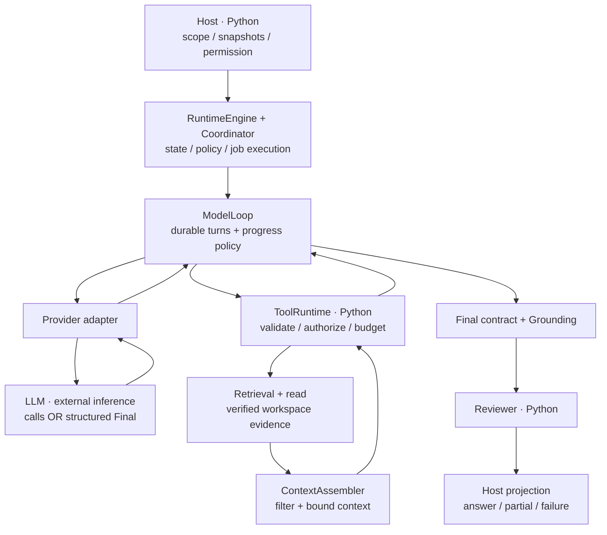
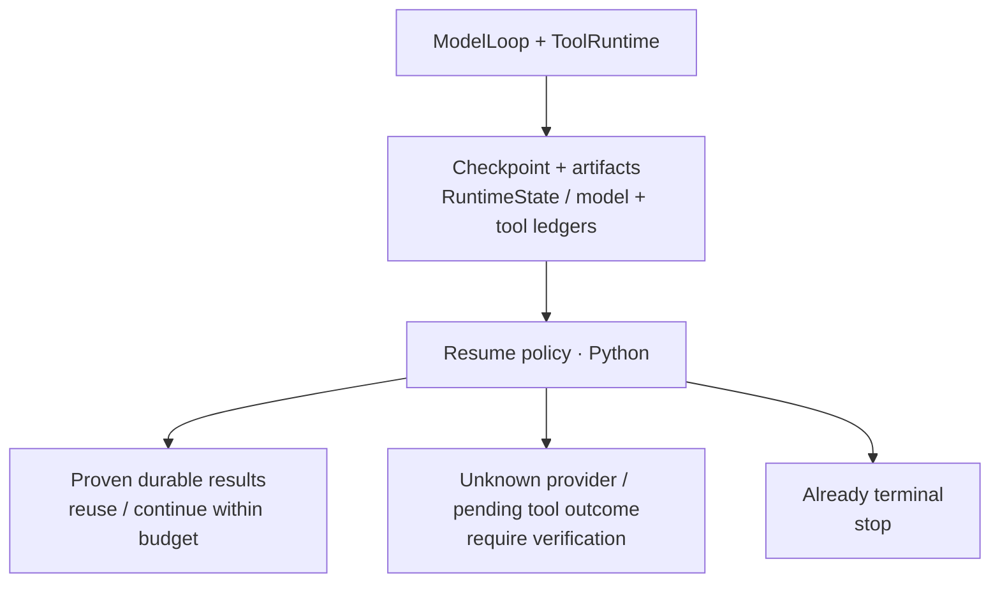

# Runtime architecture

[Product architecture](PRODUCT_ARCHITECTURE.md) · [Developer map](../README.md)

This describes merged source at
`95a125ce4d1b2867102217e1d0430044fbf4f739` (remote master checked October 20,
2026). Names such as Host, Curator and Reviewer describe responsibilities;
they do not imply a collection of independently conversing LLMs.

## Host, Runtime and Model

Every box except **LLM** is Python control, validation, storage or presentation.
The provider adapter invokes the model; an SDK call is not a tool permission
bypass. Semantic extraction is a separate LLM call path upstream of Review,
shown in the [product map](PRODUCT_ARCHITECTURE.md).

| Owner | Responsibility |
|---|---|
| Host | Launch-time provider configuration, per-request opt-in, workspace selection, source snapshots, UI job lifecycle and safe result projection. |
| Runtime | Own state, call identities, durable requests/proposals/results, tool policy, budgets, context visibility, termination and controlled resume. |
| Model | Propose an ordered list of tool calls or a Final under the selected protocol. It cannot grant tool permissions, change pinned scope or approve durable business facts. |

`Coordinator`, `CuratorAgent` and `ReviewerAgent` are deterministic Python
components. The Curator's pair-signal path belongs to the separate `connect`
workflow; it is not a required stage of product investigation. `RetrievalAgent`
wraps the actual model loop and validates its result. The source contains older
deterministic execution paths too; this diagram follows the model-backed
investigation path used by Unified Ask.

## One model turn and its tool calls

1. The Host exports selected immutable source versions into a temporary read-only
   input snapshot and builds `RuntimeEngine`. The runtime adapter supplies
   verified tools, scope, context and policy to the retrieval wrapper.
2. `SingleAgentModelLoop` assembles a bounded `ModelTurnRequest`. The model
   request lifecycle and response artifacts are persisted; an ordered V2 proposal
   is durable before its tools execute.
3. For each tool call, `ToolRuntime` resolves the registered executor, validates
   JSON schema and semantic arguments, and checks allow/deny rules and budget
   eligibility. It records **pending**, checkpoints, consumes the call budget,
   then invokes the executor. Result schema is checked and terminal ledger state
   is checkpointed before the result becomes a durable observation.
4. Successful tool observations and provider continuation return to the next
   model turn. Calls within a proposal execute in order, not concurrently.
5. A proposed Final passes the selected result/claim contract and grounding
   checks in `RetrievalAgent` and its validators. The Coordinator invokes the
   deterministic Reviewer before the Host exposes an accepted Agent answer.

The registered read tools include `search_notes` and `read_verified_note`; scoped
Decision Memory and reviewed temporal lookup tools are wired only where
enabled. A source-relation run disables Decision Memory and generic memory.
Dependent search entities must come from verified parent reads, not from a
model's unverified intermediate guess.

## Retrieval, context and evidence

| Stage | What the implementation does |
|---|---|
| Retrieval | `RuntimeRetrievalBackend` scopes to a workspace and optional directory. Modes include BM25, dense and hybrid; hybrid fuses lexical and local embedding candidates. Matching body passages from one file retain separate evidence identities within existing caps. Dense models require the optional retrieval dependency. |
| Context assembly | `ContextAssembler` selects evidence, eligible Decision Memory, runtime state and optional experience within item/character/estimated-token budgets. Deduplication uses evidence identity, so distinct passages from one file can survive. It records drops for scope, duplicates, staleness, provenance and budget. |
| Model visibility | The model loop rebuilds bounded verified-evidence context from successful tool results and durable observations; it also trims old tool history to its request-size bound. These are estimates and byte limits, not a guarantee about a provider's tokenizer. |
| Grounding | Final validation checks the evidence actually observed, source identity/hash, exact quotes and supported typed claim relations. Temporal claims additionally use the Host's pinned workspace/subject/relation/date validator. |
| Reviewer and projection | Reviewer checks source evidence/schema; UI projection rechecks snapshot source identity/version and only exposes accepted conclusions. Missing/conflicting fields remain explicit. |

Retrieval finds candidates; reading establishes observed source evidence.
Memory can guide navigation or terminology but cannot replace source citations.
The temporal lookup route in Unified Ask is deterministic and uses its own
receipt/evidence checks; it does not need an LLM or the investigation Reviewer.

## Ledger, checkpoint, resume and Recovery boundaries

`RuntimeState` includes model execution records, the Tool Ledger, termination,
usage and provider continuation references. `SQLiteCheckpointer` and
`ModelArtifactStore` persist state and request/response artifacts. Traces provide
diagnostics; they do not independently authorize replay.

| Durable state | Existing master behavior |
|---|---|
| Request durable, no invocation recorded | Resume policy can allow model invocation. |
| Durable ordered proposal with a verified prefix of tool results | Resume from that prefix; reuse durable results and continue remaining eligible calls. |
| All proposal results durable | Continue from those observations, retaining provider continuation contracts. |
| Request sent / response obtained without a durable proven outcome | Require verification; do not blindly invoke the provider again. |
| Next tool remains pending with unknown outcome | Require verification/manual decision rather than assuming it failed. |
| Runtime already terminal | Do not restart it as an active loop. |

`runtime/recovery.py` decides resume eligibility;
`runtime/recovery_policy.py` constrains the next step using errors/progress.
It can request one schema correction, a different bounded search, a parent read,
a partial/conflict Final, or termination. `tools/recovery.py` provides pure
pending-call recommendations; a recommendation does not itself execute a retry.
Provider retry adapters distinguish known failures from unknown outcomes.

Bounded Recovery is integrated at the stated master baseline; it adds no
automatic retry or new provider invocation authority. Existing runtime durability
does not mean the UI can recover jobs after a process restart: `ProductInvestigationService`
holds jobs in memory and stores each investigation under `TemporaryDirectory`.
Durable runtime callers and the current product job lifecycle are different
boundaries.

## Progress Recovery and partial Finals

The merged controller uses deterministic `assess_progress` and
`decide_recovery`, scoped to the active run/task/agent/workspace and durable
observations available at the assessment boundary. It is a constraint on the
existing model loop, not another LLM Agent.

| Condition | Current behavior |
|---|---|
| New evidence or a verified read | Continue within existing budgets; returned matching passages retain distinct identities. |
| Repeated search with no new evidence | Adjust the strategy; confirmed stall stops repetition. One distinct query can be tried within budget before further stalled search is rejected as `MODEL_PROGRESS_STALLED`. |
| Typed TaskPlan v2 has reachable missing subgoals already searched, returned evidence read, and no planned alternate remaining | `FINAL_PARTIAL` supplies no tools to the next model request. The model must propose a Final with `decision.value=null`, `insufficient_evidence`, separately cited verified facts in rationale, and missing subgoal IDs in `unknown_fields`. Legacy v1 does not use this automatic exhaustion rule. |
| One recoverable plan-argument error | One correction window; a rejected subgoal/query-variant call may instead be abandoned for a validated null Partial Final. It cannot be abandoned to claim full success. |
| Identity/scope violation or tool permission denial | Terminate. In an ordered multi-call proposal, denial prevents later calls and a subsequent Final; it cannot be relabeled as evidence insufficiency. |
| Repeated uncorrected schema/tool errors, invalid outputs or checkpoint/ledger failures | Terminate without an accepted answer. |

Partial guidance is not partial acceptance: `RetrievalAgent` validates the
Final against successful observed reads and supported claim relations, then
Reviewer and product projection apply their existing checks. Unread search
hits or fabricated rationale cannot become cited facts. After `FINAL_PARTIAL`,
an attempted eligible tool call is blocked by the progress
guard rather than bypassing validation, permission or freshness checks.

For a source-relation partial, product projection retains verified facts and
gaps as `INSUFFICIENT` and leaves its requested answer null. Conflicting sources
remain explicit; independently verified upstream facts can still be retained.
A budget stop, denied action or uncertain provider outcome is an execution
failure/uncertainty, not a partial completion. Tool budget exhaustion can still
permit a valid Final from existing evidence; reaching the model/provider run
limit before a valid Final remains `budget_exhausted` and fails product completion.

## Uncertainty and termination

The model loop returns `completed`, `failed` or `budget_exhausted`; product
projection additionally distinguishes investigation progress, insufficient
evidence and provider uncertainty. Completion of a model turn alone does not
establish an accepted product answer.

- Unsupported or ambiguous questions request scope/clarification before a run.
- Policy denial, invalid outputs, ledger/checkpoint conflicts and repeated
  uncorrected tool errors stop execution. Source-context identity/scope errors
  are terminal, not candidates for the ordinary argument-correction window.
- Step, provider-request and tool budgets bound work. Tool exhaustion may allow
  a Final from already verified evidence; it does not authorize extra calls.
- Verified source conflicts retain uncertainty and disputed dependent fields;
  unknown provider outcomes require verification instead of silent replay.

Grounding checks evidence provenance and supported claim forms. They do not
prove arbitrary natural-language reasoning or general factual accuracy.

## Source anchors

| Responsibility | Source |
|---|---|
| Host/job setup and projection | [ui/__main__.py](../../src/linkloom/ui/__main__.py), [ui/investigation.py](../../src/linkloom/ui/investigation.py), [ui/backend.py](../../src/linkloom/ui/backend.py), [ui/projection.py](../../src/linkloom/ui/projection.py) |
| Engine, wrapper and deterministic orchestration | [runtime/graph.py](../../src/linkloom/runtime/graph.py), [agents/runtime_adapter.py](../../src/linkloom/agents/runtime_adapter.py), [agents/retrieval_agent.py](../../src/linkloom/agents/retrieval_agent.py), [agents/coordinator.py](../../src/linkloom/agents/coordinator.py) |
| Model loop and providers | [runtime/model_loop.py](../../src/linkloom/runtime/model_loop.py), [agents/model_adapter.py](../../src/linkloom/agents/model_adapter.py), [Gemini adapter](../../src/linkloom/agents/providers/gemini_api.py), [retry policy](../../src/linkloom/agents/providers/retry_policy.py) |
| Tool contracts and policy | [tools/runtime.py](../../src/linkloom/tools/runtime.py), [tools/tool_policy.py](../../src/linkloom/tools/tool_policy.py), [tools/ledger.py](../../src/linkloom/tools/ledger.py) |
| Retrieval and context | [retrieval_v2/runtime_backend.py](../../src/linkloom/retrieval_v2/runtime_backend.py), [context/assembler.py](../../src/linkloom/context/assembler.py), [agents/runtime_evidence.py](../../src/linkloom/agents/runtime_evidence.py) |
| Grounding and Reviewer | [agents/team_decision.py](../../src/linkloom/agents/team_decision.py), [agents/claim_grounding.py](../../src/linkloom/agents/claim_grounding.py), [agents/reviewer_agent.py](../../src/linkloom/agents/reviewer_agent.py) |
| Persistence and recovery | [runtime/checkpoint.py](../../src/linkloom/runtime/checkpoint.py), [runtime/artifacts.py](../../src/linkloom/runtime/artifacts.py), [runtime/recovery.py](../../src/linkloom/runtime/recovery.py), [runtime/recovery_policy.py](../../src/linkloom/runtime/recovery_policy.py), [tools/recovery.py](../../src/linkloom/tools/recovery.py) |
| Progress and product termination | [runtime/progress.py](../../src/linkloom/runtime/progress.py), [ui/projection.py](../../src/linkloom/ui/projection.py), [ui/unified_ask.py](../../src/linkloom/ui/unified_ask.py) |

Executable offline contracts include [multi-action resume](../../tests/integration/test_runtime_v2_multi_action_resume.py),
[pending recovery](../../tests/unit/test_p84_recovery.py),
[recovery policy](../../tests/unit/test_recovery_policy.py) and
[Unified Ask integration](../../tests/integration/test_unified_ask_flow.py).
Recovery-specific evidence includes [graceful partials](../../tests/unit/test_graceful_partial_recovery.py),
[progress assessment](../../tests/unit/test_progress_assessment.py),
[ordered-call permission failure](../../tests/unit/test_runtime_v2_multi_action.py),
[same-file passage coverage](../../tests/unit/test_recovery_passage_coverage.py)
and the [Ask DOM contracts](../../tests/ui/unified_ask_dom_test.cjs).
For historical build-versus-buy context see [LangGraph mapping](LANGGRAPH_MAPPING.md).
