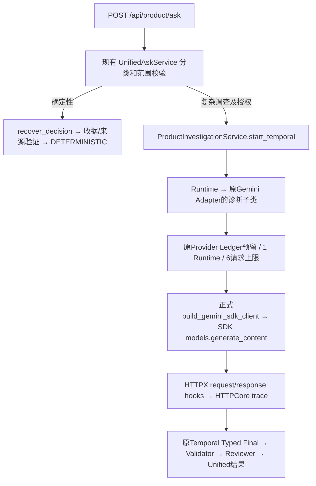

# Unified Ask + Gemini Transport 集成验收

本轮真实 Gemini 请求：**0**。`ROOT_CAUSE_UNCONFIRMED`。

`UNIFIED_ASK_TRANSPORT_READY: YES`。此状态仅表示离线接入、审查和受控执行入口已准备；真实网络稳定性与Agent真实任务成功尚未验证。

## 来源与集成范围

集成基线是 Unified Ask `d7628aa47240ecda93acda32b8bd3fca42e1aa17`。网络功能从本地 `eb09f6936a200f3243f9b84a48a1b5f032d1a061` 提取，它包含前置 `f639b22` 的诊断模块及第二阶段正式SDK接入。使用指定SHA的累积文件内容，未只提取最新增量。没有导入历史报告、Provider Ledger、Trace、运行事件或主机配置。

独立分支 `codex/unified-ask-transport-integration`；全部实现和测试在该工作树完成。未修改两个原专项树、round2树或D盘源码。UnifiedAskService、ProductApplication、Decision Memory、Validator、Reviewer、Workspace/日期权限和前端路由源码与产品基线相同。

## 审查与修复

独立Reviewer审查两次网络提交，报告5个P2、无P1：emit未严格限制字段；诊断预检失败仍能启动Provider；协议指纹遗漏实际接入文件；动态异常类型名与任意proxy scheme可作为敏感字符串通道。全部在集成树修复：固定事件/字段/类型白名单，真实异常class身份映射，代理协议枚举；诊断预检在SDK前阻断；指纹覆盖product接入及LedgeredGeminiClient。并发测试验证线程身份/轮次隔离和finally reset。

独立复审进一步发现预算表述及授权包审计元数据完整性两个P2，已修复：完整canonical JSON校验锁定全部字段及类型；发送预算与in-flight/终态宽限分别声明，轮询使用实际Runtime的同一截止时间。最终独立Reviewer确认这些问题关闭，无新增P1/P2，授权链路与预算/授权包完整性PASS。普通sink故障时诊断事件可能不完整，必须单独报告diagnostic_failures，不能把业务成功等同于完整传输证据。

运行中的普通诊断sink故障仅计数，业务账本按真实结果记成功或UNCERTAIN。启动预检失败阻断与运行故障隔离是不同阶段。服务端Provider ID和请求身份使用随机盐HMAC摘要；日志不保存原值、盐、正文、敏感头或异常消息。

## 真正的产品路径



模型工厂只在AGENT路径真正启动时构造SDK。当前/历史确定性查询与缺少外部授权的调查均不构造SDK、不产生生成请求。SDK构造的诊断默认None；执行入口仅显式启用，开启诊断不代表获得外部调用权限。130秒、attempts=1、TLS验证、模型和序列化均保留。

本机实际离线验收版本：google-genai 2.22.0、HTTPX 0.28.1、HTTPCore 1.0.9；通过安装包metadata读取，执行协议也会锁定版本。使用SDK同步Client的公开HttpOptions.client_args/event_hooks接口，没有替换生产HTTP栈。同步HTTPX当前默认HTTP/1.1；每次响应的实际协议版本以事件为准，不能据默认值证明全部历史连接状态。

实际Runtime回合经诊断ContextVar关联generation_sequence与agent_round。request hook在Schema/wire修正之后记录最终已缓存body长度；未缓存stream为UNKNOWN。trace可见TCP、CONNECT的HTTP1.1交换、代理TLS、发送头/体、接收头/体及失败阶段和耗时。响应头ID是摘要；连接复用身份及服务端是否执行仍UNKNOWN；没有新TCP事件仅是复用线索，客户端发送完成不代表服务端执行。

## 离线与浏览器证据

新增真实`POST /api/product/ask`测试使用产品Workspace导入/审核、Runtime、Gemini Adapter、业务Ledger、官方google-genai和HTTPX，只有HTTPX底层FakeTransport是合成。成功调查读取审核记忆、搜索、当前与先前来源，Typed Final经Validator及实际Reviewer接受。捕获这5轮真实Runtime输入，关闭诊断后用原Adapter/SDK重放，同一输入的最终wire bytes完全一致。

第4次headers/body中断分别记录receive_response_headers.failed或receive_response_body.failed；业务账本3成功+1UNCERTAIN，没有第5次发送；Unified结果PROVIDER_UNCERTAIN，结论、Evidence和收据为空。伪造收据/错误Evidence不能取得验证Final。诊断sink抛错时正常业务账本仍为成功。

FakeTransport阶段事件为故障注入，不能声称是真实网络观测；loopback测试另验证真实HTTPCore的headers/body断开和连接复用事件。没有进行TLS解密、关闭证书检查或切换Clash节点/TUN。

实际应用内浏览器使用新启动的合成服务：当前Wrenwell、历史2026-10-06的Birchline、AGENT调查成功及展开实际Reviewer、第四次headers中断、第四次body中断、日期切换立即清空结果、Workspace切到Other清空问题/旧结果。浏览器console无错误。对应本地fake账本为成功5次、headers UNCERTAIN4次、body UNCERTAIN4次；本地证据work/unified_transport_browser_audit.json。截图仅本地保存，不推送公开仓库。

本机Playwright CLI因npm缓存冲突不可用，浏览器验收改用真实应用内浏览器的Playwright/AX接口，不以API单测代替。合成HTTP客户端支持额外等待SDK冷启动的可选timeout；产品HTTP语义、130秒Provider超时不变。

汇总验收初次91项通过、4个本机合成等待超时（5秒GET、30秒启动/终态窗口），见work/unified_transport_final.xml。停止并行浏览器服务后，仅串行复验这4项及新startup预算/安全/授权门，共11/11通过，见work/unified_transport_focused.xml；没有修改产品逻辑掩盖超时。前端竞态检查tests/ui/unified_ask_dom_test.cjs PASS、product.js语法检查PASS。只运行相关验证，不修复无关旧P8.5或其他基线测试。

最终授权包篡改、截止边界与脱敏/并发回归18/18通过，见work/unified_transport_protocol_final.xml。没有把上述分批验证表述成单次全绿测试。

## 新实验入口（未授权、未执行）

`scripts/gemini_transport/unified.py`默认只prepare。新协议固定1 Runtime、最多6生成、gemini-3.8-flash、并发1、attempts=1、130秒每请求、900秒新发送预算。SDK Client沿用当前环境代理，不同时更换网络变量，TLS验证开启。原模型参数/输出token默认保持，费用和token只观察，六次请求是次数上限，不是精确美元上限，也不保证Final。

准备命令：

```powershell
$env:PYTHONPATH='src;.'
python -m scripts.gemini_transport.unified --directory work/NEW_UNIQUE_EXPERIMENT
```

只有独立用户授权才可设置协议中的精确实验身份授权值，并显式传`--execute`。执行器验证固定边界、源码SHA256、依赖版本；只读凭据来自GEMINI_API_KEY，不写凭据。`executed`目录以exclusive creation预留，无法再次执行同身份；新Runtime及Provider账本也独占创建。启动证据预检失败不构造SDK；运行中诊断故障不污染Ledger。所有生成预算由原Ledger强制，UNKNOWN/UNCERTAIN立即停机，崩溃留下未闭合reservation按未知处理，不允许重启重发。SDK只在授权AGENT请求后延迟构造；合成来源提取使用本地fake，不增加Gemini生成。

协议明确900秒为new_send_budget_seconds，已有请求允许inflight_grace_seconds=130，另有terminal_grace_seconds=5；1035秒从实际Runtime的send gate起算，是声明的观察窗口，不再额外叠加130秒。轮询等待和HTTP timeout均限制在剩余窗口内。发送截止只检查新请求，不能强行取消已发送请求；HTTPX socket超时不是进程级墙钟终止保证。执行器的本机HTTP客户端启动等待160秒、轮询最多30秒，不沿用轻量fake夹具的5秒等待；这不改变Provider超时。若系统socket超时行为不可靠或用户中断，保留未闭合账本，禁止自动恢复。不要借用旧授权、运行或重发T03/T04。

每次执行分别报告transport_evidence、runtime_complete、validator_reviewer、gold；任何一项成立都不自动代表其他项成功。新协议身份、实际账本和环境快照只存本地work，不提交。执行前仍需只读采集Clash/DNS/TUN活动状态，协议保存当前代理快照但不宣称绕过TUN。历史断开方、socket身份、provider执行状态、32–44秒超时来源和具体SDK缺陷均UNKNOWN。

保留scripts/gemini_transport/prepare.py的独立最多四请求备选。它更适合控制线路和Client生命周期变量，但简单生成的上下文与真实工具历史不能复现长Agent调查。新Unified协议的信息价值更高：第四次请求前已有真实Runtime工具历史，可观察最终请求体大小和等待阶段，同时受Typed Final/Validator/Reviewer约束。单Runtime、最多六请求仍不具备稳定性统计能力，也不能保证恰在第四次故障。

## 修改文件与冲突位置

| 文件 | 用途 |
| --- | --- |
| .gitignore | 排除本地证据与敏感运行材料 |
| scripts/gemini_transport/__init__.py、diagnostics.py、ledger.py、prepare.py、product.py、sdk.py | 累积网络诊断及独立实验依赖，含安全修正 |
| scripts/gemini_transport/unified.py | 新Unified受控实验prepare/execute及离线浏览器demo |
| src/linkloom/agents/providers/gemini_api.py | 现有SDK构造函数的可选诊断参数及hook合并 |
| tests/smoke/run_temporal_product_http.py、test_p14_cn2_typed_gemini38_smoke.py | 正式HTTP Runner开关、预检及Ledgered SDK诊断绑定 |
| tests/integration/unified_ask_fixture.py、unified_transport_fixture.py | 原合成fixture可选HTTP等待、新官方SDK底层FakeTransport |
| tests/integration/test_product_transport_http.py、test_transport_investigation_loopback.py、test_unified_transport_flow.py | Agent/Unified HTTP接入、真实loopback故障阶段及权限回归 |
| tests/unit/test_product_transport_hooks.py、test_transport_investigation.py、test_transport_sdk_bridge.py、test_transport_safety_integration.py、test_unified_transport_protocol.py | hook/诊断/授权/并发/脱敏回归 |
| docs/evaluation/UNIFIED_ASK_TRANSPORT_INTEGRATION.md | 本报告 |

潜在集成冲突集中在共享gemini_api.py的build_gemini_sdk_client，以及两个既有smoke runner/ledger文件、unified_ask_fixture.py和.gitignore。未修改产品分类、业务规则或前端源码。报告中的实验材料路径为本地证据，不包含在公开提交中。

## 发布边界

公开分支仅包括源代码、合成fixture、测试和此报告。work、浏览器截图、账本、事件/环境文件由.gitignore排除，发布前执行凭据扫描及暂存文件核对。只推送此独立分支到既有origin，不合并master、不创建PR/Release、不删除原专项分支。
