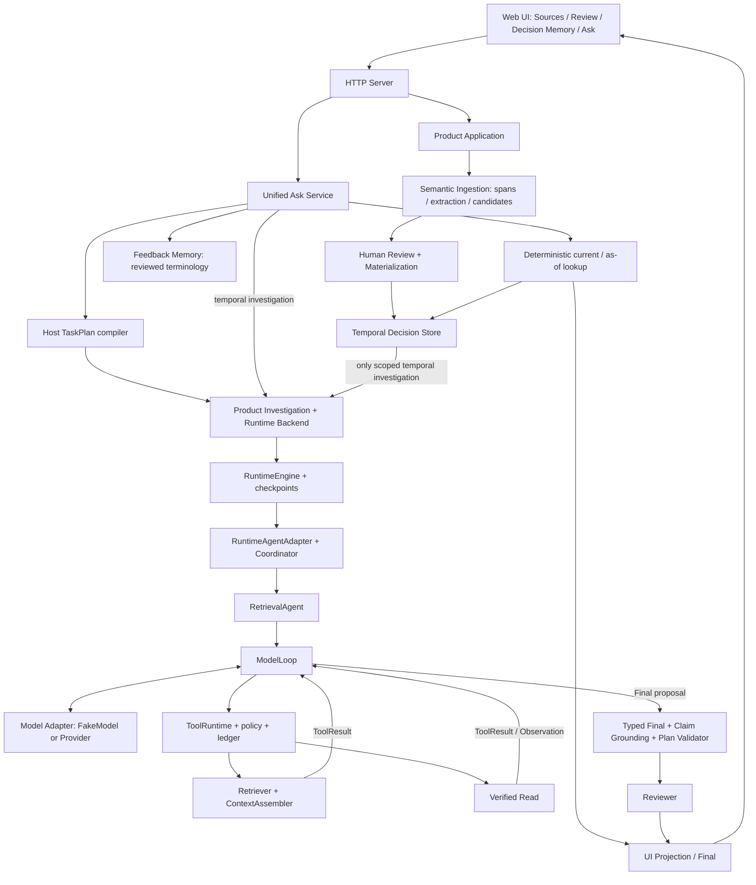

# 从打开网页到结果：实际系统结构

基线与 A/B/C 口径见 [学习入口](00_START_HERE.md)。本页按当前源码组织；**A** 的产品调用链由 [02 的离线 HTTP Trace](02_AGENT_LOOP_LAB.md) 和 `test_unified_investigation_flow.py` 验证。每行“删除后损失”是 **C：设计解释**，不是删除实验。

图中的箭头表示调用/数据流，`STORE → BRIDGE` 是业务注入的有界 Temporal lookup；**来源关系三跳没有 Decision Memory 读写能力**。`RuntimeEngine.start_multi_agent` 是历史命名，不意味着每个 Agent 都是一位 LLM：Reviewer 和 Coordinator 是确定性 Python。检验：[test_unified_investigation_flow.py:140 · test_source_policy_excludes_decision_memory_reads_and_candidate_capture](../../tests/integration/test_unified_investigation_flow.py#L140)。

## 模块职责、输入输出与接力位置

表中 W=确定性 Workflow/后端；M=模型参与点；W/M=Host 管理模型循环。调用者→组件→下游与输入→输出合在一行，沿行阅读即可。

| 组件及真实位置 | 谁调它→它调谁；关键输入→输出 | 属性；删除后损失（C） |
|---|---|---|
| Web UI：`product.html`；[product.js:555 · submitAsk](../../src/linkloom/ui/static/product.js#L555)、[product.js:538 · pollAsk](../../src/linkloom/ui/static/product.js#L538) | 用户→表单→HTTP；query/workspace/date→结果卡/引用 | W；失去用户交互和运行中状态隔离 |
| HTTP：[server.py:106 · LinkLoomRequestHandler.do_GET](../../src/linkloom/ui/server.py#L106) / [server.py:191 · LinkLoomRequestHandler.do_POST](../../src/linkloom/ui/server.py#L191) | 浏览器→路由→Application/UnifiedAsk；JSON→HTTP状态和JSON | W；失去输入与本机访问边界。不是 FastAPI |
| Product Application：[product.py:727 · ProductApplication](../../src/linkloom/ui/product.py#L727) | HTTP→产品服务→Repository/ingestion/store；来源、审核指令→候选/receipt/决策视图 | W；业务状态和审批规则会散落到 UI/模型 |
| Semantic Ingestion：[product.py:1248 · ProductApplication._ingest](../../src/linkloom/ui/product.py#L1248) | Application→分段/Extractor/候选服务；RawArtifact→EvidenceSpan + Candidate | W/M；模型可抽取候选，不能独立授予权威性 |
| Review/Materialization：[product.py:1467 · ProductApplication._approve_candidate](../../src/linkloom/ui/product.py#L1467) | 人的审核→candidate service→Temporal Store；candidate/reviewer/resolution→materialization receipt | W；否则提案与决定易混淆 |
| Temporal Decision Store：[store.py:280 · TemporalDecisionStore](../../src/linkloom/decision_memory/store.py#L280) | 产品/物化服务→SQLite；版本/有效时间/替代链→current/as-of记录 | W；否则“现在”“当时”没有持久业务定义 |
| Unified Ask：[unified_ask.py:149 · UnifiedAskService.ask](../../src/linkloom/ui/unified_ask.py#L149) | HTTP→发现slot/日期/权限→确定性查询或调查；payload→product-ask/v1 envelope | W；否则每问都调模型、范围容易漂移 |
| TaskPlan：[team_decision_planner.py:187 · plan_relation_investigation](../../src/linkloom/runtime/team_decision_planner.py#L187)、[task_plan.py:49 · TaskPlan](../../src/linkloom/runtime/task_plan.py#L49) | UnifiedAsk→编译器→调查服务；受支持句式→带依赖/关系类型的v2计划 | W；失去后续实体约束。不是模型的思维链 |
| Product Investigation：[investigation.py:75 · ProductInvestigationService.start](../../src/linkloom/ui/investigation.py#L75) | UnifiedAsk→snapshot/scan/RuntimeRunBackend；固定workspace/plan→只读运行 | W；产品来源版本与Runtime Vault之间缺少桥接 |
| Runtime Backend：[backend.py:123 · RuntimeRunBackend._execute](../../src/linkloom/ui/backend.py#L123) | 产品桥→Engine；query/plan/预算→后台job/status | W；失去HTTP异步轮询与RunRequest适配 |
| RuntimeEngine：[graph.py:444 · RuntimeEngine.start_multi_agent](../../src/linkloom/runtime/graph.py#L444) | Backend→Adapter；RunRequest→RuntimeState、checkpoint、最终artifact | W；执行身份/预算/持久状态无所有者 |
| RuntimeAgentAdapter：[runtime_adapter.py:751 · RuntimeAgentAdapter.run](../../src/linkloom/agents/runtime_adapter.py#L751) | Engine→Coordinator/检索tool handlers；vault/source/plan→可运行Agent环境 | W；业务来源不能安全接到通用执行器 |
| RetrievalAgent：[retrieval_agent.py:1199 · RetrievalAgent.execute](../../src/linkloom/agents/retrieval_agent.py#L1199) | Coordinator→ModelLoop→`_project_result`；task/source_context→EvidenceBundle/Typed结果 | W/M；缺少模型轨迹到产品合同的验证投影 |
| ModelLoop：[model_loop.py:834 · SingleAgentModelLoop._run_durable](../../src/linkloom/runtime/model_loop.py#L834) | RetrievalAgent→ModelAdapter/ToolRuntime；ModelTurnRequest→ToolResult或Final | W/M；失去逐轮Observation、持久化和停止边界 |
| Model Adapter：[model_adapter.py:1866 · FakeModelAdapter](../../src/linkloom/agents/model_adapter.py#L1866)；[gemini_api.py:1408 · GeminiProviderAdapter](../../src/linkloom/agents/providers/gemini_api.py#L1408) | Loop→Fake决定器或Provider传输；neutral request→action/proposal/usage/error | M接缝；SDK形状会污染Runtime。模型只提议，不能直接执行Python |
| ToolRuntime：[runtime.py:423 · ToolRuntime.execute](../../src/linkloom/tools/runtime.py#L423) | Loop→注册handler；ToolCall+policy→校验过的ToolResult/ledger | W；否则不可信模型参数可绕过schema、身份与工具白名单 |
| Retriever：[runtime_backend.py:116 · RuntimeRetrievalBackend.search](../../src/linkloom/retrieval_v2/runtime_backend.py#L116) | Adapter search handler→BM25等→passage投影；query→有来源身份的候选 | W；模型没有可定位的外部资料。分数不是事实正确率 |
| ContextAssembler：[assembler.py:129 · ContextAssembler.assemble](../../src/linkloom/context/assembler.py#L129) | Adapter→scope/去重/预算选择；候选→selected/dropped | W；证据和提示会无界增长或互相挤占 |
| Verified Read：[runtime_adapter.py:521 · RuntimeAgentAdapter._read_verified_note_for_tool](../../src/linkloom/agents/runtime_adapter.py#L521) | ToolRuntime→已观察ID→新鲜来源核验；ID→原文片段/哈希 | W；Search命中不能证明本次实际读过且仍对应来源 |
| Grounding：[team_decision.py:656 · TeamDecisionResult.from_grounded_final](../../src/linkloom/agents/team_decision.py#L656)、[claim_grounding.py:715 · assess_claim_text](../../src/linkloom/agents/claim_grounding.py#L715) | RetrievalAgent→主张与所引原文比对；Final/visible evidence/read refs→受支持结果或拒绝 | W；引用存在仍可能张冠李戴 |
| Reviewer：[reviewer_agent.py:15 · ReviewerAgent.execute](../../src/linkloom/agents/reviewer_agent.py#L15) | Coordinator→证据/subject验证工具；result refs→ReviewDecision | W；发布前缺少单独合同检查。PASS不是人类审批 |
| Feedback Memory：[feedback_memory.py:20 · FeedbackMemory](../../src/linkloom/ui/feedback_memory.py#L20) | 人的反馈→pending/approve/revoke→UnifiedAsk scoped resolver；术语映射→发现提示 | W；重复的受审术语纠正不能复用；不修改模型权重 |
| UI Projection：[investigation.py:306 · ProductInvestigationService._source_relations](../../src/linkloom/ui/investigation.py#L306)、[unified_ask.py:283 · UnifiedAskService._from_snapshot](../../src/linkloom/ui/unified_ask.py#L283) | 已验Final→scope/freshness核验→浏览器；artifact→事实链、引用、错误分类 | W；未经接受的草稿可能被当结论展示 |

## 两条主路径，别把后端都叫 Agent

**已审决策（A）**：Sources import → `_ingest` →候选；Review approve →物化→Store；Ask 当前供应商→`recover_decision`→版本/有效时间核验→UI。此路径可零模型查询；来源抽取阶段以前可以用模型。人审核的是候选业务内容，Reviewer 检查的是一次输出，两者不同。

**来源多跳（A）**：Ask→Host plan→Product snapshot→Engine→Adapter/Coordinator→RetrievalAgent→Loop↔模型→ToolRuntime→Search/Read→Final校验→Reviewer→Projection→UI。本次用 FakeModel，运行链仍是产品代码；控制器策略属于测试注入，不是默认生产逻辑。

模型能在公开给它的工具集合中选择调用并提出结构化答案；不能改变workspace/date、放宽source identity、把来源指令提升成系统指令、跳过验证、审批 Memory。工具 handler 也只能在被绑定的只读数据域中工作。具体拒绝实例见 [02 伪造下一跳负例](02_AGENT_LOOP_LAB.md#伪造下一跳实际负例)。

## 状态归属与可核验证据

产品 Workspace/source/version 在 ProductRepository，正式决策在 TemporalDecisionStore；运行状态/ledger/model records 在 RuntimeState/checkpointer；模型请求只拿受限投影；浏览器保存当前视图token并轮询，不是权威数据库。调查的临时快照由 `_InvestigationJob` 持有，当前产品没有跨进程恢复入口。

产品流程测试：[test_product_application_flow.py:291 · test_product_http_flow_imports_reviews_materializes_and_asks_with_history](../../tests/integration/test_product_application_flow.py#L291)（是否本次运行见03证据索引）；来源调查本次10项HTTP测试全通过。模型可生成计划的独立窄路径在 `RuntimeEngine.start_multi_agent` 的 `planning_mode == "model"` 分支（调用 `propose_task_plan`，可一次 `repair_task_plan`，再 `validate_model_proposed_plan`）；UnifiedAsk 三跳传入的是显式Host计划。历史Gemini样本也都是Host计划，不能据此宣称模型自主规划已验证（B，见03指标来源）。

**闭卷检查**：用“query→plan→request→call→result→Final→UI”串起一遍，并在每个箭头旁写负责函数。能说出模型位置、两处Host决定和两处验证门才算通过。
