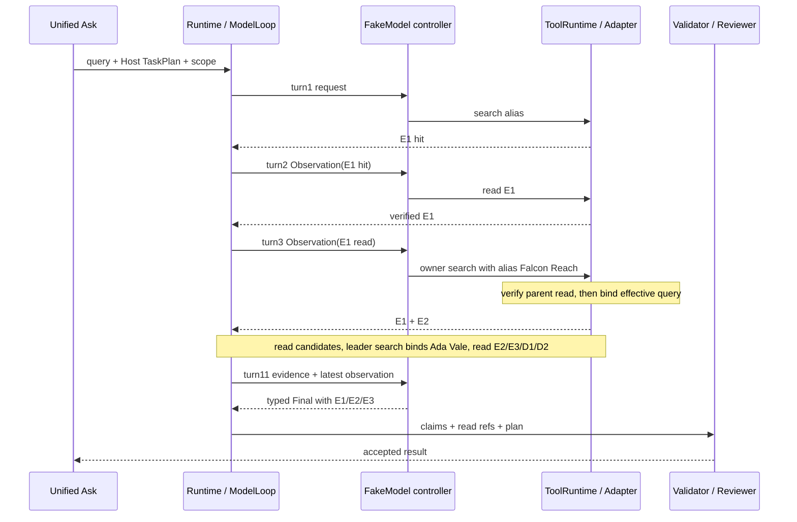

# 三跳实验：Falcon Reach 怎样进入下一轮

**A：本次实际通过产品 HTTP 入口运行，随后通过网页另发同一问题验证 UI。** 技术基线 `cd668f3`；`LINKLOOM_RETRIEVAL_MODE=bm25`，真实 Provider 请求 **0**。本次主Trace：UI run `ui-5577f314e4e4`，Runtime `run_p4_2ea7d27b21e3`，thread `ui-thread-f90f3bd85b3e`，review `review_3dadb670`。网页运行使用同一合成workspace，但有自己的run身份，不能把两次运行说成同一Trace。

原始材料留在 ignored `work/interview-lab/781878f951/`：`three-product.json`、`three-state.json`、`three-requests.json`、`three-runtime/`；负例用 `invented-dependency-*`。安全摘录和原文件摘要哈希见 [合成证据索引](evidence/three-hop-summary.json)。没有提交原始 Ledger/请求/Trace。

## 先固定问题、资料与实验接缝

每轮用户问题不变：`Who owns the project behind Copper Meadow and who leads that owner?`。workspace `Relations` 共9份合成来源，没有正式决策。关键三份原文都只有第1行：

| 教学简称 | 来源 | 原文（省略相同时间戳与 Synthetic 前缀） | Evidence ID前缀 |
|---|---|---|---|
| E1 | relation-2.md | Copper Meadow is the team alias for Falcon Reach. | `ev_v2_6712296b…` |
| E2 | relation-3.md | Ada Vale is the accountable owner of Falcon Reach. | `ev_v2_86b000e5…` |
| E3 | relation-4.md | Ada Vale reports directly to Owen Brook. | `ev_v2_6f4e1dab…` |
| D1 | relation-0.md | 林舟 is the accountable owner of Orion. | `ev_v2_ea77f585…` |
| D2 | relation-5.md | As of 2026-10-06 Tess Avery is the accountable owner of Mariner Field. | `ev_v2_1e2b9d3d…` |

完整ID/quote hash/内容hash/source version在安全索引，不用教学简称真正调用工具。Search可能命中无关D1/D2；它们没有进入Final引用。

接缝：[unified_investigation_fixture.py:48 · UnifiedInvestigationFixture.configure_agent](../../tests/integration/unified_investigation_fixture.py#L48) 注入 `FakeModelAdapter`，调用已有 [run_bounded_multihop.py:39 · SourceOnlyController.__call__](../../tests/integration/run_bounded_multihop.py#L39)。它从 `request.observation` 读取结果、排队Read，再用受限关系解析构造下一动作。**它是固定策略的测试控制器，证明的是执行契约，不是LLM理解或泛化能力。** Seed的语义抽取也用本地Fake，普通关系没有被偷偷物化为正式决策。

`run_bounded_multihop.run_case` 直接进入Engine，是Runtime Harness；本实验没有用它冒充统一产品入口，而是复用它的模型控制器，经真实 `/api/product/ask` 调用。

## 按真实调用顺序打开函数

1. `product.js` 的 [product.js:555 · submitAsk](../../src/linkloom/ui/static/product.js#L555) POST query/workspace/date → [server.py:191 · LinkLoomRequestHandler.do_POST](../../src/linkloom/ui/server.py#L191) → [unified_ask.py:149 · UnifiedAskService.ask](../../src/linkloom/ui/unified_ask.py#L149)。返回202，后续 GET `/api/product/ask/runs/{id}?workspace_id=…`。
2. `ask` 调 [team_decision_planner.py:187 · plan_relation_investigation](../../src/linkloom/runtime/team_decision_planner.py#L187)，`_source_request`检查句式、workspace、日期、外部授权 → [investigation.py:75 · ProductInvestigationService.start](../../src/linkloom/ui/investigation.py#L75)。后者核对plan与query精确一致，把选中source_id/version固定到临时Vault。
3. [backend.py:123 · RuntimeRunBackend._execute](../../src/linkloom/ui/backend.py#L123) 构造 `RunRequest(workflow="team_decision", task_plan=…, max_steps=12, max_provider_requests=12, final_protocol="team-decision-result/v1", planning_mode="template")` → [graph.py:444 · RuntimeEngine.start_multi_agent](../../src/linkloom/runtime/graph.py#L444)。
4. Engine → [runtime_adapter.py:751 · RuntimeAgentAdapter.run](../../src/linkloom/agents/runtime_adapter.py#L751) → [coordinator.py:49 · Coordinator.run](../../src/linkloom/agents/coordinator.py#L49) → [retrieval_agent.py:1199 · RetrievalAgent.execute](../../src/linkloom/agents/retrieval_agent.py#L1199) → [model_loop.py:583 · SingleAgentModelLoop.run](../../src/linkloom/runtime/model_loop.py#L583) → `_run_durable`。别被model_loop文件开头的历史Harness注释误导：本次已由生产RetrievalAgent实际调用它。
5. Loop组 `ModelTurnRequest`、保存request → FakeModel `decide` → `ModelAction`。`execute_tool_action`绑定run/task/agent/sequence/call身份 → [runtime.py:423 · ToolRuntime.execute](../../src/linkloom/tools/runtime.py#L423) → Adapter handler。
6. 每次ToolResult写Observation，下一轮请求带回；Final走 `_project_result`、Grounding与TaskPlan校验，然后Coordinator调用Reviewer；产品projection最后转换成网页事实链。



## TaskPlan 与每轮共同上下文

`task-plan/v2` 数据实际为：

```json
{"goal":"Who owns the project behind Copper Meadow and who leads that owner?",
 "schema_version":"task-plan/v2","subgoals":[
 {"subgoal_id":"alias","question":"Which project does Copper Meadow alias?","depends_on":[],"relation_path":["alias_of_project"]},
 {"subgoal_id":"owner","question":"Who owns {verified_entity}?","depends_on":["alias"],"relation_path":["owner_of_project"]},
 {"subgoal_id":"leader","question":"Who is the direct leader of {verified_entity}?","depends_on":["owner"],"relation_path":["reports_to"]}]}
```

[task_plan.py:49 · TaskPlan](../../src/linkloom/runtime/task_plan.py#L49) 管结构、依赖和关系合同。`plan_relation_investigation`是正则句式编译器，只复制根名Copper Meadow。模型根据已读事实选择工具、提议依赖实体；Host负责校验和生成有效查询。这不等于模型生成计划。

每轮 `user_input` 都带原问题、同一plan和source_context；available_tools为该任务允许的只读工具。Source context在本次包含 `index_path="vault_index.json"`、index SHA、schema=1、vault fingerprint `root_23b832c109c70c72`、document_count=9、fixture_id=null。Product证据workspace为独立的 `ws_35aa6005f00e472c9693b4fcbff0fb8d`，**不是root fingerprint**。

## 11轮原样压缩表

共同问题/plan如上，不逐行重复。S=Search，R=Read；H是请求中的旧tool_history条数。每个成功ToolResult都成为下一轮最新Observation，已读片段另投影进evidence_context。

| 轮 | 输入最新Observation；H | 模型动作与关键参数 | 本轮工具输出→下一轮；因果作用 |
|---:|---|---|---|
| 1 | 无；0 | S alias，`Which project does Copper Meadow alias?`，limit=2，deps={} | E1 Hit→轮2；只能发现候选 |
| 2 | S结果E1；0 | R `note_ref=E1` | 已核验E1→轮3；Falcon Reach现在可供父依赖验证 |
| 3 | R E1；1 | S owner，query仍含`{verified_entity}`，limit=2，deps={alias:Falcon Reach} | Host校验后实际查`Who owns Falcon Reach?`；返回E1,E2→轮4 |
| 4 | S结果E1,E2；2 | R E1 | 重读alias→轮5；还没读到owner，不能以E2 Hit跳过Read |
| 5 | R E1；3 | R E2 | 已核验Ada Vale负责Falcon Reach→轮6 |
| 6 | R E2；4 | S leader，query含`{verified_entity}`，limit=4，deps={owner:Ada Vale} | 实际查`Who is the direct leader of Ada Vale?`；E2,E3,D1,D2→轮7 |
| 7 | S四项；5 | R E2 | 重读owner→轮8；无新一跳 |
| 8 | R E2；6 | R E3 | Owen Brook原文核验→轮9 |
| 9 | R E3；7 | R D1 | 无关Orion关系→轮10；不进入Final |
| 10 | R D1；8 | R D2 | 无关Mariner关系→轮11；不进入Final |
| 11 | R D2；9 | Final，无Tool Call | 3项原子关系、只引E1/E2/E3→Validator/Reviewer/UI |

Read按控制器pending列表逐个执行，所以三跳不等于三轮，也不等于只Read三次。第11轮最新Observation反而是无关D2，主链仍可用，是因为先前的E1/E2/E3被保留在受限Evidence Context和持久Ledger中。该轮evidence_context包含5份去重的Read记录；Read优先，已由Read覆盖的Search投影被去重。

计数别混用：网页11个model records、10个检索工具调用；Coordinator汇总为12 steps/14 tool calls，包含Review与发布工作。这个Fake轨迹的RuntimeState实际provider_requests=0；模型轮次不等于真实Provider付费请求数。

## 关键ToolResult与Observation：沿两行源码找回灌

轮2实际Read的安全摘录（完整哈希见索引）：

```json
{"tool_id":"read_verified_note","status":"ok","value":{
 "status":"verified","evidence_id":"ev_v2_6712296b…",
 "workspace_id":"ws_35aa6005f00e472c9693b4fcbff0fb8d",
 "relative_path":"src_3847ea9928e742f9b83920694f0130ef.md",
 "line_start":1,"line_end":1,
 "quote":"[2026-10-06T10:00:00Z] Synthetic: Copper Meadow is the team alias for Falcon Reach.",
 "content_sha256":"114beae9…","quote_sha256":"114beae9…"}}
```

这是ToolResult的形状摘录；省略号不能作为真参数。`source_version`由产品snapshot映射到UI引用，不是本条Runtime ToolResult自带的字段。

打开 [model_loop.py:834 · SingleAgentModelLoop._run_durable](../../src/linkloom/runtime/model_loop.py#L834) 内 `execute_tool_action`，实际短摘录：

```python
result = self.tool_runtime.execute(call, self.policy_enforcer,
    event_sink=event_sink, ledger=ledger, checkpoint_callback=persist_ledger)
# 中间持久化ToolResult
observation = result
observation_ref = stored_observation.ref
```

再跳到同函数的 `ModelTurnRequest(...)`：

```python
observation=None if grouped_history else observation,
evidence_context=self._verified_evidence_context(
    ledger, run_id=state.run_id, task_id=task_id, agent_id=agent_id,
    before_sequence=turn.sequence,
    workspace_id=self.workspace_id or state.source.vault_root_fingerprint,
    source_fingerprint=state.source.vault_root_fingerprint,
    max_bytes=evidence_budget, audit=context_audit),
```

本FakeModel用singleton action路径，所以轮3 `observation`就是轮2的Read；其request artifact的 `observation_ref`指向turn_2/observation.json。多工具proposal路径使用 `tool_turns`成组回灌，不能把本实验的单Observation说成所有Provider唯一形态。

控制器从 `request.observation.value.quote`及已存Read解析Falcon Reach，提议 `dependency_entities={"alias":"Falcon Reach"}`。Runtime **重新**从已完成Ledger重建 [task_plan.py:424 · assess_task_plan](../../src/linkloom/runtime/task_plan.py#L424)；[runtime_adapter.py:220 · RuntimeAgentAdapter._planned_search_query](../../src/linkloom/agents/runtime_adapter.py#L220) 调 [task_plan.py:676 · verified_dependency_entities](../../src/linkloom/runtime/task_plan.py#L676)，确认它正是父关系的object，然后 [subgoal_query_strategy.py:21 · SubgoalQueryStrategy.build_queries](../../src/linkloom/retrieval_v2/subgoal_query_strategy.py#L21) 才替换占位符。不是“模型说了什么，Retriever就查什么”。

模型没有执行Python；FakeModel返回 `ModelAction`。若换Gemini，[gemini_api.py:1551 · GeminiProviderAdapter.complete](../../src/linkloom/agents/providers/gemini_api.py#L1551) 解析SDK function_call为neutral proposal/action，Loop仍负责绑定身份、执行和回灌。此Gemini适配器不在本次Fake三跳的模型接缝中。

## 伪造下一跳：实际负例

同一HTTP入口、同一资料、同一计划，在模型接缝只把owner搜索参数改成 `dependency_entities={"alias":"Invented Meridian"}`。前两轮仍真实Search/Read E1。结果：

```text
ledger sequence 3: search_notes -> failed
error.code = TOOL_INVALID_ARGUMENTS
error.details.reason = task_plan_semantic_mismatch
error.details.path = $.source_context.dependency_entities
product.status = FAILED
product.conclusions = []
reviewer.performed = false; accepted = false
```

拒绝发生在 `_planned_search_query` → `verified_dependency_entities`，被ToolRuntime规范化为错误，**在后续Retriever搜索前**就拦住了伪实体。该错误有一次狭义纠错机会；本控制器下一轮遇错误主动停止，所以总4轮，不是Runtime一看到它就绝不允许下一轮。若伪造的是Final主张，另由Grounding/Plan Validator拒绝；本次六项Recovery测试还验证了伪造partial rationale不能被接受。

## Final、Grounding、Reviewer、UI各做什么

轮11 Final实际用 `team-decision-result/v1`：`decision.value`是E1/E2/E3三项分号分隔原子关系，`decision.status="approved"`，`uncertainty.status="none"`，rationale/actions等为空。**这里approved是旧结果协议字段，绝不是正式业务审核状态**。产品事实标签为 `SOURCE_SUPPORTED`，`receipts=[]`。

[retrieval_agent.py:589 · RetrievalAgent._project_result](../../src/linkloom/agents/retrieval_agent.py#L589) 解析Final，[team_decision.py:656 · TeamDecisionResult.from_grounded_final](../../src/linkloom/agents/team_decision.py#L656) / `validate_claim_support`检查字段、Read引用和每项主张；[claim_grounding.py:715 · assess_claim_text](../../src/linkloom/agents/claim_grounding.py#L715)只拿该主张所引片段比对实体/方向/时间；[task_plan.py:614 · validate_relation_final](../../src/linkloom/runtime/task_plan.py#L614)检查计划目标与有据依赖，不能仅用合法ID“装饰”错误答案。

[coordinator.py:49 · Coordinator.run](../../src/linkloom/agents/coordinator.py#L49) 调 [reviewer_agent.py:15 · ReviewerAgent.execute](../../src/linkloom/agents/reviewer_agent.py#L15)：本次3个引用检查pass，1个subject schema检查pass，decision=`evidence_sufficient`。它没有调用企业审批人。Review后 [investigation.py:306 · ProductInvestigationService._source_relations](../../src/linkloom/ui/investigation.py#L306) 重新核来源/current version和关系链，[unified_ask.py:283 · UnifiedAskService._from_snapshot](../../src/linkloom/ui/unified_ask.py#L283)投影，`pollAsk`→`renderSourceInvestigation`展示Owen Brook、3跳、11轮、三来源。网页实测可见这些字段；没有用Mock静态截图代替运行。

## 上下文工程：记住什么，何时停

[model_adapter.py:1483 · ModelTurnRequest](../../src/linkloom/agents/model_adapter.py#L1483)包含身份、instruction、工具声明、最新Observation/previous call、provider continuation、Evidence Context、旧tool_history或tool_turns、recovery guidance。Instruction/工具定义来自Host；来源片段是待核验业务内容，不能成为指令；Memory hints可信度更低，不能作为事实引用。

[model_loop.py:275 · SingleAgentModelLoop._verified_evidence_context](../../src/linkloom/runtime/model_loop.py#L275) 按run/task/agent、Product workspace及独立source fingerprint过滤，Read优先，至多8个ToolResult、24KiB，还受user input预算约束。[model_loop.py:60 · _bounded_model_request](../../src/linkloom/runtime/model_loop.py#L60) 以96KiB约束序列化请求，先丢最旧tool_turns，再丢tool_history，保留最新Observation和已选Evidence；若仍超出就失败。**不是承诺无限保留所有历史证据**：证据自身也有数量/字节预算，裁剪审计可查。

## 自己复现与闭卷验收

只在此基线、安装已有依赖的Python环境运行：

```powershell
$env:PYTHONPATH='src;tests/integration'
$env:LINKLOOM_RETRIEVAL_MODE='bm25'
python -m pytest -q tests/integration/test_unified_investigation_flow.py
python tests/integration/run_unified_ask_demo.py --source-investigation --port 8804
```

网页选Relations后问本页问题；FakeModel不需要API key。本次主运行用以下入口（摘要伪代码，保存临时目录必须在 `stop()`前）：

```python
demo = UnifiedInvestigationFixture(local_synthetic_database)
demo.configure_agent(); wid = demo.select_workspace(RELATIONS)
status, body = request_json(demo.base_url, '/api/product/ask', method='POST',
    data={'query': THREE, 'workspace_id': wid})
_, final = poll_product_ask(demo, body['result']['agent_run_id'], wid)
# 从demo.service._jobs取backend、checkpoint、model.requests，仅用于实验观察
```

本次10项产品HTTP测试通过，包括依赖重建、来源更新失效、跨workspace访问、禁用Decision Memory读与candidate capture；本地Recovery六例通过。原始脚本留ignored `work/run_interview_lab.py`，没有改生产或正式断言。

面试官追问1：“为什么Tool History还在，却仍会丢Falcon Reach？”验收：说出不同投影、不同预算和ws/root过滤缺陷，不能只说模型记性差。

面试官追问2：“把alias依赖换成另一个原文里出现过的人名可以吗？”验收：必须是父关系正确object，不能仅仅文本出现；指到 `verified_dependency_entities` 的relation_targets检查。闭卷讲完才记为个人通过，目前未验收。
