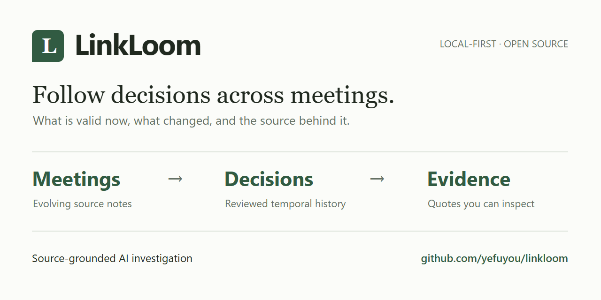

# LinkLoom 开源发布准备

状态：**素材与人工审核稿；尚未对外发布或配置仓库 Settings。** 检查日期：2026-10-25（Asia/Shanghai）。

本包只改善仓库展示、体验入口与传播准备，不增加产品功能。基线为
[`master f2ce6b82`](https://github.com/yefuyou/linkloom/commit/f2ce6b82d635a7b78b17a6d100556c354f7a461a)。
[#25](https://github.com/yefuyou/linkloom/pull/25) 检查时仍为 Open Draft，head 为
`aa3473d18b5c4542b665a88df1cfbb7dcea88ed5`，覆盖双语 README、`V1_DEMO.md` 和 UI 文案。
本分支不修改这些文件，也不修改 Runtime、评测、实验账本或其他 PR。

## 1. 访问者体验：之前与准备之后

| 目标 | 检查到的展示 | 本包交付；生效条件 |
|---|---|---|
| 10 秒理解用途 | README 的当前决定/变更/原文定位已经清楚；仓库 About 仍是 Obsidian 搜索与整理 | 保留首句；提供 3 版准确简介，由维护者配置 |
| 30 秒找到展示 | 已有 8 张 V1 浏览器截图，#25 又更新了 UI 截图，但缺少短视频 | 80 秒带字幕的截图剪辑、3 张精选截图入口、新的真实离线任务截图 |
| 3 分钟知道怎么体验 | 普通启动无密钥；完整决策摄取需 Provider；中文 master 缺少离线任务入口 | 干净环境验证；双语待应用补丁把 Quickstart 提前，并突出无密钥任务演示；不承诺安装耗时恒小于 3 分钟 |
| 理解差异 | 详细能力表和架构在 Quickstart 前，阅读较长 | 待应用补丁聚焦 3 个产品能力；报告提供可复用对比文案 |
| 找到贡献入口 | 有开发者导航和 Agent 规则，缺少面向贡献者的短入口 | 新增 [CONTRIBUTING.md](../../CONTRIBUTING.md)，补丁补充 Issues/贡献链接 |

**审计结论：首句和合成供应商场景保留。** #25 已完成的状态措辞、双语清理、权限说明不再重做。
只建议调整信息顺序、展示密度与体验入口。没有外部陌生用户计时测试；10 秒/30 秒/3 分钟是设计目标。

### 三个核心能力与产品区别

1. **恢复当前与历史决定**：查询当前值和指定日期值，保留生效时间、替代关系和来源。
2. **先审后成为事实**：提取候选与模型关系建议单独展示，人工审核才赋予相应授权；证据变化触发复核。
3. **带着原文调查**：在有界问法内读取来源、展示已核验证据与缺口；需外部模型的调查明确授权。

| 常见工具的主要入口 | LinkLoom 强调的结果 |
|---|---|
| 单场会议总结 | 跨记录保留已审核决定的有效期和替代历史 |
| 文档问答 | 区分检索命中、模型解释、已审核决定与证据过期 |
| Obsidian 关键词/语义搜索 | 从段落继续追溯当前或历史状态及其支持原文；当前是独立本地应用，不是 Obsidian 插件 |

任务场景可这样讲：第一次会议安排日志迁移，后一次记录出现新的完成日期，用户想核对任务是否延续、谁负责、哪天生效。
**现有离线样例没有负责人变更**；两条来源都写林枫，第二条原文含 `2029-06-24`，但演示提取的 deadline 字段保持 UNKNOWN。
SAME_TASK 是待确认的模型建议，不能据此宣布正式延期。完整的“批准 → 替代 → 历史查询”展示使用已经核验的
Birchline → Wrenwell 供应商样例，不把任务提案拼成获批业务事实。

## 2. GitHub Settings 建议（未应用）

### Description 候选

三版均低于 350 字符：A 168、B 173、C 154（含空格与标点）。

- **A，推荐**：`Track decisions across meetings: what is valid now, what changed, and the evidence behind it. Local-first, human-reviewed history with source-grounded AI investigation.`
- B：`A local-first assistant for cross-meeting decision tracking. Review decisions, follow their temporal history, and investigate questions against the original source evidence.`
- C：`Meetings change. Keep the decision trail: current and historical decisions, human review, and source-grounded AI investigation in a local-first workspace.`

推荐 A：先说明用户能找回什么，再说明本地、审核和调查方式。避免继续用“searches, connects, organizes”概括整个产品。
在仓库首页 About 的齿轮中人工更新 Description、Topics；不改可见性。

### Topics：推荐 8 个

| Topic | 适用依据 |
|---|---|
| `decision-tracking` | 当前/历史决定、生效时间和替代关系是主场景 |
| `meeting-notes` | 时间戳会议文本是现有示例输入 |
| `local-first` | 本地 SQLite 与来源副本；外部模型调用另行 opt-in |
| `knowledge-management` | 面向演进的团队来源与证据 |
| `ai-agent` | 有界只读调查、工具执行与结果校验 |
| `context-engineering` | 预算化上下文与可追溯证据边界 |
| `rag` | BM25/可选 dense/hybrid 检索和证据回答；不暗示所有路径都调用生成模型 |
| `obsidian` | Markdown/Obsidian 知识助手定位与读取能力；明确独立应用、无自动回写 |

不加 `meeting-transcription`、`obsidian-plugin`、`multi-agent` 等不能由当前产品体验支持的标签。

### Social Preview



[PNG](assets/social-preview.png) 为 1280×640、不透明背景；[SVG 源稿](assets/social-preview.svg)可编辑。
沿用产品 `#fbfcf9` 纸色、`#20291f` 正文、`#315b42` 绿和 Georgia 标题。
这是产品价值流程图，不是 UI 截图。无外部字体、远程素材或虚构指标。

维护者：Settings → General → Social preview → Upload an image，上传 PNG，分享前检查平台裁切和缓存。
GitHub 建议 1280×640，PNG/JPG/GIF 小于 1 MB；SVG 保留为设计源稿。
参见 [GitHub 官方说明](https://docs.github.com/en/repositories/managing-your-repositorys-settings-and-features/customizing-your-repository/customizing-your-repositorys-social-media-preview)。
当前 About/API 已读；未读取私有 Settings 页面，不能断言原来是否配置过自定义封面。

## 3. 演示、截图与 README 补丁

[80 秒 MP4](assets/linkloom-walkthrough.mp4) · [README GIF](assets/linkloom-walkthrough.gif) ·
[可编辑分镜](assets/storyboard.json) · [字幕 SRT](assets/linkloom-walkthrough.srt)

演示形式：真实浏览器截图的连续剪辑，保留操作顺序，有字幕；**不是连续操作录像，也不是新的真实模型实测**。
前半复用仓库内 V1 截图（合成供应商资料、确定性 fake provider）；任务部分为本次在 Chromium 中实际执行的
`--offline-task-demo`。两套 fixture 在切换字幕中说明，不冒充同一条已获批任务流程。
自然语言“当前供应商”走已审核状态查询；最后的任务问题才展示离线调查。完整新摄取/审批流程仍需显式 Provider 配置。

### 80 秒演示脚本

| 时间 | 画面与操作 | 中文讲解/字幕要点 |
|---|---|---|
| 0–8s | 品牌流程封面 | 跨会议找回决定、变化和支持原文。合成数据、离线响应、截图剪辑 |
| 8–18s | Sources 的三条时间戳资料 | 6 日选 Birchline，7 日只是提案，8 日明确改用 Wrenwell |
| 18–31s | 审核 replacement 的原文与日期 | 对照原文和生效日，由人批准；提取不是批准 |
| 31–44s | Decision Memory 时间线 | Wrenwell 当前有效，Birchline 仍保留在历史 |
| 44–55s | Ask 当前供应商 | 查询返回当前值、前序值和引用 |
| 55–65s | 同问法指定 10 月 7 日 | 返回当时有效的 Birchline，不被后续记录覆盖 |
| 65–75s | 切换独立任务 fixture，展开字段证据 | 对照两次会议的 owner/date 和原文；关系待确认，正式状态未确认 |
| 75–80s | 仓库与体验入口 | Python 3.11+，无密钥任务演示；完整决策提取需 Provider opt-in |

技术展示精选 3 张（点击原图，不复制已有文件）：

| 截图 | 展示价值与出处 |
|---|---|
| [决策时间线](../assets/v1/03-decision-memory.png) | 当前/被替代值、有效区间、原文；已有 V1 合成浏览器图 |
| [当前回答与引用](../assets/v1/04-ask.png) | 问题、Wrenwell、Birchline 和精确引用；已有 V1 合成浏览器图 |
| [任务字段与原文](assets/offline-task-evidence.png) | 本次 Chromium，2 条公开合成记录；展开字段证据；第二 deadline 未确认 |

#25 合并后，首页优先保留它的新 UI 截图。本视频里的 V1 画面是历史产品演示，若 UI 文案变化需要新的实时操作视频再补录。

可直接用于 README 的片段（相对仓库根目录）：

```markdown
[Watch the 80-second walkthrough](docs/launch/assets/linkloom-walkthrough.mp4)


```

### 待应用 README 方案

补丁 [readme-after-pr25.patch](readme-after-pr25.patch) **以 #25 head `aa3473d1` 为前置版本**。
保留首句、场景、授权与 Data and review，只做：展示收敛为 GIF/视频与三张图、能力收敛为三项、Quickstart 提到架构前、
补上中文无密钥任务路径与贡献入口。不要直接套用在当前 master；#25 若再更新须重新核对。

```bash
# 在 #25 已合并且工作区干净的后续分支，先检查再应用；不要在本分支改 README
git apply --check docs/launch/readme-after-pr25.patch
git apply docs/launch/readme-after-pr25.patch
```

本分支的双语 README 保持原样，Git diff 为空。补丁本身已在 #25 文件副本上进行应用检查；不修改 #25。

## 4. 陌生开发者上手验证

验证平台：Windows，Python **3.13.5**，新建 Git Worktree、新 `.venv`、独立 `work/launch/` SQLite，无 Provider Key、无 smoke SDK。
从 README 执行 `python -m venv .venv`、`python -m pip install -e .`；安装为 0.1.0，
基础依赖 PyYAML 6.0.3、rank-bm25 0.2.2、NumPy 2.5.4。`pip check` 通过。
初次沙箱 ensurepip/本地网络受限，移到获准的本地执行环境后成功；不是产品缺陷。

| 验证项 | 结果与范围 |
|---|---|
| 干净依赖安装、CLI help | 通过；不需要 Provider extra 即可导入并启动 |
| 普通无密钥启动 | 实际浏览器创建合成工作区并进入 Sources；提取未启用，符合空库行为 |
| 离线任务演示 | 实际 Chromium 提问，返回 2 条记录、partial/待确认状态、可展开的字段原文 |
| 示例预期 | 第一 deadline `2029-06-20`，第二 deadline Not established；两条 owner 林枫；不声称正式延期 |
| 完整决策摄取/审核/历史查询 | 本次未新跑付费 Provider；复用既有合成浏览器证据，不冒充新的端到端实测 |
| Windows 命令 | 虚拟环境的 `Scripts/python.exe`、相对 database 路径和任务开关已执行；激活的 PowerShell 路径语法已核对 |
| macOS/Linux 命令 | `python3`、`.venv/bin/python`、`source .venv/bin/activate` 与 bash export 已静态核对；本机没有原生 macOS/Linux 执行证据 |
| 聚焦离线检查 | 28 项均有通过证据：首次 23 项通过，5 项因 Windows 子进程编码失败；设置 CI 已有的 `PYTHONUTF8=1` 后只复查这 5 项，全部通过 |

最快的无密钥体验（先停止占用同一端口的服务；不必激活环境）：

```powershell
# Windows / PowerShell
git clone https://github.com/yefuyou/linkloom.git
cd linkloom
python -m venv .venv
.\.venv\Scripts\python.exe -m pip install -e .
.\.venv\Scripts\python.exe -m linkloom.ui --port 8765 --database work/task-demo.sqlite --offline-task-demo
```

```bash
# macOS / Linux；静态核对，未在本机执行
git clone https://github.com/yefuyou/linkloom.git
cd linkloom
python3 -m venv .venv
.venv/bin/python -m pip install -e .
.venv/bin/python -m linkloom.ui --port 8765 --database work/task-demo.sqlite --offline-task-demo
```

打开 `http://127.0.0.1:8765/` → Ask → **Tasks across the current workspace records** → 输入：
“Do these meetings describe the same task, and what changed about its deadline?” → Ask → 展开 **Field evidence and original message**。
离线响应是固定样例，不证明任意问题的理解能力。普通无密钥空库与完整付费摄取是不同体验；不要在宣传中混用。
无需为离线演示安装 retrieval/smoke 扩展。实时来源关系调查的 BM25/embedding 依赖保持 README 原有说明。

## 5. 中文发布文章（人工审核稿）

### 做了一个跨会议追踪决策变化的开源 AI Agent：LinkLoom

会议总结通常能告诉我“这次说了什么”，但一个决定往往分散在几次会议里：先选一个方案，过几天讨论替代项，之后才明确修改。
再次提问时，我需要的不只是最新的一段文字，还想知道当前批准的是什么、何时生效、之前是什么，以及原文在哪里。

所以我做了 LinkLoom，一个本地运行的开源团队知识助手，把人工审核的决策历史与只读 AI 调查放在一起。

仓库里有一个完全合成的场景：10 月 6 日决定选择 Birchline，7 日有人提议 Kestrel Ledger，但没有批准；
8 日明确决定改用 Wrenwell。导入后，先检查候选的原文和日期，再由人批准。随后查询当前供应商会看到 Wrenwell；
把日期设为 7 日，则可以找回当时有效的 Birchline。提案不会仅因模型提取出来就变成正式决定。

另一个无密钥任务样例更接近日常协作：两次会议提到日志迁移与不同日期，用户问“是不是同一任务，截止日期改了吗？”
界面会分别展示负责人、日期字段和原文，把模型关系建议标为待确认。现有样例的第二条 deadline 字段仍未确认，
因此不会给出“任务已经正式延期”的结论。它演示的是对照记录与保留疑点，而不是替人做业务批准。

工程上最有代表性的三个选择是：把有效时间和替代关系存进决策模型；把原文版本和精确引用绑定起来；
把候选、模型解释与人工批准分开。来源变更后，旧证据会触发复核。Agent 调查有明确的工具、范围与预算边界，回答同时保留证据缺口。

代码和状态保存在本地。普通启动和离线任务演示不需要密钥；启用外部模型的提取/调查会发送来源文本，可能产生费用，需明确授权。
当前是本地应用，不承诺任意会议格式的准确率，也没有真实知识库自动回写。

想体验可以看仓库的 Quickstart，运行 `--offline-task-demo`，按演示问题查看两条记录与字段证据。
80 秒演示使用合成资料和离线响应。欢迎反馈第一次运行的阻碍、难以理解的状态，或提交一个可公开的最小复现。

GitHub：[yefuyou/linkloom](https://github.com/yefuyou/linkloom)。
发布时附上本报告中的视频或三张精选截图，并链接 [贡献指南](../../CONTRIBUTING.md)。

## 6. 英文发布素材（人工审核稿）

### LinkedIn

I've been building LinkLoom, a local-first tool for following decisions across meeting notes.
It helps recover what is valid now, what changed, and the original evidence behind it.
Reviewed decisions have temporal history; AI extraction and relationship suggestions stay separate from approval.

The repository includes synthetic examples and a no-key offline task demo. The short walkthrough uses preset offline responses.
External-model extraction and investigation require explicit opt-in. I'd welcome feedback on the first-run experience and how clearly the evidence is presented.

[Code and quickstart](https://github.com/yefuyou/linkloom).

### GitHub Release Notes（不新建 Tag 或 Release）

**LinkLoom — cross-meeting decision history and evidence**

- Import meeting sources, review decision candidates, and retain effective dates and supersession history.
- Query current or historical reviewed decisions with source passages.
- Inspect task records, owner/date evidence, unconfirmed relationship suggestions and missing prerequisites in a no-key offline demo.
- Run locally; enable external-model extraction and investigation only with explicit permission.

Start with the [README](https://github.com/yefuyou/linkloom#quickstart) and the synthetic examples.
The launch walkthrough uses offline responses. This is a local application; these examples do not establish general model accuracy or production readiness.

这是对已有能力的发布介绍，不声称本 PR 新实现这些功能。版本号与发布日期由维护者选定；已有
[V1 Release 草稿](../V1_RELEASE_NOTES_DRAFT.md)中的历史测试数和限制不直接复制为本次验收。

### Show HN 候选

**Title:** Show HN: LinkLoom – Track decisions across meetings with source evidence

**URL:** https://github.com/yefuyou/linkloom

**Author comment:** I built LinkLoom because finding the latest matching paragraph wasn't enough when meeting decisions changed over time.
It keeps reviewed decisions, effective dates, supersession history and source passages together.
The local UI also supports bounded read-only investigation, with model suggestions kept separate from approved facts.
Python 3.11+ is required. You can try the synthetic offline task demo without an API key or account;
full source extraction requires an explicitly enabled external provider. The walkthrough uses offline responses.
I'm interested in feedback on the workflow and on where the evidence/status distinction is unclear.

发布前检查：

- [ ] #25 与本包已进入将要分享的主线，README 的命令/媒体链接可用。
- [ ] 在另一台机器完成 no-key task demo；当前只有 Windows 实测，macOS/Linux 待补。
- [ ] 仓库首页能找到示例提问、离线响应说明、完整提取的权限/费用边界。
- [ ] 确认 [Show HN 规则](https://news.ycombinator.com/showhn.html)与[账户提交限制](https://news.ycombinator.com/showlim)，不要拉票或只发文章链接。
- [ ] 作者能在发布后回复实际问题；不把 GitHub 流量变化归因成未经验证的转化。

## 7. 技术短文（可独立复制，历史实验）

### How we improved evidence coverage in a bounded Agent context

Retrieving the right passage is only the first step. A bounded Agent context can still omit a second hop or the opposing evidence that makes an answer defensible.
In LinkLoom's historical M3-C experiment, we compared context selection strategies instead of assuming that a larger window would solve the problem.

The baseline took a fixed top-five prefix before testing whether each item fit. An oversized early passage could consume a candidate slot while smaller useful passages later in the list were never considered.
Its `ceil(len(text) / 4)` token estimate also substantially underestimated Chinese text. The audit separated retrieval loss, context assembly loss, tool-history eviction and final request trimming.

We ran three strategies on the same eight synthetic scenarios. A used the frozen legacy caps: five items, 12,000 characters and 3,000 estimated tokens.
B doubled those caps. C kept the original local caps while combining bounded candidate inspection, fit-before-selection, atomic evidence groups,
multilingual token estimates, request reservations, guarded fake-model compaction and explicit source recovery.
This was a strategy-bundle comparison, not an ablation that identifies the contribution of each component.

| Observed metric | A: legacy | B: larger caps | C: bounded selection |
|---|---:|---:|---:|
| Required evidence covered | 1/17 | 4/17 | 15/17 |
| Complete subgoals | 0/16 | 3/16 | 14/16 |
| Counterevidence retained | 0/2 | 0/2 | 2/2 |
| Rendered reference tokens, aggregate | 52,119 | 67,749 | 3,385 |

The paired fixtures covered multi-hop chains, separated passages, conflicts, revisions, distractors, long histories and changed/deleted sources.
Gold was read after strategy outputs had been produced. Selection received caller-declared subgoals and evidence-group hints, not answer labels.
C restored two of four requested sources; invalidated or deleted sources stayed incomplete rather than being replaced silently with a summary.

The useful engineering lesson is narrow: in these fixtures, preserving complete evidence groups and checking fit improved coverage more than doubling caps.
The token totals describe rendered experimental context, not provider billing or the complete production request. Counts used `tiktoken 0.12.0`, `cl100k_base`;
they are not Gemini/DeepSeek token counts. C still underestimated some identifier-heavy text, so a target-model tokenizer matters when enforcing hard limits.

This was a synthetic mechanism experiment with fake compaction, not an Agent reasoning benchmark or a product accuracy score.
It depended on declared groups and could not discover an undeclared contradiction. The experiment was on a historical branch; its files are absent from this launch's master baseline.
Later integration needs its own evidence. No new evaluation was run for this article.

Sources pinned to experiment commit `9520362261f8f850191c0fa82f04bdc6452ddc05`, compared with baseline `26392432dcef70692461e6f2f50bc1bd5528f69a`:
[audit](https://raw.githubusercontent.com/yefuyou/linkloom/9520362261f8f850191c0fa82f04bdc6452ddc05/docs/requirements/m3-context-engineering/AUDIT.md),
[recorded experiment](https://raw.githubusercontent.com/yefuyou/linkloom/9520362261f8f850191c0fa82f04bdc6452ddc05/docs/requirements/m3-context-engineering/experiment.json),
[runner](https://raw.githubusercontent.com/yefuyou/linkloom/9520362261f8f850191c0fa82f04bdc6452ddc05/benchmarks/context_engineering/run.py),
[delivery and limitations](https://raw.githubusercontent.com/yefuyou/linkloom/9520362261f8f850191c0fa82f04bdc6452ddc05/docs/requirements/m3-context-engineering/DELIVERY.md),
[independent review](https://raw.githubusercontent.com/yefuyou/linkloom/9520362261f8f850191c0fa82f04bdc6452ddc05/docs/requirements/m3-context-engineering/REVIEW.md).

## 8. 外部渠道筛选（仅候选，不投稿）

规则核对日期：2026-10-25。规则可能更新，提交前回看链接。优先投入实际体验反馈，目录收录其次。

| 渠道/链接 | 关联、投稿要求与自荐 | 推荐形式 | 优先级 |
|---|---|---|---|
| [V2EX 分享创造](https://www.v2ex.com/go/create) | 适合独立作品；允许展示自己的项目，准确选节点，避免刷屏；商业推广用推广节点。[节点说明](https://www.v2ex.com/help/node) | 中文项目帖 + 截图/离线体验 + 具体反馈问题 | P1 |
| [Obsidian Share & showcase](https://forum.obsidian.md/c/share-showcase/9) | Markdown/知识管理相关；[社区准则](https://obsidian.md/help/community-code-of-conduct)反对仅自荐、不参与社区；有条件分享，非插件不可投插件列表 | 实际工作流、公开合成资料、独立应用定位与权限边界；先参与讨论 | P1，已有社区参与时 |
| [掘金](https://juejin.cn/) | 原创技术经验；[用户协议](https://lf3-cdn-tos.draftstatic.com/obj/ies-hotsoon-draft/juejin/86857833-55f6-4d9e-9897-45cfe9a42be4.html)限制广告/垃圾内容，账号发布要求现场确认；自荐须以实质技术内容为主 | Context 实验短文或工程复盘，文末附仓库 | P2 |
| [Show HN](https://news.ycombinator.com/showhn.html) | 作者展示可运行作品，最好无注册门槛；允许自荐，须符合[提交限制](https://news.ycombinator.com/showlim)；不接受只有文章/landing page | 仓库 URL + 离线命令 + 作者说明；完成可试用清单后再发 | P2，条件性 |
| [awesome-second-brain](https://github.com/Mindola-ai/awesome-second-brain) | PKM/second brain 工具；[贡献规则](https://github.com/Mindola-ai/awesome-second-brain/blob/main/CONTRIBUTING.md)要求实际可用、官方链接、中性短描述、格式/顺序/标签；接受相关项目贡献，维护者审核 | 单条工具介绍，按当前分类和格式，非批量 PR | P2 |
| [awesome-obsidian](https://github.com/kmaasrud/awesome-obsidian) | 仅在外部工具分类适配时；[贡献规则](https://github.com/kmaasrud/awesome-obsidian/blob/master/CONTRIBUTING.md)要求相关性与现有格式；可提 PR，是否收录由维护者决定 | 中性一句话，明确非插件；投稿前检查维护状态 | P3 |

目录候选文案：`LinkLoom — Local-first cross-meeting decision history with human review and source-linked evidence.`
未验证账号资格或完成投稿；不承诺能收录。排除把 LinkLoom 当转录服务、Obsidian 插件或托管 SaaS 的目录。

## 9. GitHub Profile 草稿与置顶建议

只准备草稿，不修改 `yefuyou/yefuyou`。核验公开贡献链接，区分自己的项目与外部贡献：

```markdown
# Hi, I'm yefuyou

I build practical AI agents with explicit evidence, observable execution, and clear user controls.

## Project

- [LinkLoom](https://github.com/yefuyou/linkloom) — Local-first cross-meeting decision history, human review, and source-grounded investigation. Includes a no-key offline demo.

## Open source contributions

- [PR-Agent](https://github.com/The-PR-Agent/pr-agent) — [Review-coverage visibility for large PRs](https://github.com/The-PR-Agent/pr-agent/pull/2589).
- [ANOLISA / AgentSight](https://github.com/agentic-os-org/ANOLISA) — [LLM latency and throughput metrics](https://github.com/agentic-os-org/ANOLISA/pull/2578).
- [Qwen Code](https://github.com/QwenLM/qwen-code) — [Windows file links in session exports](https://github.com/QwenLM/qwen-code/pull/8953).

I'm interested in reliable Agent workflows, evidence coverage, and developer tooling.
```

以上三个外部 PR 已独立核对合并状态；不暗示维护上游或拥有上游项目。无工作单位、内部业务或私人信息。

维护者进入 GitHub Profile → Customize your pins，优先置顶 LinkLoom，再选择有贡献资格的 PR-Agent、ANOLISA、Qwen Code。
GitHub 支持最多 6 个项目；上游不出现在可选列表时，用 Profile README 的贡献链接，不冒充自己的仓库。
资格/操作参见 [GitHub profile reference](https://docs.github.com/en/account-and-profile/reference/profile-reference)与
[pinning items](https://docs.github.com/en/account-and-profile/how-tos/profile-customization/pinning-items-to-your-profile)。

## 10. 曝光追踪：只记真实数据

[GitHub API 原始快照](github-baseline.json) · [推广追踪表 CSV](promotion-tracker.csv) ·
[仓库 Traffic](https://github.com/yefuyou/linkloom/graphs/traffic)

当前读取到的 14 天 API 汇总：**9 views / 3 unique visitors、700 clones / 239 unique cloners、Stars 0**；来源网站返回空数组。
当前 open Issues 为 **0（排除 PR）**。这是 GitHub 返回值，不是本次推广的效果；内部自动化或重复 clone 可能影响计数，不能将 clone 当成真实用户。
来源空数组不表示来源访问为零。Issues 使用不含 PR 的真实快照数量；尚无本次发布反馈。

每次人工发布在 CSV 新增一行，写实际日期、渠道、帖子 URL。发布前、D+1、D+7 读取 Traffic，保存时间戳和窗口，
记录 Stars 差值与真实 Issue/反馈链接。Unique visitors 是窗口去重，**不能相加每日 uniques**，不同滚动窗口也不能直接相减为渠道新增用户。
来源数据不能证明因果归因；留空未知项，不填估算。日期字段区分本地发布日期和 GitHub UTC 统计日。

手动只读命令（需有仓库流量权限，不打印认证信息）：

```bash
gh api repos/yefuyou/linkloom/traffic/views
gh api repos/yefuyou/linkloom/traffic/clones
gh api repos/yefuyou/linkloom/traffic/popular/referrers
gh api repos/yefuyou/linkloom --jq '.stargazers_count'
gh api 'repos/yefuyou/linkloom/issues?state=open&per_page=100' --jq '[.[] | select(has("pull_request") | not) | .number]'
```

需超过 100 条时分页。流量滚动窗口为近 14 天，使用 UTC，建议定期人工留存，不能回填不存在的历史。
参见 [GitHub traffic](https://docs.github.com/en/repositories/viewing-activity-and-data-for-your-repository/viewing-traffic-to-a-repository)
及 [Traffic API](https://docs.github.com/en/rest/metrics/traffic)。本包没有设置监控或自动推广。

## 11. 文件、验证与人工操作

实际新增文件集中在 `docs/launch/`，另有根目录 `CONTRIBUTING.md`：本报告、待应用 README 补丁、真实统计 JSON、CSV 追踪表、
SVG/PNG 封面、任务浏览器图、分镜、SRT、MP4、GIF。既有 V1 截图直接引用；README、`V1_DEMO.md`、产品源代码和实验资料没有修改。
本地虚拟环境、安装/浏览器记录和中间帧保留于忽略的 `.venv/`、`work/launch/`，不进入 PR。

最终验证摘要见 [verification.json](verification.json)：

- 全新 `.venv` 的基础安装与 `pip check` 通过；真实 Chromium 完成无密钥建工作区、离线任务提问与字段证据展开。
- `test_ui_demo.py`、`test_m3p_product_review.py`、`test_ui_http_server.py` 共 28 项：首次 23 passed / 5 failed，失败均为子进程输出非 UTF-8 导致 `json.loads(None)`；启用 `PYTHONUTF8=1` 后对这 5 项定向复查，5 passed。不是一次完整的全绿运行，也不代表全仓库测试或 CI 通过。
- 尝试 `test_temporal_product_http_lifecycle.py` 时，干净 dev 环境缺少 `httpx`，在收集阶段停止；未为此安装新产品依赖、未把它计入通过项。贡献指南给出只需 dev extra 的已验证检查集。
- README 补丁在 #25 文件副本上 `git apply --check`、实际应用与预期内容比较通过（按 Git 的 Windows 换行处理）；原 README/V1_DEMO、源代码、测试和实验资料未改。
- 封面 PNG 为 1280×640 / 62,605 bytes；在 900px/360px 缩放检查。MP4 为 H.264、1280×720、80 秒；GIF 为 8 个分镜、总时长 80 秒，字幕与分镜一致。检查全部静态分镜与 GIF 帧；这属于素材验收，不是 Provider 性能测试。
- 历史 Context 文章的 5 个源文件经**无认证** raw.githubusercontent.com 请求均 HTTP 200，内容与本地指定 Git blob 完全一致；对应 SHA-256 记录于 verification.json。公开来源可审计，未发起新实验。
- 公开贡献 PR 的作者均为 yefuyou，状态均 MERGED。报告内渠道规则链接经过只读核对；账号发布资格仍由维护者现场确认。
- 独立只读审查完成：初审提出公开实验来源可访问性、失败记录披露两项必修问题；修正后定向复核无遗留发布准备阻塞项。

验证使用项目内独立 `work/linkloom-open-source-launch`，分支 `codex/linkloom-open-source-launch`。桌面工具首次创建时尚未完成挂载，故使用原生 Git 在项目内完成验证；桌面托管检出随后完成注册，两份检出均保留。

| 人工待办 | 原因 |
|---|---|
| 审阅并推进 #25；合并后重新检查本包 README 补丁 | 避免覆盖文案/UI 清理，当前分支不处理其他 PR |
| 设置 About/Topics、上传 Social Preview | 用户要求额外授权前不改远端 Settings |
| 在 macOS/Linux 或第二台机器验证 no-key 路径 | 当前实测环境为 Windows；本包不伪称跨平台实测 |
| 选择 Release 版本、发布渠道与时间并审核稿件 | 本次只准备稿件，不创建 Release、发帖或操作社交账号 |
| 人工更新 Profile README 与置顶 | 本次只准备草稿 |
| 若需要完整实时决策录屏，另行授权 Provider 成本 | 本次禁止真实付费 Provider；已有图和本次离线浏览器路径已可展示 |

按投入/收益排序的下一步：

1. **5–10 分钟，高收益**：审核推荐 Description、8 个 Topics 和封面后人工配置，立刻修正 About 的产品定位。
2. **15–30 分钟，高收益**：#25 合并后检查应用补丁；用新访问者路径核对视频、离线问题与贡献链接。
3. **15–30 分钟，高收益**：找另一位开发者/另一台机器完整跑 no-key 演示，记录真实阻碍；不先增加产品功能。
4. **30–60 分钟，中高收益**：选一个中文开发者社区首发，附素材，留出回复问题时间；记录发布前与后续真实统计。
5. **30–60 分钟，中收益**：用 Context 文章解释实际工程取舍，再考虑 Show HN 与相关 Awesome List；逐个看规则、不批量投递。

验收判断：发布准备包可供一次人工审核推广；公开仓库首页生效、跨平台实测、Settings、正式 Release 和外部发布仍需上述步骤。
本次提交、推送与 Draft PR 仅针对 `codex/linkloom-open-source-launch`，不合并 master、不改写历史。
