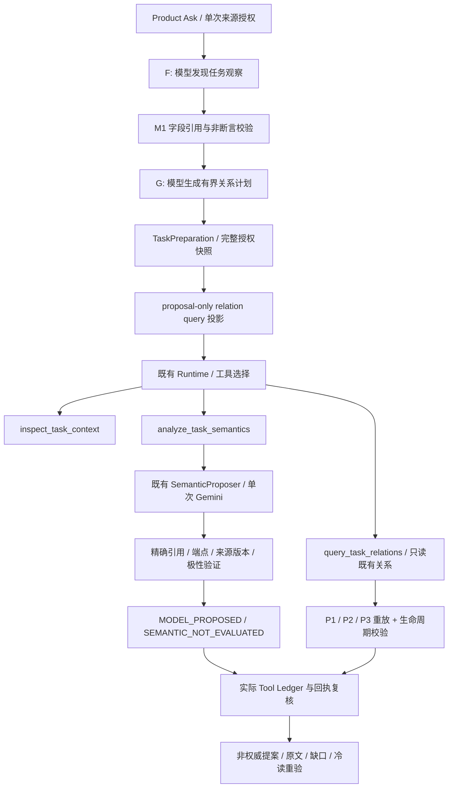

# M3-R 路径审计

基线：`224d2d8df64f7b209c446ff04359733d95619af3`。没有合并旧语义分支。
本次功能边界来自用户提供的 M3-R SPEC，主 Agent 实施；Planner 与最终 Reviewer 均只读。

## r8 为什么没有语义请求

`preparation/planning-1.json` 的 step_4 SAME_TASK、step_5 REVISES_PLAN 已有端点，且都带
`source_handles=[source_0:1, source_1:1]`。step_6 是依赖它们的日期比较。

`ui/task_investigation._proposal_queries()` 原来只接受 `not step.source_handles`，并复用
`InvestigationStep.to_semantic_query()`；后者主动拒绝 source-scoped relation。
结果 queries 为空，`semantic=None`。`register_task_relation_tools()` 没有注册语义工具，
Runtime 的 `semantic_analysis_enabled` 为 false。实际 ledger 只有 inspect/query；
`SEMANTIC_PROPOSAL_CONSUMER_NOT_CONNECTED` 是 Host 过滤结果，并非模型拒绝或模型能力失败。

现在只增加 `to_semantic_proposal_query()`：来源句柄是完整授权快照内的候选线索；
时间范围仍不支持。原 `to_semantic_query()` 及 `TaskRelationTools._investigation_steps()`
对 source/time scope 的 P4 阻断保留。关系问题存在且语义工具已注册时，Prompt 提醒模型
不能因 P4 为空跳过候选调查；无候选时不创建 SemanticAnalysis，也没有额外 Provider 请求。

## 语义和确定性职责

| 入口 | 责任与当前限制 |
| --- | --- |
| `prepare_task_investigation` 的 F / G | LLM 发现、规划；F 的字段引用、非断言 veto 和预算仍可能留下 partial 观察 |
| `task_relation_candidates.discover_candidates` | 旧候选词法排序/提示；Product SemanticContext 直接包含 F 的 valid+partial 观察与全部已授权源 spans，不以旧候选命中作为语义准入 |
| `SemanticProposer.propose` | LLM 解释 SAME_TASK、REVISES_PLAN、AFFECTED_BY 等语义，必须使用已有端点/引用句柄；没有新判定器 |
| `context_errors` / `validate_proposals` | 只检查范围、身份、版本、原文、端点类型、方向、输出结构与正反证极性；不调用旧业务 assessor |
| P1 `assess_same_task` | 旧固定句式身份证明；新候选层不以其 SUPPORTED 为前提 |
| P2 `assess_relation` / `task_work_proofs` | 旧项目、关联、影响证明；仍服务已有关系证明与兼容路径 |
| P3 `assess_plan_revision` / `compare_revision` | 旧有限修订语法与可信日期证明；仍服务 P4 重放，不覆盖新模型 verdict |
| `RelationQuery._ReadSnapshot.replay` | 读取并重验已有 P4 关系、撤回、冲突和当前性；无模型提案写入 |
| `review_task_relation_result` | 复核真实调用产物与证据绑定；accepted 不表示语义或正式业务确认 |

编号、日期、句柄、路径和引用偏移的正则继续保留；没有新增中文业务正则或样例特判。
F 若漏召回任务端点，语义模型仍无法凭空创建端点；授权来源正文和反证 spans 会保留，
但这不等于已经证明全局召回。缺失来源或截断必须保持 UNKNOWN/显式 gap。

## 对照与正式权威

旧分支的核心 SemanticProposer/Models 与 M3-Q 相同；SemanticAnalysis 与 Validator 已有
M3-Q 接线和极性增量，不能整体合并覆盖。旧 P1 相比 `d085240f0`、P3 相比 `af001a4d9`
内容未变；本轮没有修改这些模块。`task_work_proofs` 历史只有一行导出增量。

`evidence/legacy-control.json` 在相同新来源上实际执行旧 assessor，显示旧身份门槛的
UNKNOWN / PROJECT_SCOPE_UNKNOWN 及 P3 的 SAME_TASK_NOT_SUPPORTED；同样来源的真实
LLM 候选可以输出 SUPPORTED、REFUTED、CONFLICT，并通过精确引用校验。
该对照不降低 P4 门槛，也不计入普遍准确率。

| 层 | 本轮实际状态 |
| --- | --- |
| MODEL_PROPOSED | 真实 Gemini 已产生关系及正反证 |
| EVIDENCE_VALIDATED | 通过精确引用/端点/版本者可以展示；失败者仅展示不确定 metadata，不展示未经核验的引用 |
| SEMANTIC_REVIEWED | 尚未建立独立语义裁决合同，继续 `SEMANTIC_NOT_EVALUATED` |
| AUTHORIZED_RELATION | 未接通；没有可认证任务关系审核身份、授权收据及撤销合同，不伪造人工批准 |

现有 Decision Memory 的人工审核针对另一种决策数据模型，不能借用为任意任务关系批准。
本轮没有新增关系库、审批平台、Planner 或 Runtime。
