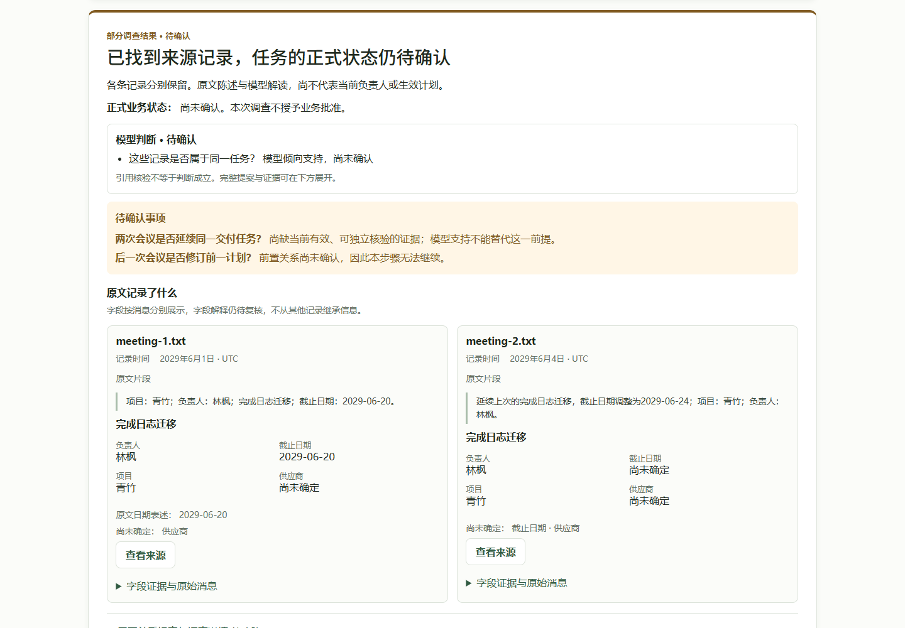
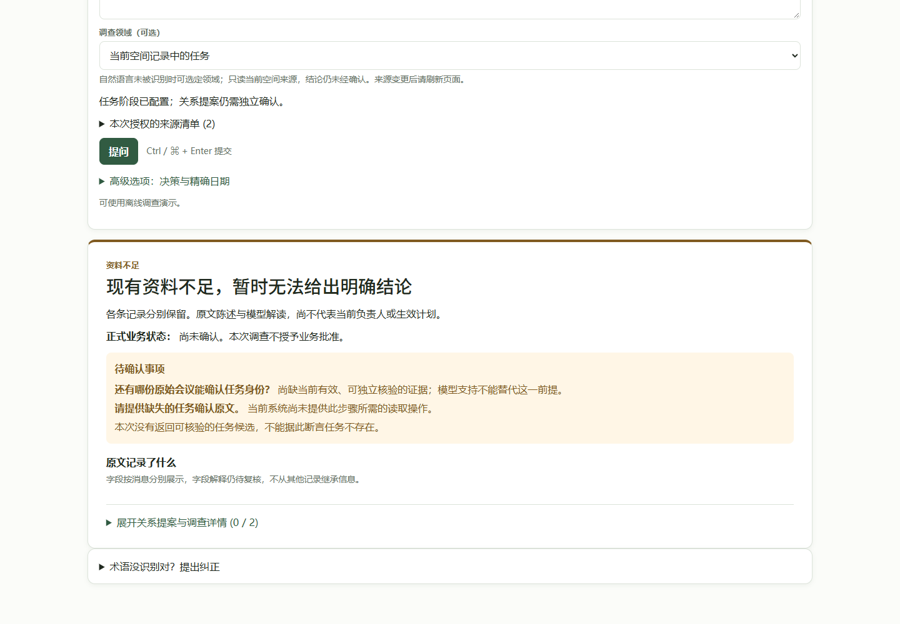
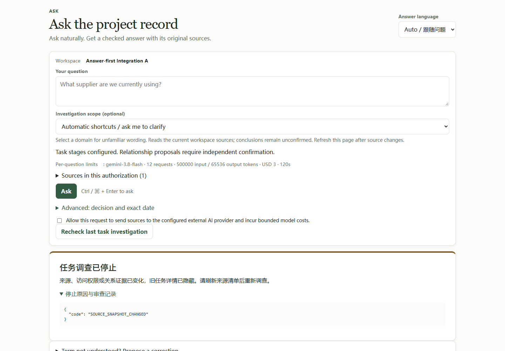
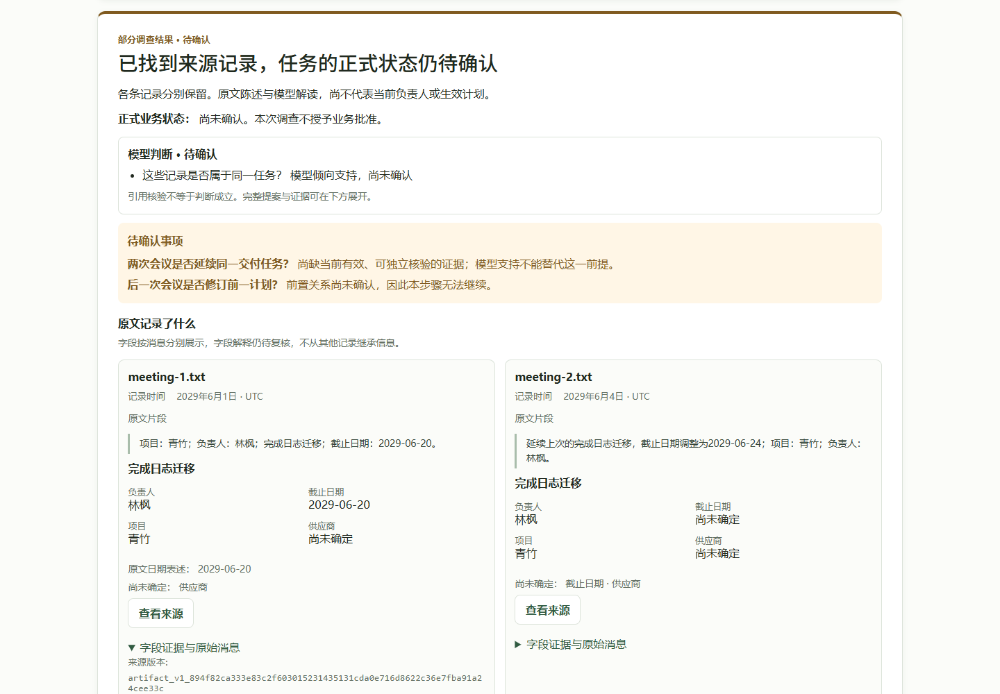
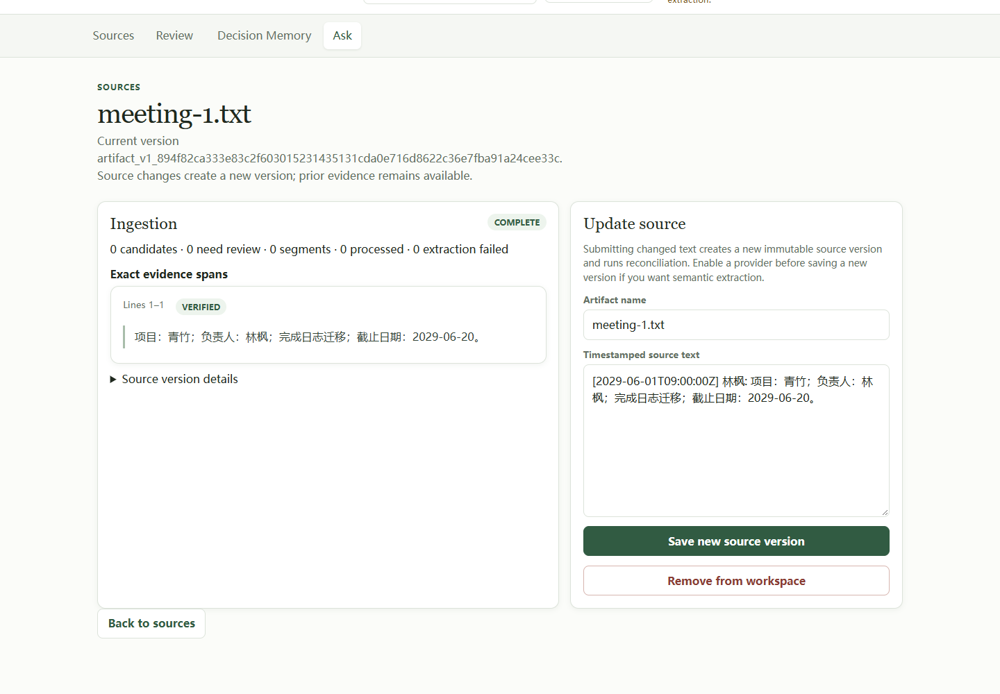
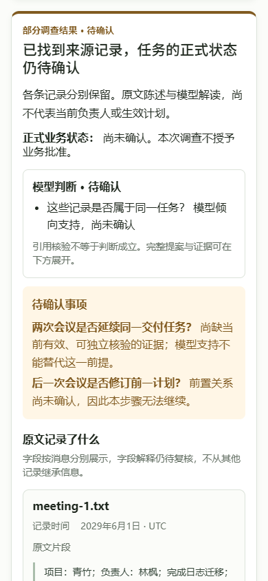

# M3-D + Answer-first integration — 2026-10-22

Governing boundary: [SPEC](SPEC.md). Branch:
`codex/m3d-answer-first-integration`. Target:
`codex/m3s1-s2-combined-acceptance` (PR #13 remains OPEN at verification).

## Increment and architecture

- Fixed M3-D: `33390e2eeaad71d215e279b2f724cae672ea4f80`.
- Original UI: `94e52027fb97bde0d28fb003c7bab189975fb047`, whose parent and
  merge-base with M3-D are M3-S `bde9d9e2b88c2e69132cf48d1534dc28d4fca764`.
  Exactly one UI commit is unique relative to M3-D.
- Normal, conflict-free cherry-pick:
  `b7134ae0d1881b77d69cf72298cc652072fb3617`; its parent is the fixed M3-D SHA.
  Stable patch IDs match. [Integration checks](evidence/integration-checks.json)
  record this and SHA256 hashes of the five production files.
- One necessary revalidation compatibility patch follows the unchanged UI
  cherry-pick. Independent review reproduced a pending-fetch disclosure: clicking
  Recheck retained old source fields until the server returned BLOCKED. The
  `reopen-task` handler now calls the existing `invalidateAsk()` before polling,
  clearing the result/state and advancing its view token. No new state or policy
  was introduced. The other four UI production files remain identical to fixed
  UI. No F, G, TaskResult projection, Runtime, Reviewer, Provider or persistence
  code changed.
- The follow-up also contains fresh evidence/reproduction harnesses and four CI
  lines: renderer syntax, Answer-first DOM, Answer-first HTTP and M3-D combined
  HTTP tests. It introduces no second product feature.

The original UI's DELIVERY and screenshots were preserved by cherry-pick as
historical artifacts. Every result below was generated in this new worktree.

## New verification

| Check | Result / evidence |
| --- | --- |
| Focused automatic regression | **162 unique PASS, 0 unresolved failures/errors/skips**. [Reconciled record](evidence/regression-final.json) identifies each test's successful receipt. |
| Answer-first HTTP | All 4 cases pass: PARTIAL, UNKNOWN + conflict gap, explicit model CONFLICT, UNKNOWN. Static script ordering, MIME, CSP and saved TaskResult equality pass. |
| M3-D combination | A/B/C and their cold reads pass. C retains UNKNOWN discovery receipt, one replan, original IDs/dependencies/source bindings, blocked dependent read and completed independent inspection; request input remains bounded and discover cannot repeat. |
| Related regression | F v3 recall/field binding, result projection, semantic/P4 projection, offline permissions, planner/context, polarity, ambiguous S1 Runtime, execution failures, M3-P review/ledger/source authority and unified Ask pass. |
| DOM and syntax | task_answer, unified_ask, first_use, stale_revalidation and both Product JS syntax checks pass. See [transcript](evidence/dom.txt). |
| Pending revalidation patch | [DOM RED](evidence/pending-red.txt) and [real Chromium RED](evidence/pending-browser-red.json) reproduce the stale waiting state. [DOM GREEN](evidence/pending-green.txt) and [final Chromium GREEN](evidence/pending-browser-green.json) verify immediate invalidation, no revival via language changes, and delayed real HTTP after source update/revocation. |
| Real Chromium | **8/8**, Chrome **155.0.8059.85**, normal Product HTTP and Ask form, public synthetic sources, real Host/Runtime/Reviewer, scripted model transport. [Summary](evidence/chromium-summary.json), [browser validation](evidence/browser-validation.json). |
| Source integrity | Each returned observation is checked against the source HTTP response: full-content SHA256, immutable source version, provenance quote hash and exact offsets, plus each field's exact source slice. Full receipts are in browser-*.json. Source buttons open the matching original content. |
| Layout | 1440 × 1000 desktop and 390 × 844 mobile have no horizontal overflow. Chinese/English labels and collapsed/expanded evidence pass. Screenshots were visually inspected. |
| Workflow / whitespace | Existing workflow YAML parses (4 jobs); `git diff --check` passes. New checks are included in the existing offline workflow. |

The first setup attempt failed before product execution because the pytest
temporary parent directory did not yet exist. The next sandbox run passed 117
tests but could not connect to localhost (`WinError 10013`), affecting 45 HTTP
cases. The authorized localhost reruns passed 28 and then the remaining 17
cases; reconciliation uses test identity, not the sum of overlapping batches.
The initial receipts are preserved: [setup](evidence/initial-setup-error.xml),
[sandbox](evidence/regression.xml), [HTTP retry](evidence/http-retry.xml),
[remaining HTTP](evidence/http-remaining.xml). These failures did not cause any
production-code or expected-result change.

## Product, authority and safety

| Scenario | Fresh receipt and result |
| --- | --- |
| A: source-confirmed fields | [browser-A.json](evidence/browser-A.json): F task-recall/v3 returns 乔雨 / 2037-08-19, shown beside the exact original source. Business state remains unconfirmed. |
| B: fields UNKNOWN | [browser-B.json](evidence/browser-B.json): the work observation survives, owner/deadline remain explicitly 尚未确定. PARTIAL is retained. |
| C: bounded replan | [browser-C.json](evidence/browser-C.json): no new confirmation is found; UNKNOWN does not establish absence, dependent inspection stays blocked, independent reads execute. |
| Model SUPPORTED | [browser-partial.json](evidence/browser-partial.json): “模型倾向支持，尚未确认”; checked citations and Reviewer acceptance do not approve identity/revision or make a date effective. Separate records retain separate fields. |
| UNKNOWN / CONFLICT | [UNKNOWN](evidence/browser-unknown.json), [model CONFLICT](evidence/browser-model-conflict.json), [UNKNOWN conflict gap](evidence/browser-conflict-gap.json). Valid citations do not turn CONFLICT into SUPPORTED. |
| P4 dates | [browser-p4.json](evidence/browser-p4.json): the existing comparison's 4-day difference is shown with its currentness limit. Model-extracted dates remain source observations; no current formal plan is inferred. DOM also covers future-effective/reference-date conditions. |
| Per-request permission | A/B/C each first submit without authorization: HTTP 403 and zero scripted transport requests. Only explicit checkbox submission starts the scripted run. No paid Provider calls occur anywhere in this campaign. |
| Refresh / cold read | A/C refresh clears visible result data and retains a Workspace-bound pointer only. A/B/C re-read through a new service without model configuration. C also reopens in a real browser on a Provider-free HTTP host, with an unchanged budget-journal hash and scripted request count. |
| Source update / revocation | A source update and C evidence revocation yield BLOCKED on hot and cold reads. Empty evidence and absent task_review are confirmed. Even expanded blocked diagnostics contain no old quotes, fields or model proposals. |
| Workspace isolation | A/C change Workspace in Chromium; no result pointer or source text carries over. Original Workspace/run read returns HTTP **409**. Existing HTTP regressions also cover source removal and relation retraction. |
| Console | **0 page errors**. Exactly **3 expected network-console errors**, one deliberate 403 permission refusal in each of A/B/C; no other console errors/warnings. Unfiltered events and key HTTP responses are retained in browser-*.json. |

The eight-scene main campaign and 162 backend contracts were completed before
the independent-review patch. After this browser-only event-handler change, the
four DOM scripts, both JS syntax checks and targeted real Chromium pending
revalidation scenarios were rerun. The renderer, server and F/G/Runtime contracts
did not change. Earlier screenshots remain evidence for those unchanged paths;
the pending GREEN receipt records the final Product JS hash separately.

All data is public synthetic fixture text. No real vault, user notes, account
credentials, paid Provider transport, business approval, deployment or original
branch modification was used. This proves integration contracts and browser
behavior; it is not a new real-model semantic-quality evaluation.

## New screenshots

| PARTIAL | UNKNOWN |
| --- | --- |
|  |  |

| BLOCKED after source update | Expanded evidence |
| --- | --- |
|  |  |

[Full expanded source versions and offsets](evidence/partial-expanded-evidence-full.png).

| Original source | Mobile 390 × 844 |
| --- | --- |
|  |  |

Additional fresh captures: [M3-D known fields](evidence/A-desktop.png),
[M3-D unknown fields](evidence/B-desktop.png), [replan](evidence/C-desktop.png),
[Provider-free browser](evidence/C-provider-free-cold.png),
[valid-citation CONFLICT](evidence/model-conflict-desktop.png),
[P4 comparison](evidence/p4-desktop.png),
[Workspace isolation](evidence/C-workspace-isolation.png).

Review-finding closure: [RED stale pending result](evidence/pending-red-A.png),
[GREEN pending result cleared](evidence/pending-green-A.png),
[GREEN final BLOCKED](evidence/pending-green-A-blocked.png),
[GREEN evidence revocation](evidence/pending-green-C-blocked.png).

## Reproduction

From this worktree, use PYTHONPATH `src;.;tests/integration`, PYTHONUTF8=1,
PYTEST_DISABLE_PLUGIN_AUTOLOAD=1, LINKLOOM_RETRIEVAL_MODE=bm25 and empty API keys.
The selected pytest file list and command options are represented in the JUnit
records above; use a new short project-local basetemp directory each time.
`python scripts/run_m3d_answer_first_acceptance.py` runs the eight new browser
cases. It requires existing Python Playwright and local Chrome; use a fresh
campaign root/output paths, because existing evidence is deliberately preserved.
The supplementary full-page evidence capture reopens the saved synthetic partial
result on a Provider-free host and calls Playwright screenshot(full_page=True).
Ignored test databases/logs remain under work/; no cleanup deletion was performed.

## Independent review and Git boundary

The independent read-only review is recorded in [REVIEW](REVIEW.md).
The new PR is Draft and stacked on `codex/m3s1-s2-combined-acceptance`.
It must stay Draft and keep this target while PR #13 is open. The repository's
offline workflow currently triggers pull_request only for master, so stacked
local PASS is not reported as remote CI PASS.

After PR #13 merges:

1. Read #13's merge state and actual master SHA. Compare this PR against master;
   ensure only the UI increment and this integration evidence/CI remain.
2. With authorization to change the target, retarget this same Draft PR to
   master. If ancestry requires updates, merge current origin/master normally
   into this integration branch, resolve only demonstrated conflicts, and
   non-force push. Do not rewrite either feature history.
3. Re-run focused integration checks if code changes. Let the master-targeted
   offline workflow test the final PR head; require its Linux/Windows ledger,
   Core, legacy and task-investigation jobs to complete successfully. Inspect
   checks for that exact SHA, including the new Answer-first checks.
4. Report final CI separately. Ready/merge still require explicit human action
   or authorization; this delivery performs neither.
