# P2-B delivery: inspection Ledger dependencies

Baseline: `33390e2eeaad71d215e279b2f724cae672ea4f80`.
Branch: `codex/m3d-fix-inspect-ledger-dependency`.
Scope and acceptance: [SPEC.md](SPEC.md), directly authorized by the P2-B request.
Acceptance status: **READY_FOR_P2_INTEGRATION**. Independent [REVIEW.md](REVIEW.md)
is PASS with no unresolved P1/P2. This is local acceptance, not CI or merge.

## Behavior and trust flow

The previous Product HTTP path persisted a successful inspection, but its
relation query saw only the plan's verified results and local relation rows.
An inspect dependency therefore remained BLOCKED. Reviewer replayed the same
incomplete view and accepted it. The independent failing acceptance test and
unaltered raw BEFORE receipts preserve that behavior.

The patch passes the active Host Ledger into the query executor after normal
Runtime authorization and pending checkpoint. The Host validates earlier
inspection records from the same run, task and agent against the current plan,
tool arguments, normalized result identity, deterministic output/hash and current
source authorization/version. Only these receipts supply inspection outcomes.
Planner-declared inspection completion cannot substitute for that Ledger.
The expected retrieval task comes from Host model execution records; mutually
consistent tool rows cannot authenticate their own task identity.

```mermaid
flowchart LR
  G[Planner] --> P[TaskPreparation: plan and source bindings]
  P --> R[ToolRuntime: schema, policy, durable pending]
  R --> I[inspect_task_context]
  I --> L[Existing durable Tool Ledger]
  L --> H[Host: query prefix and inspection_receipts_from_record]
  P --> H
  H --> Q[query_task_relations: dependency plus current P4]
  Q --> V[Reviewer: reconstruct from actual Ledger]
  V --> S[Saved result and checkpoint]
  S --> C[Cold read: same current-source and Ledger replay]
```



An inspection can unblock the execution prerequisite; it cannot create P4
support. UNKNOWN, REFUTED and CONFLICT remain nonpositive. Later inspections
cannot retroactively unblock an earlier query. Reviewer and context lifecycle
replay reconstruct the query using its earlier Ledger prefix, so self-consistent
but incorrect dependency receipts are rejected.

Production files:

| File | Change |
| --- | --- |
| `src/linkloom/tools/registry.py` | Typed Host-only `LedgerBoundExecutor`, rejecting direct argument-only calls. |
| `src/linkloom/tools/runtime.py` | Pass a defensive copy of the active Ledger after existing schema/policy/checkpoint gates. |
| `src/linkloom/tools/ledger.py` | Preserve terminal checkpoint uncertainty in the existing error field, so a later checkpoint cannot turn uncertain execution into trusted completion. |
| `src/linkloom/tools/task_relations.py` | Validate actual inspect records, project the same-run query prefix and supply only Host-checked inspection outcomes. Public schemas accept no execution-status inputs. |
| `src/linkloom/agents/task_relation_result.py` | Reject duplicate call identities; independently revalidate inspections and query dependencies from Ledger records. |
| `src/linkloom/agents/runtime_adapter.py` | Supply the canonical Host retrieval task to online Reviewer. |
| `src/linkloom/ui/investigation.py` | Supply the checkpoint model execution task to cold-read Reviewer. |
| `src/linkloom/ui/task_investigation.py` | Independently supply the canonical planning-context hash; rebuild and validate plan Workspace/hash before cold replay. |
| `src/linkloom/runtime/context_engineering.py` | Use the same Host Ledger projection for lifecycle replay. |

No new dependency, execution database, relation mutation or UI trust source was
introduced. P4 relation/date semantics, budgets and Planner admission remain
unchanged. No real vault, historical Gold/Frozen/M2 result, existing branch or
PR was modified. Provider stages are explicitly scripted offline; billable
Provider calls for this work: **0**.

## BEFORE / AFTER receipts

| Observation | BEFORE | AFTER |
| --- | --- | --- |
| Planner | `inspect_owner -> identity(SAME_TASK)` | Same dependency contract |
| Durable inspect and query | Both `completed` | Both `completed` |
| Inspection dependency | `BLOCKED` | `COMPLETED` |
| Matching current P4 SAME_TASK | Incorrectly `BLOCKED` | `SUPPORTED` |
| Reviewer | Accepted incomplete view | Accepted Host Ledger replay |
| Product TaskResult | `PARTIAL` | `PARTIAL` |
| Provider-free cold read | Reproduces blocked dependency | Reproduces completed dependency and supported P4 |

`PARTIAL` remains the product's bounded, unconfirmed task-result contract; this
fix does not assert global task ownership or semantic acceptance.

Raw evidence:

- [BEFORE HTTP](evidence/before/http.json), [Ledger](evidence/before/ledger.json),
  [Reviewer](evidence/before/reviewer.json), [cold read](evidence/before/cold-read.json).
- [AFTER HTTP](evidence/after/http.json), [Ledger](evidence/after/ledger.json),
  [Reviewer](evidence/after/reviewer.json), [cold read](evidence/after/cold-read.json).
- [AFTER fresh Python process](evidence/after/cold-process.json) and
  [foreign-task checkpoint rejected in a fresh process](evidence/after/cold-process-canonical-task.json).
- [Precise BEFORE HTTP assertion failure](evidence/before/http-regression-baseline-precise.xml).
- [Hash and identity manifest](evidence/manifest.json): raw-file SHA-256,
  canonical Ledger/record/arguments/result hashes, run/plan/call identities and
  inspection receipt hashes.
- [Baseline source verification](evidence/baseline-source-check.json): the BEFORE
  source copy matches the modified files at the fixed baseline.
- [Failing Runtime acceptance](evidence/before-runtime.xml) and
  [passing initial integration](evidence/after-runtime.xml).

## Verification

Focused initial integration: **23 passed**. Host negative-path batch: **22
passed**, plus **1 passed** plan-only completion regression. Independent review
then found two P2 issues (same-memory uncertain completion and self-authenticated
task identity); [both failed as explicit tests](evidence/review-findings-before.xml)
before their fixes. The earlier broad runs were interrupted without complete
XMLs; the sandbox denied HTTP loopback with Windows error 10013. They are not
counted as passing runs.
The next review found a plan Workspace/snapshot binding gap and uncertain query
lifecycle replay. [Runtime metadata/lifecycle RED tests](evidence/plan-binding-before.xml)
and [cold-plan RED tests](evidence/cold-plan-binding-before.xml) preserve those
failures. Host construction now supplies a snapshot binding independently of
the plan; missing or mismatched bindings cannot certify inspections. Cold
preparation compares the plan with a freshly rebuilt canonical context.
Final results:

- Final-source A–H cross-chain selection: **41 passed**, no failures/skips
  ([XML](evidence/final-cross-chain.xml)).
- Plan binding, Host and existing P4 step selection: **40 passed**
  ([XML](evidence/plan-binding-after.xml)); independent adversarial recheck:
  **5 passed**, all findings closed in [REVIEW.md](REVIEW.md).
- Earlier durable-boundary selection: **49 passed**; receipt/Reviewer selection:
  **55 passed**. These overlap and are not added to inflate the unique count.
- Broad selection: **858 passed, 13 failed** initially
  ([original XML](evidence/related-regressions.xml)). Four cold-read failures
  included Windows UTF-8 decoding errors; other HTTP failures included a
  3-second client timeout. UTF-8/low-concurrency recheck: **7/8 passed**
  ([XML](evidence/related-http-recheck.xml)). The remaining timeout passed in a
  sequential unchanged-test comparison on both
  [fixed baseline](evidence/http-update-baseline.xml) and
  [current source](evidence/http-update-current.xml). No timeout, assertion,
  budget or product behavior was relaxed.
- The other **5 failures** are existing Memory-capture fixtures. All five fail
  on the fixed baseline too, with `TOOL_INVALID_ARGUMENTS / semantic_mismatch`
  ([baseline control](evidence/memory-baseline-control.xml)). They are outside
  this task-relation fix and were left unchanged.
- Across the broad and final targeted evidence: **877 distinct cases,
  872 final passes, 5 baseline-reproduced failures, 0 newly unresolved failures**
  ([deduplicated summary](evidence/verification-summary.json)). This does not
  claim an initially green broad run or a wholly passing repository suite.
- Final-source raw HTTP/Ledger/Reviewer/cold capture: **1 passed**
  ([XML](evidence/final-http-capture.xml)). BEFORE receipts remain unmodified.

No paid Provider, CI, deployment, PR mutation or merge was performed. Git
delivery is limited to this new branch. The next step is combined P2-A/P2-B
integration acceptance; no merge is authorized by this report.

Acceptance coverage:

| Request | Executable evidence |
| --- | --- |
| A | `test_completed_inspect_unblocks_only_matching_current_p4_relation`; normal Product HTTP success test. |
| B | Unexecuted inspection, later-completion prefix replay, plan-only genuine receipt and model argument injection negative tests in `test_inspect_ledger_host.py`. |
| C | Real failed executor, durable pending reload after terminal checkpoint failure, and same-memory uncertain continuation tests; existing P8.3/P8.4 checkpoint tests. |
| D | Foreign run/task/agent/workspace/plan/sequence matrix; argument/hash/receipt/step/source-version tampering matrix. |
| E | Source authorization/version changes between inspect and query, plus Product hot/cold fail-closed tests after mutation. |
| F | `test_inspect_ledger_nonpositive.py`: real `assess_same_task` UNKNOWN/REFUTED/CONFLICT, completed durable inspect/query and blocked positive dependents. |
| G | Persisted Ledger reload in Reviewer; rejection of self-consistent wrong query; canonical model task compared with jointly altered tool records during fresh-process cold read. |
| H | `test_inspect_ledger_dependency.py` and `test_inspect_ledger_cold_process.py`: normal HTTP Planner/Runtime/query/Reviewer/TaskResult and model-free replay. |

Only new dedicated test files were added; existing P2-A test files were not
edited. Normal success proves both tool records were durably completed, and
the negative cases verify actual execution failure or the absence of execution
evidence rather than mocking `_dependency_outcomes`.
`test_inspect_ledger_plan_binding.py` additionally rejects self-consistent foreign
plan metadata during cold reconstruction. The Host suite rejects the same
metadata before tool execution and rejects uncertain query lifecycle replay.

Windows offline environment:

```powershell
$env:PYTHONPATH='src;.;tests/integration'
$env:PYTEST_DISABLE_PLUGIN_AUTOLOAD='1'
$env:LINKLOOM_RETRIEVAL_MODE='bm25'
$env:GEMINI_API_KEY=''
$env:DEEPSEEK_API_KEY=''
```

The broad selection is frozen in [related-test-files.json](evidence/related-test-files.json).
Use an unused short temporary root under the workspace with `--basetemp` to
avoid Windows path-length failures. Logs and synthetic runtime databases remain
under `work/`; no cleanup/deletion was performed.

To regenerate a separate AFTER HTTP capture (preserve existing receipts when
auditing the original run):

```powershell
$env:LINKLOOM_P2B_EVIDENCE_PHASE='after'
python -m pytest -q tests/integration/test_inspect_ledger_dependency.py::test_product_http_inspection_receipt_unblocks_dependent_relation
```

Terminal checkpoint uncertainty still stops the existing model loop, and its
previous durable inspection remains pending after reload. The patch additionally
marks the in-memory completed executor result as uncertified using the Ledger's
existing error field. Even explicit continuation cannot launder that inspection
into a verified success through a later checkpoint. No additional database or
retry protocol is introduced.

Reflection: the defect was a missing Host-owned cross-tool projection, not a
P4 support problem. Reusing the existing strict inspection verifier keeps
execution evidence and business relationship authority separate. Integration
should use this branch's final commit after independent acceptance.
