# P2-B: Host Ledger inspection dependencies

Approved boundary: the user's P2-B request, on
`33390e2eeaad71d215e279b2f724cae672ea4f80`, branch
`codex/m3d-fix-inspect-ledger-dependency`.

An actual completed Runtime inspection must satisfy its matching inspection
dependency, while the dependent relation still requires current P4 evidence.
G output, UI traces and TaskResult are never execution authority.

The existing flow loses inspection outcomes between the durable Tool Ledger
and TaskRelationTools. Reviewer currently repeats that incomplete view.

```mermaid
flowchart LR
  G[Planner G] --> P[TaskPreparation: bound plan and sources]
  P --> R[ToolRuntime: policy and pending checkpoint]
  R --> I[inspect_task_context]
  I --> L[Existing durable Tool Ledger]
  L --> H[Host: same run/task/agent, earlier sequence]
  P --> H
  H --> V[inspection_receipts_from_record: hash, arguments, plan, current sources]
  V --> Q[TaskRelationTools: dependency outcomes plus current P4]
  Q --> RV[Reviewer: replay using Ledger prefix]
  RV --> S[Persisted result and checkpoint]
  S --> C[Cold read: same Host replay, no Provider]
```

Contracts:

- ToolRuntime supplies a defensive copy of its active Ledger only after policy
  authorization and durable pending checkpoint. Tool arguments gain no trusted
  status/receipt fields.
- Only completed, successful inspect records from this run, task, agent and
  query prefix may contribute. Inspection receipts must bind the exact plan,
  unique step identity, execution key, current endpoint and evidence versions.
- Normalized result identity, arguments and result hash are checked against
  deterministic current inspection replay. Failed, uncertain, cancelled,
  unexecuted, stale and foreign records never unblock an inspection.
- Relation states remain P4-derived. UNKNOWN, CONFLICT and REFUTED cannot satisfy
  positive relation dependencies. No changes to relation lifecycle/date rules.
- Reviewer and cold reads independently reconstruct the same projection from
  persisted records and current sources. No Provider calls on replay.

Acceptance: preserve a BEFORE failure, demonstrate AFTER success through real
Product HTTP, prove durable inspect/query execution, and cover request A–H
(unexecuted/error/foreign/stale/nonpositive/Reviewer/cold/HTTP). Independent
security review must find no unresolved P1/P2 bypass allowing model-declared
completion. Run the relevant offline Runtime, Ledger, Planner, P4, Reviewer,
Product HTTP, cold-read and permission suites.

Non-goals: Runtime redesign, additional execution databases, UI authority,
paid models, real-vault changes, historical benchmark changes, existing branch
or PR changes, automatic merge.

Implementation sequence: failing cross-chain acceptance; minimal Host bridge
and receipt validation; adversarial regressions and broader offline checks;
independent review; commit and normal push of this branch only.
