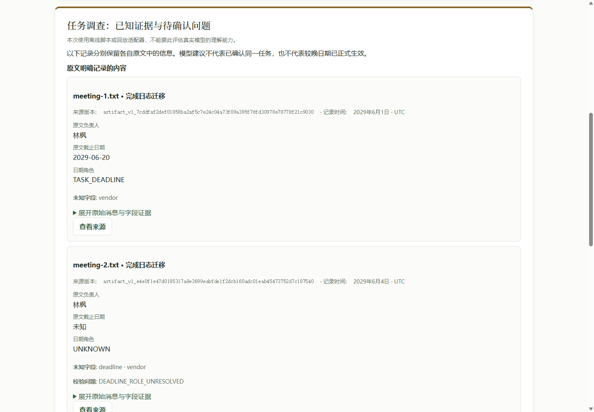
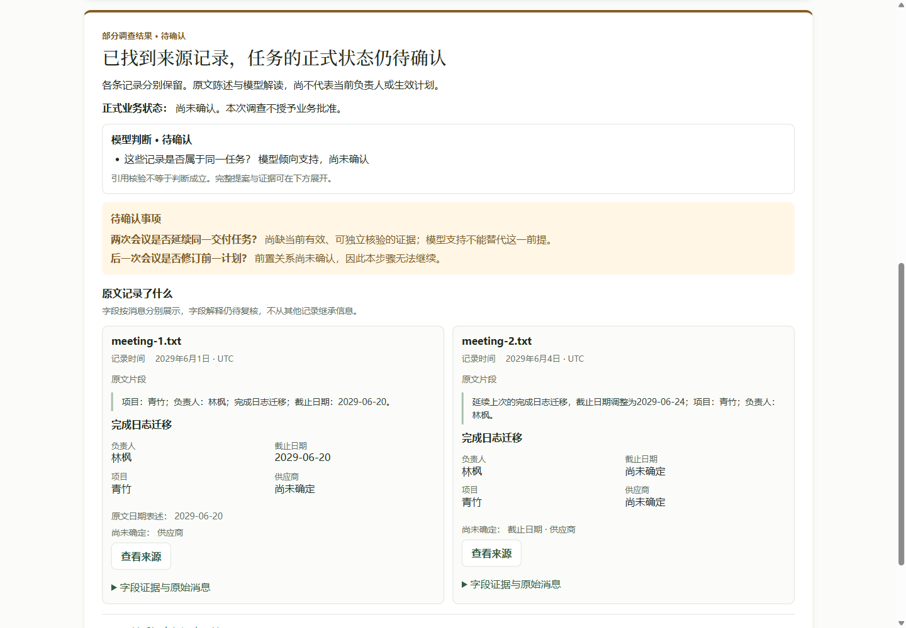

# Task answer-first delivery — 2026-10-22

Base: `bde9d9e2b88c2e69132cf48d1534dc28d4fca764`.
Branch: `codex/task-answer-first-ui`. Governing boundary: [SPEC](SPEC.md).

## User experience

| Before | After |
| --- | --- |
| The first viewport shows long source version IDs, date-role codes and vertically stacked records. The user must scroll to understand why the investigation stopped. | The first viewport states the bounded conclusion and formal-status limit, then shows model judgments, open questions and source records together. |
| A later date can be buried inside proposal evidence while the extracted date remains unknown. | A short original-source excerpt preserves that date beside an explicitly unknown deadline. No date is inferred or inherited. |
| Technical interpretation and execution details dominate the result. | Exact field evidence, role bindings, versions, proposal support/counter-evidence and investigation records are expandable. Original source buttons retain their normal route. |

Both screenshots use the same public scripted task records, the normal HTTP Ask
form and Chrome 155 at 1440 × 1000, scrolled to the result. Source IDs and captured
versions differ because the two dedicated synthetic databases are independent.
The baseline static assets were copied from the fixed base before editing.

| Before | After |
| --- | --- |
|  |  |

## Unconfirmed states and authority

- PARTIAL preserves separate source observations and labels model support as
  “模型倾向支持，尚未确认”. EVIDENCE_VALID means checked citations, not semantic or
  business approval. No current owner, approved delay or effective plan is inferred.
- [UNKNOWN](evidence/after-unknown-desktop.png) says the materials are insufficient;
  no returned candidate does not establish task absence.
- [Model CONFLICT](evidence/after-model-conflict-desktop.png) explicitly attributes
  conflicting evidence to the model. The existing [UNKNOWN + conflict gap fixture](evidence/after-conflict-gap-desktop.png)
  stays UNKNOWN; the browser does not manufacture a CONFLICT verdict.
- [Existing date comparison](evidence/after-p4-comparison-desktop.png) displays the
  returned 4-day boundary difference while current formal plan validity remains
  unknown. DOM contracts additionally cover future-effective and reference-date
  conditions, preserving both dates returned by the server.
- Unsupported source/time scopes, absent read operations, unknown relation reads,
  conflicting evidence and unmet dependencies receive distinct explanations.
- [BLOCKED](evidence/after-blocked.png) hides old quotes, fields, proposals and
  preparation data; only the error code and review decision remain expandable.

## Validation

Machine-readable results: [validation.json](evidence/validation.json).

| Check | Result |
| --- | --- |
| Affected task/field/P4, Unified Ask and Product regression | 428 passed, 0 failures/errors/skips. One existing JUnit record_property compatibility warning. |
| New HTTP contracts: PARTIAL, UNKNOWN conflict gap, explicit model CONFLICT, UNKNOWN | 4 passed. Same task_review on re-read; no extra stage calls; script ordering, MIME and CSP checked. Three cases overlap the 428-test run. |
| Existing M3-P HTTP/security tests | 14 passed: independent process cold read, missing ledger, rejected review, source update/removal, relation retraction, evidence revocation, field isolation and trusted-prerequisite reads. |
| Node DOM contracts | task_answer, unified_ask, first_use and stale_revalidation scripts passed. Escaping, per-record unknowns, no approval escalation, rejected/blocked data hiding, response/workspace races and pointer-only recovery covered. |
| JavaScript syntax / diff whitespace | Passed for both Product scripts; git diff --check passed. |
| Actual Chrome 155 | PARTIAL, UNKNOWN, model CONFLICT, UNKNOWN conflict gap and existing P4 comparison passed through the normal Product form. Desktop and 390 × 844 mobile had no horizontal overflow; Chinese/English switching and exact field expansion passed. |
| Actual Chrome source and isolation flow | Source button opened the correct original; refresh showed no cached result; saved read revalidated as PARTIAL; source update returned BLOCKED / SOURCE_SNAPSHOT_CHANGED with no old data; another Workspace was rejected with HTTP 409 and no result pointer or source text. Console: 0 errors, 0 warnings. |
| Independent review | gpt-5.6-luna / max: final P1=0, P2=0. Independently reran syntax checks and task_answer / unified_ask DOM contracts. |

Initial test attempts encountered sandbox loopback/temp-directory restrictions
and Windows child-process encoding. Final HTTP checks used authorized local
network execution, project-local temp directories and PYTHONUTF8=1. One initial
test incorrectly expected the historical conflict fixture to report CONFLICT;
its actual UNKNOWN result was preserved and the assertion corrected. A separate
scripted CONFLICT adapter then passed through the existing validation path.
The browser safety script also waits for bootstrap after reload and accepts the
existing HTTP 409 workspace refusal. These are test-environment/expectation
corrections, not changes to production validation.

Reproduce the affected checks from this checkout with PYTHONPATH=src,
PYTHONUTF8=1 and a fresh project-local pytest --basetemp. The test groups are
tests/unit/test_task*.py, test_unified_ask.py, test_m3q_semantic_polarity.py,
tests/integration/test_unified_ask_flow.py, test_unified_investigation_flow.py,
test_product_application_flow.py, test_task_relation_authority_readback.py,
test_task_answer_http.py and test_m3p_product_review.py.

Browser reproduction uses a fresh dedicated root:

```powershell
$env:PYTHONPATH='src'
$env:PYTHONUTF8='1'
python -m tests.task_answer_browser_server --case partial --root work/browser-new --port 0
# Open the printed URL in an isolated playwright-cli session, then:
playwright-cli run-code --filename=tests/ui/task_answer_chromium.js
playwright-cli run-code --filename=tests/ui/task_answer_safety_chromium.js
```

Other server cases: unknown, conflict (historical UNKNOWN + gap), model-conflict,
p4. The safety script updates only its disposable synthetic database. It does
not accept or manipulate any real vault.

## Independent review closure

The first independent pass identified a blocked-result disclosure risk and two
misleading presentation cases. Closure added a minimal blocked metadata view,
distinct unsupported-operation explanations and explicit future/reference-date
conditions. RED/GREEN DOM assertions cover these cases. The independent final
pass found no remaining P1/P2; no reviewer edited production files.

## Scope and limits

Production changes are the task renderer, its Product connection/styles/script
tag and one static-asset route. F, G, Runtime, SemanticProposer, providers, P4,
their persistence and server result revalidation have no changes. No triage
branch code, status classification or timeline logic was copied. No dependency,
model call, business approval action, deployment or real user data was added.
This is local synthetic HTTP/DOM/browser acceptance, not real-model semantic
evaluation or production deployment. Task relationship approval remains unavailable.

Additional screenshots: [field evidence](evidence/after-field-evidence.png),
[original source](evidence/after-original-source.png),
[mobile](evidence/after-mobile.png),
[Workspace isolation](evidence/after-workspace-isolation.png).

All acceptance criteria in this task's SPEC are satisfied. The next product
boundary, if requested separately, is authenticated relationship confirmation;
this delivery does not implement it. Temporary databases, tooling and local
test logs remain ignored under work/ and output/playwright/.
